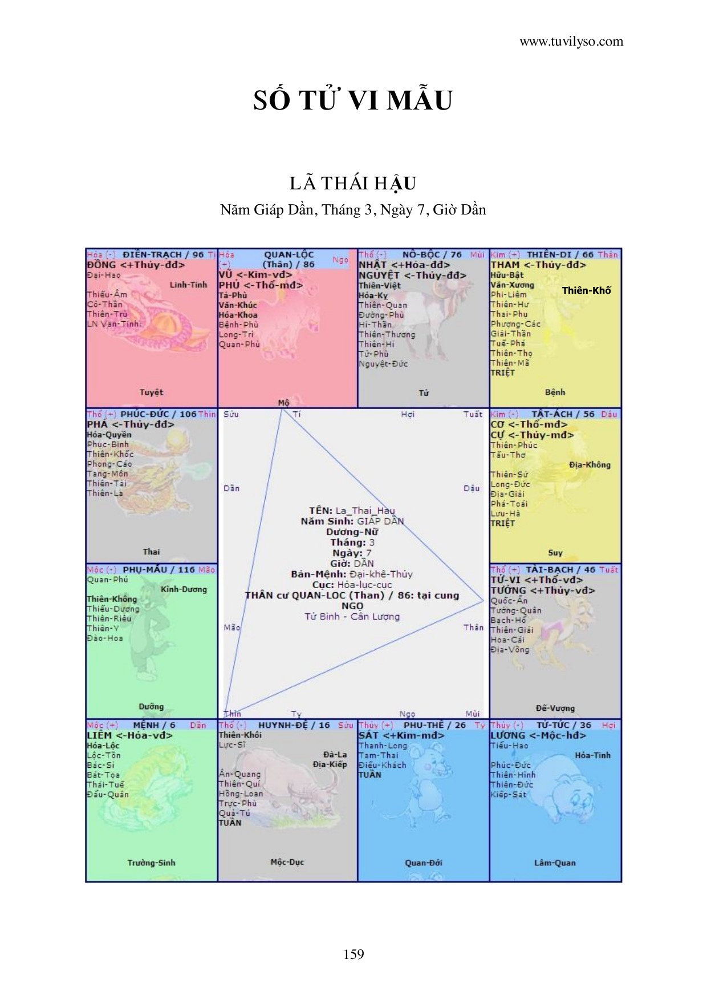

# Lá số mẫu Lã Thái Hậu (Giáp Dần, nữ, Liêm Tham tại Dần)

> **Phần:** Lá số mẫu › TVTH
> **Trả lời câu hỏi:** "Nữ mệnh Liêm Tham luận thế nào?" · "Song Lộc ngộ Mã là gì?" · "Tứ Linh triều Thân Mệnh nghĩa là gì?"
> **Từ khóa:** Lã Thái Hậu, Liêm Tham, Song Lộc, Tứ Linh, Thiên Khố, Giáp Dần, Hỏa lục cục
> **Nguồn chính:** TVTH tr.159–160 (`Tu-Vi-Thuc-Hanh/06_So-Tu-Vi-mau/01_La-Thai-Hau.md`)

## Tóm tắt
Lá số nữ mệnh quyền thế: Mệnh có Liêm Trinh hội Song Lộc, Mã, Xương Khúc; Thân có Tả Hữu, Hóa Khoa, Tướng Ấn; Tứ Linh (Long, Phượng, Cái, Hổ) triều Thân Mệnh. Sách luận "chuyên quyền", đồng thời chỉ ra mặt trái đào hoa, hôn nhân lận đận vì Liêm Tham nữ và cung Phu Thê có Sát Vũ.

## Nội dung chi tiết

### Dữ kiện
- Năm Giáp Dần, tháng 3, ngày 7, giờ Dần; Dương Nữ. Bản mệnh Đại Khê Thủy, Hỏa lục cục (đọc từ ảnh lá số, TVTH tr.159).
- Thân cư Quan Lộc (cung Ngọ).

### Bố trí sao chính (đọc từ ảnh)
- **Mệnh (Dần):** Liêm Trinh (Hỏa, vượng/đắc) cùng Hóa Lộc, Lộc Tồn, Bác Sĩ, Bát Tọa, Thái Tuế, Đẩu Quân. Cung đối Thiên Di (Thân) là Tham Lang, kèm Hữu Bật, Văn Xương, Thiên Mã, Phượng Các, Thiên Khố, Triệt. Sách gọi chung là "Liêm Tham đồng độ" (cặp Liêm–Tham ở trục Dần–Thân).
- **Thân (Ngọ, Quan Lộc):** Vũ Khúc, Thiên Phủ, Tả Phù, Văn Khúc, Hóa Khoa, Long Trì.
- Tam hợp còn lại: Tài Bạch (Tuất) Tử Vi, Thiên Tướng, Quốc Ấn, Hoa Cái; Phúc Đức (Thìn) Phá Quân, Hóa Quyền, Thiên Khố.
- Phu Thê (Tý): Thất Sát, Thanh Long, Điếu Khách, Tuần. Tử Tức (Hợi): Thiên Lương, Hỏa Tinh, Thiên Hình, Kiếp Sát.

### Cách cục nhận ra (theo sách)
1. Mệnh "Liêm Tham đồng độ, Tử Phủ Vũ Tướng chiếu"; hội Song Lộc – Mã, Xương – Khúc.
2. Song Lộc ngộ Mã ("Mệnh bà Lã Hậu chuyên quyền: Song lộc ngộ Mã chiếu miền chính cung").
3. Tứ Linh triều Thân Mệnh có Tả Hữu: "Tứ linh: Cái Hổ Phượng Long / Công danh quyền thế vẫy vùng một khi".
4. Sinh năm Giáp gặp Thiên Khố ở cung Thân: "Hỏi ai Giáp Kỷ mấy người / Gặp sao Thiên Khố tiền rời bạc muôn".
5. Ngũ hành cung, sao, mệnh cục "rất tương ứng".

### Luận theo sách
- Liêm đắc địa có Tử Vi chiếu hội Xương Khúc: "Liêm mà gặp được Tử Vi / Ở cung miếu vượng quyền uy đó mà…" và "Liêm đắc địa Khúc Xương cùng / Là người văn võ anh hùng lược thao" (TVTH tr.159).
- Mặt trái: "Liêm Tham đồng độ nam đa lãng đãng, nữ đa dâm"; cung Nô có Đào, Hồng, Mộc Dục, Diêu, Hỉ; cung Phu gặp Thất Sát – Vũ Khúc: "Bao lần hôn phối mới thành được chăng" (TVTH tr.160).

### Vận hạn được nói đến
Bài luận không nêu đại tiểu hạn cụ thể.

### Bài học áp dụng
- Cùng một cung Mệnh có thể luận hai mặt: quyền thế (Liêm + Tử Vi chiếu + Song Lộc Mã) và đào hoa/hôn nhân (Liêm Tham nữ, Phu Thê Sát).
- Luôn xét cung Phu, cung Nô riêng sau khi luận Mệnh Thân.

## Ví dụ cụ thể
Dữ kiện: nữ, Giáp Dần, Liêm Trinh tại Mệnh có Hóa Lộc + Lộc Tồn → áp dụng quy tắc "Song Lộc ngộ Mã" → sách kết luận quyền lực lớn (TVTH tr.159).

## Dị bản & lưu ý
Ảnh lá số cho thấy Liêm Trinh ở Mệnh (Dần) và Tham Lang ở Thiên Di (Thân), trong khi lời luận ghi "Liêm Tham đồng độ"; đây là cách gọi cặp sao xung chiếu của sách.

## Liên quan
- [Song Lộc ngộ Mã](../05_Phu-tinh-sat-tinh-tu-hoa/04_Loc-Ton-Thien-Ma/03_Loc-Ma-giao-tri-Loc-dao-Ma-dao.md)
- [Lộc Mã giao trì](../09_Cach-cuc/01_Cach-tot/10_Loc-Ma-giao-tri.md)
- [Liêm Trinh – sao đồng cung](../04_Chinh-tinh/06_Liem-Trinh/03_Sao-dong-cung-va-cach-cuc.md)
- [Mục lục lá số mẫu](00_Muc-luc-la-so-mau.md)
