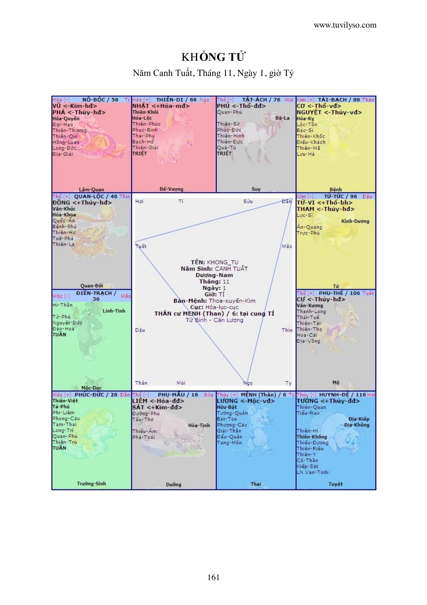

# Lá số mẫu Khổng Tử (Canh Tuất, nam, Thiên Lương tại Tý)

> **Phần:** Lá số mẫu › TVTH
> **Trả lời câu hỏi:** "Cách Cơ Nguyệt Đồng Lương luận thế nào?" · "Triệt ở cung Nhật có hại không?" · "Hạn bị tuyệt lương luận ra sao?"
> **Từ khóa:** Khổng Tử, Cơ Nguyệt Đồng Lương, Thiên Lương, Thái Dương, Tam Hóa, Triệt, Canh Tuất
> **Nguồn chính:** TVTH tr.161–162 (`06_So-Tu-Vi-mau/02_Khong-Tu.md`)

## Tóm tắt
Mệnh Thiên Lương vượng ở Tý, Thân cùng cung Mệnh; hội Thái Dương, Song Lộc, Mã, Khốc, Khách, Tướng, Ấn. Sách xếp vào cách Cơ Nguyệt Đồng Lương "uy quyền", thanh cao, trung nghĩa, hợp nghề văn hóa chứ không bền đường làm quan. Hai hạn tuổi 61 và 73 được dùng để giải thích các biến cố trong đời.

## Nội dung chi tiết

### Dữ kiện
Năm Canh Tuất, tháng 11, ngày 1, giờ Tý; Dương Nam. Bản mệnh Thoa Xuyến Kim, Hỏa lục cục. Thân cư Mệnh (TVTH tr.161).

### Bố trí sao chính (đọc từ ảnh)
- **Mệnh/Thân (Tý):** Thiên Lương, Hữu Bật, Tướng Quân, Bát Tọa, Phượng Các, Giải Thần, Đẩu Quân, Tang Môn; cung Thai.
- **Thiên Di (Ngọ):** Thái Dương, Hóa Lộc, Thiên Khôi, Thiên Phúc, Phục Binh, Thái Phụ, Bạch Hổ, Triệt.
- **Tài Bạch (Thân):** Thiên Cơ, Thái Âm, Hóa Kỵ, Lộc Tồn, Bác Sĩ, Thiên Khốc, Điếu Khách, Thiên Mã.
- **Quan Lộc (Thìn):** Thiên Đồng, Văn Khúc, Hóa Khoa, Quốc Ấn. **Nô Bộc (Tỵ):** Vũ Khúc, Phá Quân, Hóa Quyền.
- Phu Thê (Tuất) Cự Môn, Văn Xương; Tử Tức (Dậu) Tử Vi, Tham Lang, Kình Dương; Tật Ách (Mùi) Thiên Phủ, Đà La, Triệt.

### Cách cục nhận ra
"Cơ Nguyệt Lương Đồng, hội Song Lộc, Mã Khốc Khách, Tướng Ấn. Cách uy quyền" (TVTH tr.161). Sách cũng nói Cơ Nguyệt ở Thân đắc địa nên "văn chương quán thế"; Thiên Di có Tam Hóa liên châu (Lộc ở Ngọ, Quyền ở Tỵ, Khoa ở Thìn).

### Luận theo sách
- Lương vượng ở Tý gặp Thái Dương, Lưỡng Lộc: vinh hiển; tính thanh cao đạo hạnh, trung nghĩa cương cường. Dẫn phú: "Lương đắc địa đồng vì Xương Khúc / Hoặc Thái Dương, Hóa Lộc hiển vinh…".
- Nhật có Triệt nhưng Triệt ở Ngọ là nơi âm dương giao thoa, nên Nhật không bị ảnh hưởng nhiều; Nhật lại gặp Nguyệt hội Bát Tọa là "bậc quý nhân".
- Quan Lộc có Xương Khúc, Tướng Ấn, Lộc Mã nhưng Cự Đồng đồng cư: chỉ hợp nghề văn hóa, không bền đường quan.

### Vận hạn được nói đến
- Tuổi 61 (Canh Tuất): tiểu hạn về Thìn tối kỵ; đại hạn đến cung Nô, gặp Song Hao, Liêm Hỏa Tinh, Không Kiếp, Kình, Phá Toái; tiểu hạn lại có lưỡng Tuế, Kỵ, Tang Hư Khốc Điếu. Không nguy đến tính mạng "vì đại hạn có Tử Vi, Hóa Quyền", nên chỉ bị tuyệt lương ở nước Trần.
- Tuổi 73 (Nhâm Tuất): tiểu hạn lại về Thìn (La Võng, Thái Tuế rất độc), đại hạn gặp Tang Môn, Bạch Hổ, Thiên Trù, Hư Khốc lưu niên (TVTH tr.162).

### Bài học áp dụng
Triệt không nhất thiết làm hỏng sao: sách xét vị trí Triệt (Ngọ, nơi giao thoa). Sao giải (Tử Vi, Quyền) trong đại hạn có thể cứu hạn nặng.

## Ví dụ cụ thể
Dữ kiện: Triệt tọa cung Thiên Di có Thái Dương, Hóa Lộc → áp dụng: Triệt ở Ngọ ít làm hại chính tinh → kết luận "thông minh nhờ Nhật Nguyệt" (TVTH tr.161).

## Dị bản & lưu ý
Lời luận có những sao (như Song Hao, Liêm, Hỏa Tinh ở hạn 61 tuổi) không khớp hết với ô cung đọc từ ảnh; ghi lại đúng lời sách.

## Liên quan
- [Cơ Nguyệt Đồng Lương](../09_Cach-cuc/01_Cach-tot/13_Co-Nguyet-Dong-Luong.md)
- [Triệt và cung chiếu](../07_Tuan-Triet/03_Tuan-Triet-o-Menh-va-cung-chieu.md)
- [Tam Hóa liên châu](../09_Cach-cuc/01_Cach-tot/16_Tam-hoa-lien-chau.md)
- [Mục lục](00_Muc-luc-la-so-mau.md)
