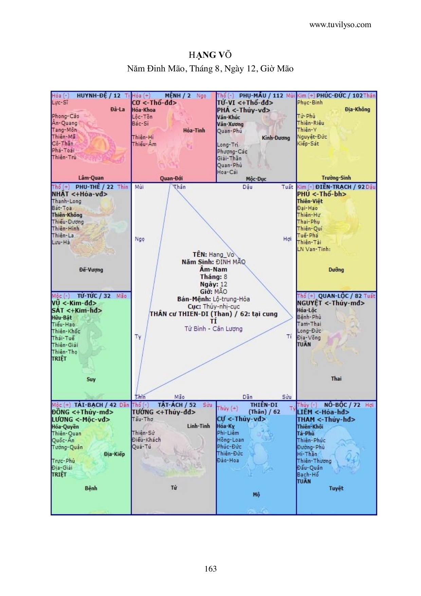

# Lá số mẫu Hạng Võ (Đinh Mão, âm nam, Thiên Cơ tại Ngọ)

> **Phần:** Lá số mẫu › TVTH
> **Trả lời câu hỏi:** "Cách Cơ Nguyệt Đồng Lương Tam Hóa triều" · "Vì sao hạn Cự Kỵ kỵ sông nước?" · "Lộc Tồn thủ Mệnh gặp Không Kiếp luận sao?"
> **Từ khóa:** Hạng Võ, Thiên Cơ, Hóa Khoa, Lộc Tồn, Không Kiếp, Trúc La, Cự Kỵ, Đinh Mão
> **Nguồn chính:** TVTH tr.163–164 (`06_So-Tu-Vi-mau/03_Hang-Vo.md`)

## Tóm tắt
Mệnh Thiên Cơ miếu ở Ngọ, Thân cư Thiên Di (Cự Môn); Tam Hóa triều, hai bên có Xương Khúc, Tứ Linh. Sách khen tài võ lược nhưng chê Lộc Tồn thủ Mệnh "không bền" lại gặp Không Kiếp; đại hạn 32 và tiểu hạn Cự Kỵ dẫn tới cái chết ở Ô Giang.

## Nội dung chi tiết

### Dữ kiện
Năm Đinh Mão, tháng 8, ngày 12, giờ Mão; Âm Nam. Bản mệnh Lộ Trung Hỏa, Thủy nhị cục. Thân cư Thiên Di (Tý) (TVTH tr.163).

### Bố trí sao chính (đọc từ ảnh)
- **Mệnh (Ngọ):** Thiên Cơ, Hóa Khoa, Lộc Tồn, Bác Sĩ, Hỏa Tinh, Thiên Hỉ, Thiếu Âm.
- **Thiên Di/Thân (Tý):** Cự Môn, Hóa Kỵ, Phi Liêm, Hồng Loan, Đào Hoa.
- Tài Bạch (Dần): Thiên Đồng, Thiên Lương, Hóa Quyền, Địa Kiếp, Triệt. Quan Lộc (Tuất): Thái Âm, Hóa Lộc, Tuần.
- Phụ Mẫu (Mùi): Tử Vi, Phá Quân, Xương, Khúc, Kình Dương. Phúc (Thân): Địa Không. Nô (Hợi): Liêm, Tham, Khôi, Tả Phù, Bạch Hổ, Tuần. Tử Tức (Mão): Vũ Khúc, Thất Sát, Hữu Bật, Triệt.

### Cách cục nhận ra
"Cơ Nguyệt Đồng Lương – Tam Hóa triều, lưỡng hợp có Xương Khúc – Tứ Linh" (TVTH tr.163): Khoa ở Mệnh, Lộc ở Quan, Quyền ở Tài.

### Luận theo sách
- Mệnh Hỏa đóng cung Hỏa; Cơ miếu địa nên đa tài, hội Thiên Lương giỏi vũ lược; Hỏa Tinh miếu gặp Khoa Quyền: võ nghệ tinh thông.
- "Đáng tiếc Lộc Tồn thủ Mệnh không bền, lại gặp cả Không Kiếp nên hãm hại công danh."
- Phú: "Ai đương Hạng Võ anh hùng / Vì sao Cơ Cự Lương Đồng hợp xung / Cơ miếu địa ở Ngọ cung…".

### Vận hạn được nói đến
- Đại hạn 32 đến cung Mão: "Trúc La gia Liêm Vũ, Thái Tuế, Kình, Hổ, Song Hao, là cách sấm sét".
- Tiểu hạn đến Thân gặp Cự Kỵ, Kiếp Không, Phục Binh, Thiên Hình: "bức tử ở Ô Giang". Dẫn: "Hạn hành Cự Kỵ hung thần / Phải phòng những chốn giang tân mới lành" (TVTH tr.164).

### Bài học áp dụng
Cách đẹp vẫn có thể bị hạn kết hợp (đại hạn xung + tiểu hạn hung tinh) làm đổ vỡ; luôn đọc đại hạn và tiểu hạn cùng nhau.

## Ví dụ cụ thể
Dữ kiện: đại hạn 32 ở Mão có Liêm, Vũ, Thái Tuế, Kình, Hổ, Hao + tiểu hạn Cự Kỵ Không Kiếp → sách kết luận tử nạn gần sông nước (TVTH tr.164).

## Dị bản & lưu ý
Ảnh cho thấy Liêm Tham ở Hợi và Vũ Sát ở Mão; câu "Liêm Vũ" ở hạn 32 là cách gọi của sách, ghi lại nguyên văn. Đây là lá số danh nhân lịch sử, giờ sinh do người đời sau gán.

## Liên quan
- [Cơ Nguyệt Đồng Lương](../09_Cach-cuc/01_Cach-tot/13_Co-Nguyet-Dong-Luong.md)
- [Lộc Tồn](../05_Phu-tinh-sat-tinh-tu-hoa/04_Loc-Ton-Thien-Ma/01_Loc-Ton.md)
- [Hóa Kỵ](../05_Phu-tinh-sat-tinh-tu-hoa/03_Tu-hoa/05_Hoa-Ky.md)
- [Mục lục](00_Muc-luc-la-so-mau.md)
