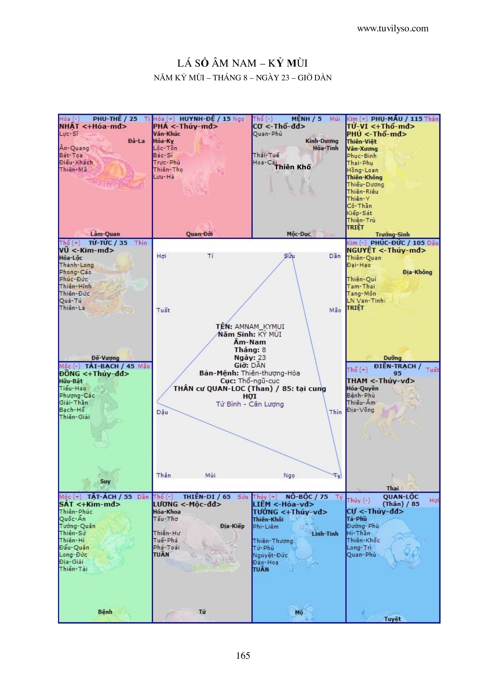

# Lá số mẫu Âm Nam Kỷ Mùi (Cơ Cự Đồng Lương, Thân cư Quan)

> **Phần:** Lá số mẫu › TVTH
> **Trả lời câu hỏi:** "Tứ Linh triều Thân Mệnh là sao?" · "Lộc Tồn bị Hóa Kỵ chiếu thì sao?" · "Mệnh Thiên Cơ có Kình Dương luận thế nào?"
> **Từ khóa:** Kỷ Mùi, Thiên Cơ, Kình Dương, Lộc Tồn Hóa Kỵ, Tả Hữu Long Phượng, Bạch Hổ thủ Tài
> **Nguồn chính:** TVTH tr.165–166 (`06_So-Tu-Vi-mau/04_Am-Nam-Ky-Mui.md`)

## Tóm tắt
Âm nam Kỷ Mùi, Mệnh Thiên Cơ tại Mùi, Thân cư Quan Lộc (Cự Môn tại Hợi). Sách luận: sinh trưởng phú quý, giỏi biện luận, trung hậu, ưa văn chương; vận khởi bại 15–25 tuổi, yên ổn sau 45–55 và vinh hiển từ 55 trở đi.

## Nội dung chi tiết

### Dữ kiện
Năm Kỷ Mùi, tháng 8, ngày 23, giờ Dần; Âm Nam. Bản mệnh Thiên Thượng Hỏa, Thổ ngũ cục. Thân cư Quan Lộc (Hợi) (TVTH tr.165).

### Bố trí sao chính (đọc từ ảnh)
- **Mệnh (Mùi):** Thiên Cơ, Quan Phủ, Kình Dương, Hỏa Tinh, Thiên Khố, Thái Tuế, Hoa Cái.
- **Thân/Quan Lộc (Hợi):** Cự Môn, Tả Phù, Đường Phù, Thiên Hỉ, Thiên Khốc, Long Trì.
- Phụ Mẫu (Thân): Tử Vi, Thiên Phủ, Thiên Việt, Văn Xương, Hồng Loan, Thiên Không, Triệt. Huynh Đệ (Ngọ): Phá Quân, Văn Khúc, Hóa Kỵ, Lộc Tồn. Điền (Tuất): Tham Lang, Hóa Quyền. Tử Tức (Thìn): Vũ Khúc, Hóa Lộc. Tài Bạch (Mão): Thiên Đồng, Hữu Bật, Bạch Hổ.

### Cách cục nhận ra
"Cơ Cự Đồng Lương hội Tả Hữu Long Phượng. Lương chính chiếu. Hợp giáp Xương Khúc. Tứ Linh triều Thân Mệnh. Bạch Hổ kỳ cách thủ Tài. Thủ Mệnh (người sinh năm Kỷ)" (TVTH tr.165).

### Luận theo sách
- Sinh trưởng phú quý nhờ Tả Hữu Long Phượng. Thích biện luận, hoạt động vì Thái Tuế – Kình hội. Trung hậu vì Cơ Lương có Hóa Khoa.
- Thích văn chương vì giáp Khúc Xương; công danh lận đận vì Kình đắc cách nhưng gặp Cơ hãm địa: "Tài có mà thời vận không gặp được".

### Vận hạn được nói đến
- Tiểu hạn đến 21 tuổi ở La Võng (Tuất) có Hình, Kỵ, Sát Phá Tham, gặp Thái Tuế lưu niên: bị tù đày, nhưng nhiều cát tinh giải nên tai ương chóng qua.
- Đại hạn 15–25: mất cơ nghiệp vì Lộc Tồn bị Hóa Kỵ chiếu ("Cát xứ phùng hung"). Đại hạn 45–55: chịu ngồi yên, làm văn chương. Từ 55: vinh hiển an nhàn (TVTH tr.166).

### Bài học áp dụng
Lộc Tồn đi cùng Hóa Kỵ làm cát hóa hung. Cát tinh đủ nhiều (Tả Hữu, Khoa) có thể làm hạn tù đày qua nhanh.

## Ví dụ cụ thể
Dữ kiện: Lộc Tồn đồng cung Hóa Kỵ ở Huynh Đệ (đại hạn 15–25) → quy tắc "cát xứ phùng hung" → sách kết luận mất cơ nghiệp thời trẻ.

## Dị bản & lưu ý
Lời luận ghi Cơ "hãm địa", trong khi ảnh lá số ghi Thiên Cơ ở Mùi là "đắc" (đđ); ghi cả hai, không phân xử.

## Liên quan
- [Lộc Tồn](../05_Phu-tinh-sat-tinh-tu-hoa/04_Loc-Ton-Thien-Ma/01_Loc-Ton.md)
- [Hóa Kỵ](../05_Phu-tinh-sat-tinh-tu-hoa/03_Tu-hoa/05_Hoa-Ky.md)
- [Thiên Cơ tại các cung](../04_Chinh-tinh/02_Thien-Co/03_Sao-dong-cung-va-cach-cuc.md)
- [Mục lục](00_Muc-luc-la-so-mau.md)
