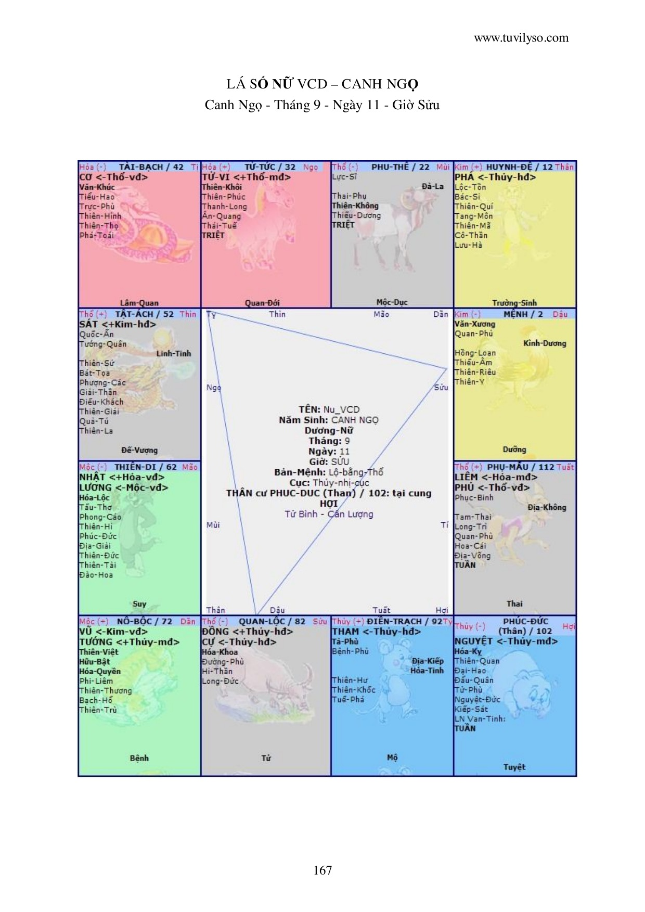

# Lá số mẫu nữ Mệnh vô chính diệu Canh Ngọ

> **Phần:** Lá số mẫu › TVTH
> **Trả lời câu hỏi:** "Nữ mệnh VCD có Xương Khúc, Đào Hồng Hỉ luận thế nào?" · "Tiền Cái hậu Mã là gì?" · "Giáp Lộc củng Lộc là gì?"
> **Từ khóa:** Mệnh vô chính diệu, Canh Ngọ, Văn Xương, Quang Quý, Thai Tọa, Tam Minh, kế thất
> **Nguồn chính:** TVTH tr.167–168 (`06_So-Tu-Vi-mau/05_Nu-menh-vo-chinh-dieu-Canh-Ngo.md`)

## Tóm tắt
Nữ Dương, Mệnh vô chính diệu tại Dậu, Thân cư Phúc Đức (Hợi). Mệnh giao hội Xương Khúc, Quang Quý, Thai Tọa, Hồng Đào Hỉ, Tấu Thư. Sách nói nữ có Xương Khúc gặp Đào Diêu thì lãng mạn, nhưng nhờ Thiên Hình, Thiên Quý (và cách Tử Phủ) nên đoan chính; phải làm kế thất; cuối đời đáng tiếc "phát không bền".

## Nội dung chi tiết

### Dữ kiện
Canh Ngọ, tháng 9, ngày 11, giờ Sửu; Dương Nữ. Bản mệnh Lộ Bàng Thổ, Thủy nhị cục. Thân cư Phúc Đức (Hợi) (TVTH tr.167).

### Bố trí sao chính (đọc từ ảnh)
- **Mệnh (Dậu):** không chính tinh; Văn Xương, Quan Phù, Kình Dương, Hồng Loan, Thiếu Âm, Thiên Riêu, Thiên Y; cung Dưỡng.
- **Thiên Di (Mão, chiếu Mệnh):** Thái Dương, Thiên Lương, Hóa Lộc, Tấu Thư, Phong Cáo, Thiên Hỉ, Phúc Đức, Thiên Đức, Đào Hoa.
- Tam hợp: Tài Bạch (Tỵ) Thiên Cơ, Văn Khúc; Quan Lộc (Sửu) Thiên Đồng, Cự Môn, Hóa Khoa. Thân/Phúc Đức (Hợi): Thái Âm, Hóa Kỵ, Nguyệt Đức, Kiếp Sát, Tuần.
- Phu Thê (Mùi): không chính tinh; Thiên Không, Đà La, Triệt. Tử Tức (Ngọ): Tử Vi, Thiên Khôi, Thanh Long, Ân Quang.

### Cách cục nhận ra
"Mệnh vô chính diệu giao hội Xương Khúc, Quang Quý, Thai Tọa, Hồng Đào Hỷ, Tấu Thơ. Giáp Lộc củng Lộc. Tiền Cái hậu Mã cách" (TVTH tr.167).

### Luận theo sách
- Thuở nhỏ sung sướng vì có Thai Tọa. Nữ có Xương Khúc gặp Đào Diêu: thích văn thơ ca hát, đa tình; nhưng gặp Hình, Quý nên trở nên đứng đắn. Phú: "Kìa người phượng chạ loan chung / Đào Diêu số ấy trong lòng chẳng trinh / Nhưng gặp được Quí, Hình, Tử Phủ / Dạ sắt vàng nào sợ lung lay".
- Hồng Đào Hỉ gọi là Tam Minh nên giữ đoan chính tuy phải làm kế thất; cung Phối "Nguyệt Đức Đào tinh": "Trai lấy vợ đẹp gái lành chồng sang".
- Về sau ung dung vì tiền Mã hậu Cái; "sinh phùng bại địa phát không bền", mong ở cung Phối.

### Vận hạn được nói đến
Đại hạn 12–32 có đại tang; đại hạn 32–42 cũng thế (TVTH tr.168).

### Bài học áp dụng
Nữ mệnh VCD: xét sao hội chiếu từ tam phương; sao văn tinh gặp Đào Diêu cần cặp sao chế (Hình, Quý, Tử Phủ).

## Ví dụ cụ thể
Dữ kiện: Mệnh VCD có Văn Xương + Hồng Loan + Thiên Riêu → quy tắc phú "Xương Khúc gặp Đào Diêu" → đa tình; có Thiên Hình/Quý/Tử Vi → đoan chính.

## Dị bản & lưu ý
Sách nói cung Phối có Nguyệt Đức; ảnh lá số cho thấy Nguyệt Đức ở Phúc Đức (Hợi), chưa thấy ở Phu Thê (Mùi). Ghi nguyên lời sách.

## Liên quan
- [Nguyên tắc xem Mệnh vô chính diệu](../04_Chinh-tinh/15_Menh-vo-chinh-dieu/01_Nguyen-tac-xem-VCD.md)
- [Đào Hoa](../05_Phu-tinh-sat-tinh-tu-hoa/05_Sao-tinh-cam/01_Dao-Hoa.md)
- [Văn Xương – Văn Khúc](../05_Phu-tinh-sat-tinh-tu-hoa/01_Luc-cat-tinh/02_Van-Xuong-Van-Khuc.md)
- [Mục lục](00_Muc-luc-la-so-mau.md)
