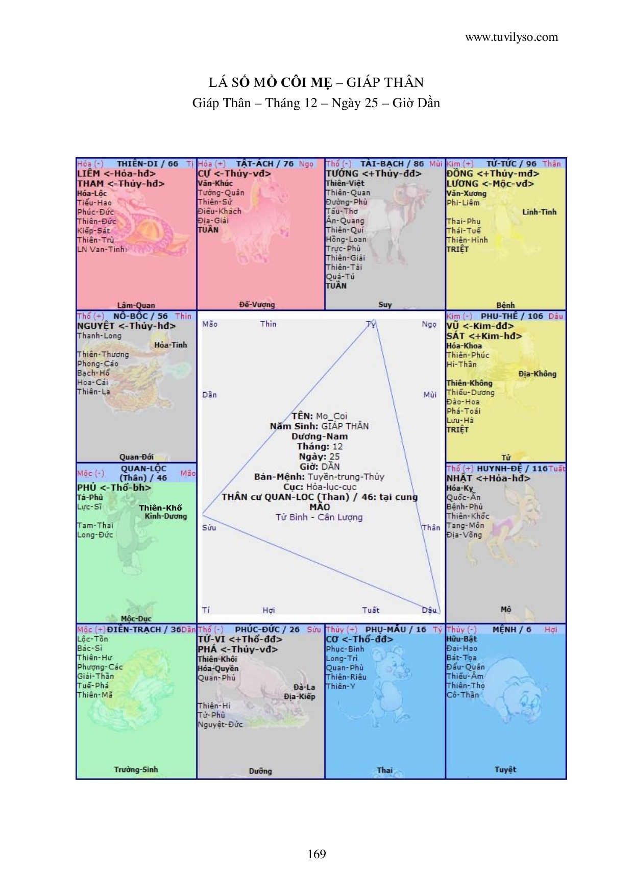

# Lá số mẫu mồ côi mẹ Giáp Thân (Mệnh vô chính diệu)

> **Phần:** Lá số mẫu › TVTH
> **Trả lời câu hỏi:** "Xem cung Phụ Mẫu thế nào để biết mồ côi mẹ?" · "Hợp Lộc củng Lộc là gì?" · "Ân Quang đóng Mùi Sửu có tốt không?"
> **Từ khóa:** Giáp Thân, Mệnh VCD, Song Hao, Phụ Mẫu, Thái Dương hãm, Thiên Khố, mồ côi
> **Nguồn chính:** TVTH tr.169–170 (`06_So-Tu-Vi-mau/06_Mo-coi-me-Giap-Than.md`)

## Tóm tắt
Dương Nam Giáp Thân, Mệnh vô chính diệu tại Hợi, Thân cư Quan Lộc (Mão). Sách suy ra mồ côi mẹ từ cung Phụ Mẫu (Âm Dương phản bối ngộ Linh Hỏa, Hình, Phục, Hổ). Thông minh, ham học (đỗ cử nhân Luật năm 20 tuổi), về sau quý hiển; cung Phối xấu.

## Nội dung chi tiết

### Dữ kiện
Giáp Thân, tháng 12, ngày 25, giờ Dần; Dương Nam. Bản mệnh Tuyền Trung Thủy, Hỏa lục cục. Thân cư Quan Lộc (Mão) (TVTH tr.169).

### Bố trí sao chính (đọc từ ảnh)
- **Mệnh (Hợi):** không chính tinh; Hữu Bật, Đại Hao, Bát Tọa, Đẩu Quân, Thiếu Âm, Thiên Thọ, Cô Thần; cung Tuyệt.
- **Thân/Quan (Mão):** Thiên Phủ, Tả Phù, Lục Sĩ, Thiên Khố, Kình Dương, Tam Thai, Long Đức.
- Thiên Di (Tỵ): Liêm Trinh, Tham Lang, Hóa Lộc. Tài Bạch (Mùi): Thiên Tướng, Thiên Việt, Ân Quang. Phu Thê (Dậu): Vũ Khúc, Thất Sát, Hóa Khoa, Địa Không, Thiên Không, Triệt. Phụ Mẫu (Tý): Thiên Cơ. Huynh Đệ (Tuất): Thái Dương, Hóa Kỵ, Tang Môn.

### Cách cục nhận ra
"Mệnh vô chính diệu hội Tả Hữu, Quang Quí, Thai Tọa, 'hợp Lộc củng Lộc cách'" (TVTH tr.169).

### Luận theo sách
- Mồ côi mẹ từ bé: cung Phụ mẫu thấy "Âm Dương phản bối ngộ Linh Hỏa, Hình Phục Hổ, nhưng Thái Dương hãm gặp được Hóa Kỵ".
- Mệnh có Song Hao, gặp tuổi Dần Thân rất hợp nên thông minh; Hao gặp Tuyệt: khôn ngoan, tính toán lợi hại. Ân Quý đóng Mùi đắc cách: "Quí, Ân Mùi Sửu hạn cầu / Đường mây gặp bước cao sâu cửu trùng".
- Sinh năm Giáp gặp Thiên Khố: "tiền rời bạc muôn". Cung Phối xấu vì Vũ Sát (TVTH tr.170).

### Vận hạn được nói đến
20 tuổi đỗ toàn cử nhân Luật; lúc nhỏ lao đao vì Mệnh VCD, về sau hưởng quý hiển.

### Bài học áp dụng
Luận cha mẹ cho từng cung Phụ Mẫu; Mệnh VCD thuở nhỏ khó bình lặng.

## Ví dụ cụ thể
Dữ kiện: Phụ Mẫu có Thái Dương hãm + sát tinh → sách suy ra mất mẹ sớm (Thái Dương chỉ cha, Thái Âm chỉ mẹ trong cách luận chung; ở đây chỉ chép lời sách).

## Dị bản & lưu ý
Lời sách nêu Âm Dương ở Phụ Mẫu; ảnh cho thấy Phụ Mẫu (Tý) là Thiên Cơ, còn Thái Dương ở Huynh Đệ (Tuất), Thái Âm ở Nô (Thìn). Có thể sách dùng cách đếm cung khác; ghi lại nguyên lời.

## Liên quan
- [Nguyên tắc xem VCD](../04_Chinh-tinh/15_Menh-vo-chinh-dieu/01_Nguyen-tac-xem-VCD.md)
- [Cung Phụ Mẫu](../03_Muoi-hai-cung/02_Cung-Phu-Mau/01_Y-nghia-va-cach-xem.md)
- [Mục lục](00_Muc-luc-la-so-mau.md)
