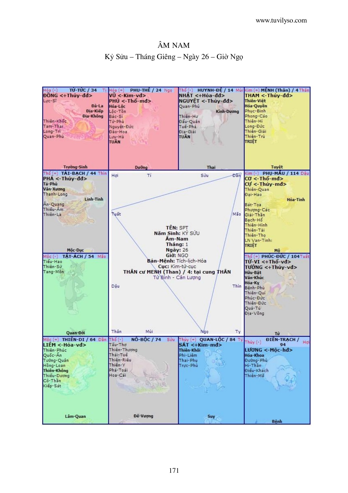

# Lá số mẫu Âm Nam Kỷ Sửu (Tham Lang tại Mệnh, Sát Phá Liêm Tham)

> **Phần:** Lá số mẫu › TVTH
> **Trả lời câu hỏi:** "Quyền tinh nhập miếu cách là gì?" · "Tham Lang thủ Mệnh sinh năm Giáp Kỷ thế nào?" · "Cung Huynh Đệ Nhật Nguyệt Hỉ Thần?"
> **Từ khóa:** Kỷ Sửu, Tham Lang, Thất Sát, Khôi Việt, Tướng Ấn, anh em dị bào, Thai Cáo
> **Nguồn chính:** TVTH tr.171–172 (`06_So-Tu-Vi-mau/07_Am-Nam-Ky-Suu.md`)

## Tóm tắt
Âm nam Kỷ Sửu, Mệnh/Thân cùng cung, Tham Lang tại Thân. Sách xếp cách Sát Phá Liêm Tham có Khôi Việt, Tướng Ấn, Thai Cáo; Thất Sát ở Quan Lộc là "Quyền tinh nhập miếu". Hợp kinh doanh, kỹ nghệ, quân binh hơn văn học; phú quý sau 30 tuổi.

## Nội dung chi tiết

### Dữ kiện
Kỷ Sửu, tháng Giêng, ngày 26, giờ Ngọ; Âm Nam. Bản mệnh Tích Lịch Hỏa, Kim tứ cục. Thân cư Mệnh (Thân) (TVTH tr.171).

### Bố trí sao chính (đọc từ ảnh)
- **Mệnh/Thân (Thân):** Tham Lang, Thiên Việt, Hóa Quyền, Phục Binh, Phong Cáo, Thiên Hỉ, Long Đức, Thiên Giải, Thiên Trù, Triệt; cung Tuyệt.
- Thiên Di (Dần): Liêm Trinh, Thiên Phúc, Quốc Ấn, Tướng Quân, Hồng Loan, Thiên Không, Kiếp Sát. Quan Lộc (Tý): Thất Sát, Thiên Khôi, Thái Phụ.
- Huynh Đệ (Mùi): Thái Dương, Thái Âm, Kình Dương, Tuần. Phu Thê (Ngọ): Vũ Khúc, Thiên Phủ, Hóa Lộc, Lộc Tồn. Phúc (Tuất): Tử Vi, Thiên Tướng, Hóa Kỵ, Văn Khúc, Hữu Bật.

### Cách cục nhận ra
"Sát Phá Liêm Tham cách Khôi Việt Tướng Ấn Thai Cáo. Quyền tinh nhập miếu cách Thất Sát cư Quan Lộc" (TVTH tr.171). Phú: "Hồng Xương Liêm Khôi phù trì / Sân rồng dấn bước tên ghi Cửu trùng".

### Luận theo sách
- Chú ý: người sinh năm Giáp, Kỷ mà Tham đóng Mệnh ở cung miếu vượng đắc địa thì rất hợp, hưởng phú quý nhưng phải ngoài 30 tuổi.
- Tính ít ngồi yên, thích hoạt động nơi đông người; hợp kinh doanh, kỹ nghệ hoặc quân binh hơn văn học.
- Cung Bào có Nhật Nguyệt gặp Hỉ Thần: có anh em dị bào (nhất là có cả Thai Vượng). Phú: "Âm Dương chiếu với Hỉ tinh / Âm cùng Thiên Phúc cũng sinh dị bào" (TVTH tr.172).

### Vận hạn được nói đến
Chỉ nêu mốc "ngoài 30 tuổi" mới phú quý.

### Bài học áp dụng
Tính chất nghề nghiệp suy từ chính tinh Mệnh (Tham + Sát = hoạt động, quân/thương) và từ cung Quan.

## Ví dụ cụ thể
Dữ kiện: Huynh Đệ có Nhật + Nguyệt + Thiên Hỉ → quy tắc phú "Âm Dương chiếu Hỉ tinh" → sách kết luận anh em dị bào.

## Dị bản & lưu ý
Không có.
- Đối chiếu ảnh trang 171: ô Mệnh (Thân) in "Thiên-Giải"; Giải Thần đi cùng Phượng Các ở Phụ Mẫu (Dậu).

## Liên quan
- [Sát Phá Liêm Tham](../09_Cach-cuc/01_Cach-tot/12_Sat-Pha-Liem-Tham.md)
- [Tham Lang](../04_Chinh-tinh/09_Tham-Lang/03_Sao-dong-cung-va-cach-cuc.md)
- [Cung Huynh Đệ](../03_Muoi-hai-cung/12_Cung-Huynh-De/01_Y-nghia-va-cach-xem.md)
- [Mục lục](00_Muc-luc-la-so-mau.md)
