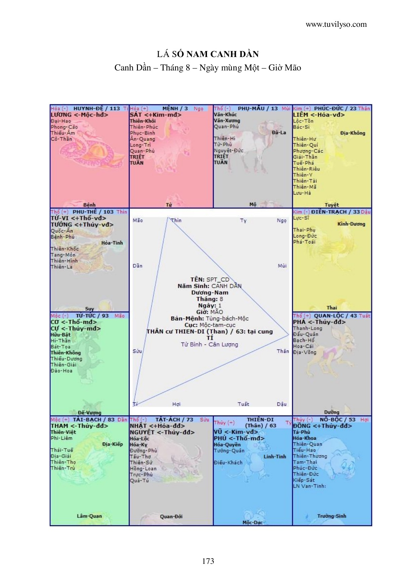

# Lá số mẫu nam Canh Dần (Thất Sát tại Ngọ, Thân cư Thiên Di)

> **Phần:** Lá số mẫu › TVTH
> **Trả lời câu hỏi:** "Thất Sát gặp Hóa Quyền có hại không?" · "Mệnh có Tuần Triệt đồng cung thì sao?" · "Thân cư Thiên Di khi nào hanh thông?"
> **Từ khóa:** Canh Dần, Thất Sát miếu, Thiên Phủ chiếu, Hóa Quyền, Tuần Triệt, Thân cư Thiên Di
> **Nguồn chính:** TVTH tr.173–174 (`06_So-Tu-Vi-mau/08_Nam-Canh-Dan.md`)

## Tóm tắt
Dương Nam, Mệnh Thất Sát miếu tại Ngọ có Thiên Phủ chính chiếu, hội Khôi Việt; Thân cư Thiên Di có Tử Phủ Vũ Tướng hội Quyền Lộc. Sách: có tài cán, hay liều lĩnh dễ thất bại vì Sát gặp Quyền, lại bị Tuần Triệt đương đầu nên công danh trắc trở; phải ngoài 33 tuổi mới hanh thông.

## Nội dung chi tiết

### Dữ kiện
Canh Dần, tháng 8, ngày mùng 1, giờ Mão; Dương Nam. Bản mệnh Tùng Bách Mộc, Mộc tam cục. Thân cư Thiên Di (Tý) (TVTH tr.173).

### Bố trí sao chính (đọc từ ảnh)
- **Mệnh (Ngọ):** Thất Sát, Thiên Khôi, Thiên Phúc, Phục Binh, Ân Quang, Long Trì, Quan Phù, Triệt, Tuần; cung Tử.
- **Thân/Thiên Di (Tý):** Vũ Khúc, Thiên Phủ, Hóa Quyền, Tướng Quân, Điếu Khách, Linh Tinh.
- Phu Thê (Thìn): Tử Vi, Thiên Tướng, Quốc Ấn, Hỏa Tinh. Tật Ách (Sửu): Thái Dương, Thái Âm, Hóa Lộc, Hóa Kỵ, Hồng Loan. Tài Bạch (Dần): Tham Lang, Thiên Việt, Địa Kiếp. Quan Lộc (Tuất): Phá Quân, Thanh Long. Nô (Hợi): Thiên Đồng, Tả Phù, Hóa Khoa.

### Cách cục nhận ra
"Mệnh: Sát Phá Tham hội Khôi Việt. Thân: Tử Phủ Vũ Tướng hội Quyền Lộc, Quang Quí, Tướng Ấn, Long Phượng" (TVTH tr.173).

### Luận theo sách
- Mệnh dương đóng cung dương; Thất Sát miếu ở Ngọ tất có tài cán, gặp Thiên Phủ chính chiếu. Phú: "Phủ phùng Thất sát chí khôn / Việc làm mạnh bạo những toan hơn người".
- Sát gặp Quyền nên hay liều lĩnh, dễ thất bại; bị Tuần Triệt đương đầu nên trắc trở sự nghiệp công danh.

### Vận hạn được nói đến
Phải ngoài 33 tuổi mới hanh thông, vì Thân cư Thiên Di được đắc cách; tất có công danh và hiển đạt (TVTH tr.174).

### Bài học áp dụng
Khi Mệnh bị Tuần Triệt, sách nhìn sang Thân: nếu Thân đắc cách thì vận muộn vẫn tốt.

## Ví dụ cụ thể
Dữ kiện: Mệnh Thất Sát có Triệt + Tuần, Thân đóng Thiên Di có Tử Phủ Vũ Tướng → sách kết luận: trước 33 tuổi trắc trở, sau đó hiển đạt.

## Dị bản & lưu ý
Lời sách ghi "Thân: Tử Phủ Vũ Tướng"; ảnh cho thấy Thân (Tý) là Vũ Phủ, Tử Tướng ở Phu Thê (Thìn). Hai nơi thuộc cùng tam phương nên sách gom chung.

## Liên quan
- [Thất Sát](../04_Chinh-tinh/13_That-Sat/03_Sao-dong-cung-va-cach-cuc.md)
- [Tuần Triệt ở Mệnh](../07_Tuan-Triet/03_Tuan-Triet-o-Menh-va-cung-chieu.md)
- [Thân cư Thiên Di](../02_Ban-menh/01_Menh-va-Than/06_Than-cu-Di.md)
- [Mục lục](00_Muc-luc-la-so-mau.md)
