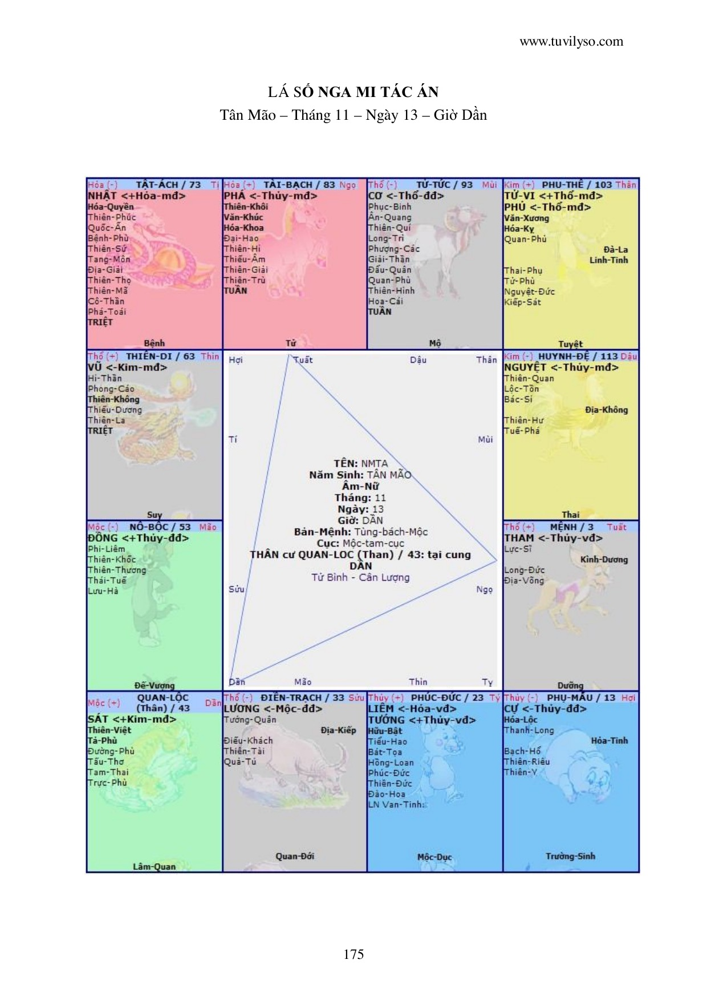

# Lá số mẫu "Nga mi tác án" Tân Mão (nữ, Tham Lang tại Tuất)

> **Phần:** Lá số mẫu › TVTH
> **Trả lời câu hỏi:** "Kình Dương đắc cách ở tứ mộ thế nào?" · "Mệnh giáp Song Lộc là gì?" · "Nữ mệnh vượng phu ích tử cần gì?"
> **Từ khóa:** Nga mi tác án, Tân Mão, Tham Vũ, Kình Dương tứ mộ, giáp Song Lộc, Tử Phủ cung Phu
> **Nguồn chính:** TVTH tr.175–176 (`06_So-Tu-Vi-mau/09_Nga-mi-tac-an-Tan-Mao.md`)

## Tóm tắt
Nữ Âm Tân Mão, Mệnh Tham Lang miếu tại Tuất đồng cung Kình Dương, Vũ Khúc chiếu từ Thiên Di; Mệnh giáp song Lộc. Sách gọi "Nga mi tác án", luận vượng phu ích tử, đoan trang thẳng thắn, sau thích văn chương và đại khoa, nhưng cung Phu có Hóa Kỵ, Đà, Kiếp nên có lúc buồn đau.

## Nội dung chi tiết

### Dữ kiện
Tân Mão, tháng 11, ngày 13, giờ Dần; Âm Nữ. Bản mệnh Tùng Bách Mộc, Mộc tam cục. Thân cư Quan Lộc (Dần) (TVTH tr.175).

### Bố trí sao chính (đọc từ ảnh)
- **Mệnh (Tuất):** Tham Lang, Lục Sĩ, Kình Dương, Long Đức, Địa Võng. **Thiên Di (Thìn):** Vũ Khúc, Hỷ Thần, Phong Cáo, Thiên Không, Thiếu Dương, Triệt.
- Giáp Mệnh: Huynh Đệ (Dậu) Thái Âm, Lộc Tồn; Phụ Mẫu (Hợi) Cự Môn, Hóa Lộc. **Thân/Quan Lộc (Dần):** Thất Sát, Thiên Việt, Tả Phù.
- Phu Thê (Thân): Tử Vi, Thiên Phủ, Văn Xương, Hóa Kỵ, Đà La, Linh Tinh, Nguyệt Đức, Kiếp Sát. Phúc (Tý): Liêm Trinh, Thiên Tướng, Hữu Bật, Hồng Loan, Đào Hoa. Tài (Ngọ): Phá Quân, Thiên Khôi, Văn Khúc, Hóa Khoa, Tuần.

### Cách cục nhận ra
"Tham Vũ đồng hành hội Khôi Việt giáp song Lộc. Phúc cung có Hồng Đào là cách Nga mi tác án" (TVTH tr.175; sách ghi "áng", chép theo tên cách).

### Luận theo sách
- Âm Dương ở cung Mệnh và Cục đều hợp. Tham miếu địa; đặc biệt hung tinh đắc cách là Kình Dương đóng tứ mộ: "hạng vượng phu ích tử, đoan trang thẳng thắn trong mọi việc", đắc cách nhất là Mệnh giáp song Lộc.
- Thân cư Quan Lộc có Xương Khúc, Khôi Việt: về sau thích văn chương, có đại khoa.
- Cung Phu tuy có Tử Phủ, Đào, Nguyệt Đức nhưng gặp Hóa Kỵ, Đà, Kiếp Sát ắt có lúc buồn đau phiền toái (TVTH tr.176).

### Vận hạn được nói đến
Không nêu.

### Bài học áp dụng
Hung tinh có thể đắc cách theo vị trí (Kình ở tứ mộ); luôn xét riêng cung Phu của nữ mệnh sau khi luận Mệnh.

## Ví dụ cụ thể
Dữ kiện: Tham tại Tuất + Kình, giáp Lộc Tồn (Dậu) và Hóa Lộc (Hợi) → quy tắc "Mệnh giáp song Lộc" → sách kết luận đắc cách, vượng phu ích tử.

## Dị bản & lưu ý
Sách ghi Tham Vũ "đồng hành"; ảnh cho thấy Vũ Khúc ở Thiên Di chiếu Mệnh.
- Đối chiếu ảnh trang 175: cung Phúc Đức ở Tý (Mệnh Tuất), bản chép cũ nhầm Tý thành Tỵ; ô Thiên Di (Thìn) in "Hi-Thần" tức Hỷ Thần, Thiên Hỷ năm Mão ở Tài Bạch (Ngọ).

## Liên quan
- [Kình Dương](../05_Phu-tinh-sat-tinh-tu-hoa/02_Luc-sat-tinh/01_Kinh-Duong.md)
- [Tham Vũ đồng hành](../09_Cach-cuc/01_Cach-tot/08_Tham-Vu-dong-hanh.md)
- [Giáp cung tốt](../08_Quan-he-giua-cac-cung/02_Giap-cung-tot.md)
- [Mục lục](00_Muc-luc-la-so-mau.md)
