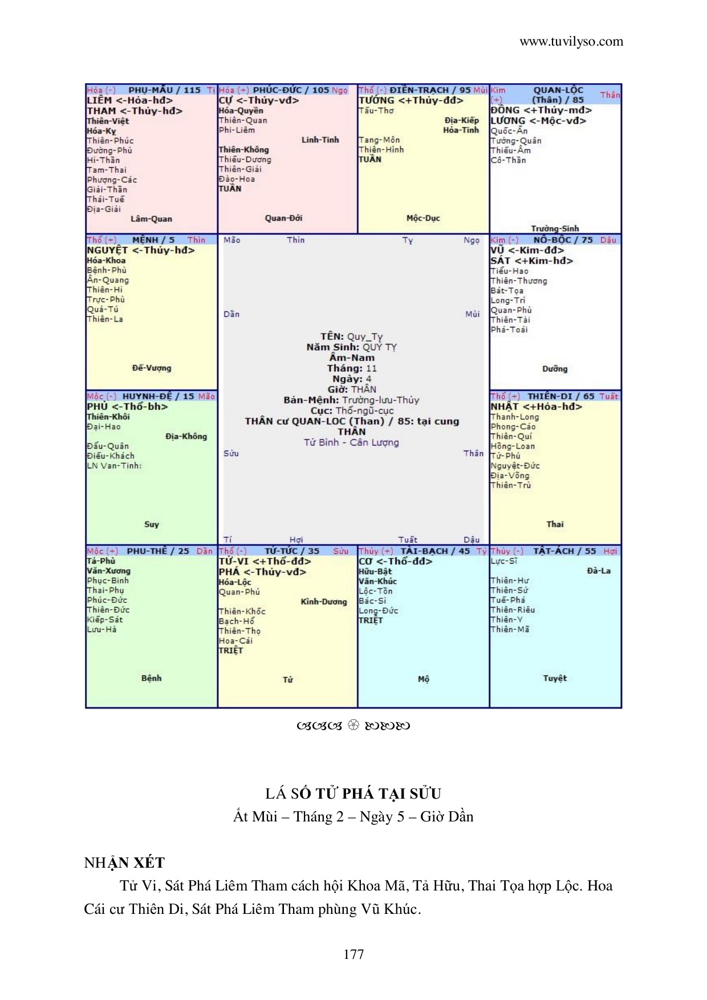

# Lá số mẫu Âm Nam Quý Tỵ (Thái Âm tại Thìn, Cơ Nguyệt Đồng Lương)

> **Phần:** Lá số mẫu › TVTH
> **Trả lời câu hỏi:** "Nguyệt hãm nhưng âm nam có sao?" · "Giáp Khôi Việt luận thế nào?" · "Thân cư Quan Lộc có Tả Hữu Xương Khúc?"
> **Từ khóa:** Quý Tỵ, Thái Âm, Cơ Nguyệt Đồng Lương, giáp Khôi Việt, Lộc Tồn Hóa Khoa, Thổ ngũ cục
> **Nguồn chính:** TVTH tr.176–177 (`06_So-Tu-Vi-mau/10_Am-Nam-Qui-Ty.md`)

## Tóm tắt
Âm nam Quý Tỵ, Mệnh Thái Âm (hãm) tại Thìn, Thân cư Quan Lộc (Thân, Đồng Lương). Sách: Nguyệt hãm nhưng âm nam, hội Khoa, Lộc, Xương Khúc, Hồng Hỉ, giáp Khôi Việt nên thành đạt khoa danh; tính ưa nhàn tản; đại hạn 35 tuổi hoạnh phát.

## Nội dung chi tiết

(Lá số Quý Tỵ nằm ở nửa trên trang 177; nửa dưới là lá số Ất Mùi, xem file 11.)

### Dữ kiện
Quý Tỵ, tháng 11, ngày 4, giờ Thân; Âm Nam. Bản mệnh Trường Lưu Thủy, Thổ ngũ cục. Thân cư Quan Lộc (Thân) (TVTH tr.176–177).

### Bố trí sao chính (đọc từ ảnh)
- **Mệnh (Thìn):** Thái Âm, Hóa Khoa, Bệnh Phù, Ân Quang, Thiên Hỉ, Trực Phù, Quả Tú, Thiên La; cung Đế Vượng.
- **Thân/Quan Lộc (Thân):** Thiên Đồng, Thiên Lương, Quốc Ấn, Tướng Quân, Thiếu Âm, Cô Thần.
- Tài Bạch (Tý): Thiên Cơ, Hữu Bật, Văn Khúc, Lộc Tồn, Bác Sĩ, Long Đức, Triệt. Phụ Mẫu (Tỵ): Liêm Trinh, Tham Lang, Thiên Việt, Hóa Kỵ. Phu Thê (Dần): Tả Phù, Văn Xương. Huynh Đệ (Mão): Thiên Phủ, Thiên Khôi, Địa Không.

### Cách cục nhận ra
"Cơ Nguyệt Đồng Lương thủ mệnh, Tồn Khoa Tướng Ấn Quang Quí, giáp Khôi Việt" (TVTH tr.176).

### Luận theo sách
- Nguyệt hãm địa, nhưng lợi vì là Âm nam; hội Khoa Lộc, Xương Khúc, Hồng Hỉ, Sinh Vượng, giáp Khôi Việt nên sẽ thành đạt khoa danh; tánh ưa nhàn tản, thích ngao du.
- Về sau có công danh vì Thân cư Quan có Tả Hữu, Tướng, Xương Khúc, Khoa, Tồn đắc cách.

### Vận hạn được nói đến
Đại hạn 35 tuổi hoạnh phát (TVTH tr.177).

### Bài học áp dụng
Sao hãm không đồng nghĩa xấu hoàn toàn: sách bù bằng tính âm dương hợp (âm nam, Nguyệt thuộc âm) và nhiều cát tinh hội.

## Ví dụ cụ thể
Dữ kiện: Nguyệt hãm ở Mệnh, âm nam, hội Khoa + Lộc Tồn + Xương Khúc → sách kết luận vẫn thành đạt khoa danh.

## Dị bản & lưu ý
Sách nói Tả Hữu ở Quan; ảnh cho thấy Tả Phù và Hữu Bật nằm ở Phu Thê (Dần) và Tài (Tý) trong tam hợp/giáp, không đồng cung với Quan Lộc.

## Liên quan
- [Cơ Nguyệt Đồng Lương](../09_Cach-cuc/01_Cach-tot/13_Co-Nguyet-Dong-Luong.md)
- [Thái Âm](../04_Chinh-tinh/08_Thai-Am/02_Mieu-ham-va-12-vi-tri.md)
- [Âm dương thuận lý nghịch lý](../02_Ban-menh/03_Am-duong-ly/01_Am-duong-thuan-ly-nghich-ly.md)
- [Mục lục](00_Muc-luc-la-so-mau.md)
