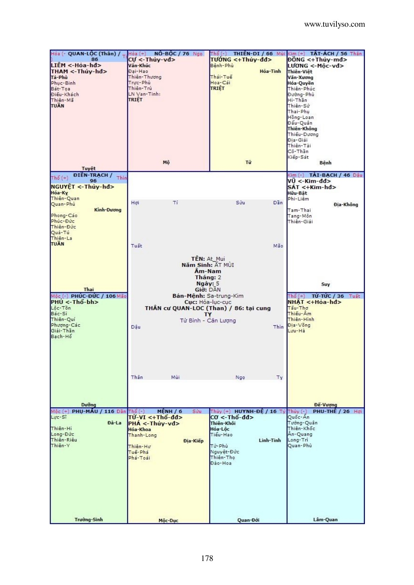

# Lá số mẫu Tử Phá tại Sửu (Ất Mùi, âm nam)

> **Phần:** Lá số mẫu › TVTH
> **Trả lời câu hỏi:** "Tử Phá ở Sửu Mùi Thìn Tuất bất trung bất nghĩa có đúng không?" · "Phản cách vi giai là gì?" · "Tử Vi mất lực vì Không Kiếp?"
> **Từ khóa:** Tử Vi Phá Quân, Sửu, Ất Mùi, phản cách vi giai, Không Kiếp, Sát Phá Liêm Tham, Hoa Cái Thiên Di
> **Nguồn chính:** TVTH tr.177–179 (`06_So-Tu-Vi-mau/11_Tu-Pha-tai-Suu-At-Mui.md`)

## Tóm tắt
Âm nam Ất Mùi, Mệnh Tử Vi Phá Quân tại Sửu, Thân cư Quan Lộc (Liêm Tham tại Tỵ). Phú nói Tử Phá ở tứ mộ "bất trung bất nghì", nhưng người tuổi Sửu, Mùi, Thìn, Tuất thì "phản cách vi giai", là người chí hiếu; tuy vậy Tử Vi bị Kiếp Không làm mất lực. Về sau giỏi kinh thương, kỹ nghệ; đại hạn 26 tuổi hưng vượng.

## Nội dung chi tiết

### Dữ kiện
Ất Mùi, tháng 2, ngày 5, giờ Dần; Âm Nam. Bản mệnh Sa Trung Kim, Hỏa lục cục. Thân cư Quan Lộc (Tỵ) (TVTH tr.178).

### Bố trí sao chính (đọc từ ảnh)
- **Mệnh (Sửu):** Tử Vi, Phá Quân, Hóa Khoa, Thanh Long, Địa Kiếp, Thiên Hư, Tuế Phá, Phá Toái; cung Mộc Dục.
- **Thân/Quan Lộc (Tỵ):** Liêm Trinh, Tham Lang, Tả Phù, Phục Binh, Bát Tọa, Điếu Khách, Thiên Mã, Tuần.
- Thiên Di (Mùi): Thiên Tướng, Hỏa Tinh, Hoa Cái, Triệt. Tài Bạch (Dậu): Vũ Khúc, Thất Sát, Hữu Bật, Địa Không. Huynh Đệ (Tý): Thiên Cơ, Thiên Khôi, Hóa Lộc, Linh Tinh. Phúc (Mão): Thiên Phủ, Lộc Tồn.

### Cách cục nhận ra
"Tử Vi, Sát Phá Liêm Tham cách hội Khoa Mã, Tả Hữu, Thai Tọa hợp Lộc. Hoa Cái cư Thiên Di, Sát Phá Liêm Tham phùng Vũ Khúc" (TVTH tr.177).

### Luận theo sách
Cước chú: phú "Mệnh thân: Tử Phá ở cùng / Sửu, Mùi, Thìn, Tuất bất trung bất nghì". Nhưng tuổi Sửu, Mùi, Thìn, Tuất thì phản cách vi giai, là người chí hiếu. Tuy nhiên Tử Vi mất lực vì Kiếp Không nên không tăng cho cách cuộc Thân Mệnh đẹp hơn được (TVTH tr.179).

### Vận hạn được nói đến
Đại hạn 26 tuổi có Tứ Linh ngộ Lộc, bắt đầu hưng vượng về công danh, tài lộc.

### Bài học áp dụng
Phú tiêu cực có thể bị đảo ngược theo năm sinh (phản cách vi giai); sao đế bị Không Kiếp thì giảm lực.

## Ví dụ cụ thể
Dữ kiện: Tử Phá tại Sửu, tuổi Mùi (thuộc nhóm Sửu Mùi Thìn Tuất) → phú nói "bất trung bất nghì" → áp quy tắc phản cách vi giai → sách kết luận chí hiếu, nhưng Tử Vi mất lực vì Địa Kiếp.

## Dị bản & lưu ý
Ảnh trang 178 cho thấy Địa Kiếp ở Mệnh, Địa Không ở Tài; sách gộp là "Kiếp Không". Lời sách ghi Khoa ở Mệnh khớp ảnh (Hóa Khoa tại Sửu).

## Liên quan
- [Sát Phá Liêm Tham](../09_Cach-cuc/01_Cach-tot/12_Sat-Pha-Liem-Tham.md)
- [Phản vi giai](../09_Cach-cuc/03_Cach-bi-pha/)
- [Địa Không – Địa Kiếp](../05_Phu-tinh-sat-tinh-tu-hoa/02_Luc-sat-tinh/04_Dia-Khong-Dia-Kiep.md)
- [Mục lục](00_Muc-luc-la-so-mau.md)
