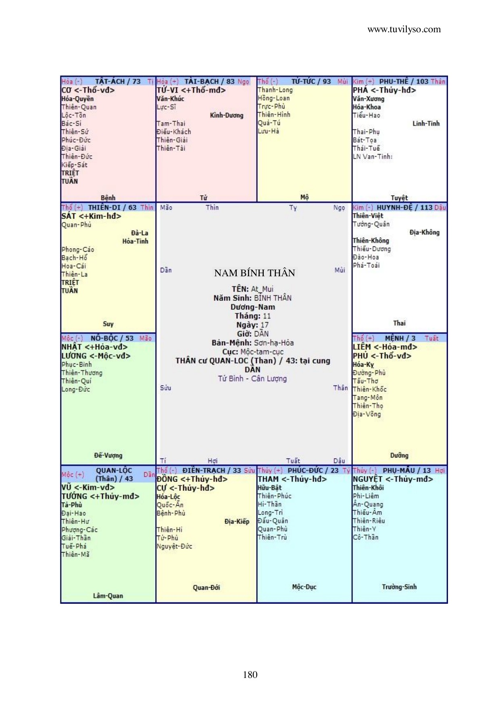

# Lá số mẫu nam Bính Thân (Liêm Phủ tại Tuất, giờ Kim xà)

> **Phần:** Lá số mẫu › TVTH
> **Trả lời câu hỏi:** "Giờ Kim xà thiết tỏa là gì và phá thế nào?" · "Thiên Phủ gặp Tuần Triệt luận ra sao?" · "Thiên Mã ở Quan Lộc, Hoa Cái ở Thiên Di nói lên gì?"
> **Từ khóa:** Bính Thân, Tử Phủ Vũ Tướng, Liêm Phủ, Kim xà thiết tỏa, giáp Khôi Việt, lưỡng giáp, Thiếu Âm Thiếu Dương
> **Nguồn chính:** TVTH tr.179–180 (`06_So-Tu-Vi-mau/12_Nam-Binh-Than.md`)

## Tóm tắt
Dương nam Bính Thân, Mệnh Liêm Phủ tại Tuất, giáp Khôi Việt và Thiếu Âm Thiếu Dương, Thân cư Quan Lộc (Vũ Tướng, Dần). Sách nói cách đẹp nhưng Thiên Phủ ngộ Tuần Triệt, ít trung tinh hội, lại sinh giờ Kim xà, nên công danh lận đận, dễ vào vòng lao lý; sau đại hạn 33 bộc phát. Cung Mệnh sao đều vượng theo lý âm dương nên phá được giờ Kim xà.

## Nội dung chi tiết

### Dữ kiện
Bính Thân, tháng 11, ngày 17, giờ Dần; Dương Nam. Bản mệnh Sơn Hạ Hỏa, Mộc tam cục. Thân cư Quan Lộc (Dần) (TVTH tr.180).

### Bố trí sao chính (đọc từ ảnh)
- **Mệnh (Tuất):** Liêm Trinh, Thiên Phủ, Hóa Kỵ, Đường Phù, Tấu Thư, Thiên Khốc, Tang Môn, Thiên Thọ, Địa Võng; cung Dưỡng.
- **Thân/Quan Lộc (Dần):** Vũ Khúc, Thiên Tướng, Tả Phù, Đại Hao, Thiên Hư, Phượng Các, Giải Thần, Tuế Phá, Thiên Mã.
- Thiên Di (Thìn): Thất Sát, Đà La, Hỏa Tinh, Phong Cáo, Bạch Hổ, Hoa Cái, Thiên La, Triệt, Tuần. Tài Bạch (Ngọ): Tử Vi, Văn Khúc, Kình Dương. Phu Thê (Thân): Phá Quân, Văn Xương, Hóa Khoa, Linh Tinh.

### Cách cục nhận ra
"Tử Phủ Vũ Tướng, giáp Khôi Việt, Thiếu Âm, Thiếu Dương" (TVTH tr.179).

### Luận theo sách
- Cách đẹp nhưng Thiên Phủ ngộ Tuần Triệt, không có nhiều trung tinh hội, tuy được lưỡng giáp tốt; sinh giờ Kim xà: cuộc sống lận đận công danh, dễ vào vòng lao lý, dù học khá có khiếu văn chương.
- Cung Phối xấu: cuộc đời đơn độc, buồn thương, bất mãn. Bù lại Thiên Mã ở Quan Lộc, Hoa Cái ở Thiên Di nên ra ngoài được quý mến.
- Cung Mệnh sao đều vượng theo lý giải âm dương: cuộc đời tốt đẹp, phá được giờ Kim xà thiết tỏa (TVTH tr.179–180).

### Vận hạn được nói đến
Đại hạn 33 bộc phát và nhiều thay đổi tốt.

### Bài học áp dụng
Một "hung cách" như giờ Kim xà có thể bị phá nếu Mệnh đắc lý âm dương; phải cân giữa điểm xấu và điểm giải.

## Ví dụ cụ thể
Dữ kiện: Mệnh Liêm Phủ giáp Khôi Việt, Thiên Mã ở Quan, giờ Kim xà → sách kết luận: ban đầu lận đận, đại hạn 33 mới phát.

## Dị bản & lưu ý
Ảnh lá số cho thấy Tuần Triệt đóng ở Thiên Di (Thìn) và Tật Ách (Tý), không đồng cung Mệnh Tuất; lời sách nói Phủ ngộ Tuần Triệt (cách luận theo tam phương). Ghi nguyên lời sách.

## Liên quan
- [Liêm Trinh](../04_Chinh-tinh/06_Liem-Trinh/03_Sao-dong-cung-va-cach-cuc.md)
- [Giáp cung tốt](../08_Quan-he-giua-cac-cung/02_Giap-cung-tot.md)
- [Tuần Triệt](../07_Tuan-Triet/01_Ban-chat-Tuan-Triet.md)
- [Mục lục](00_Muc-luc-la-so-mau.md)
