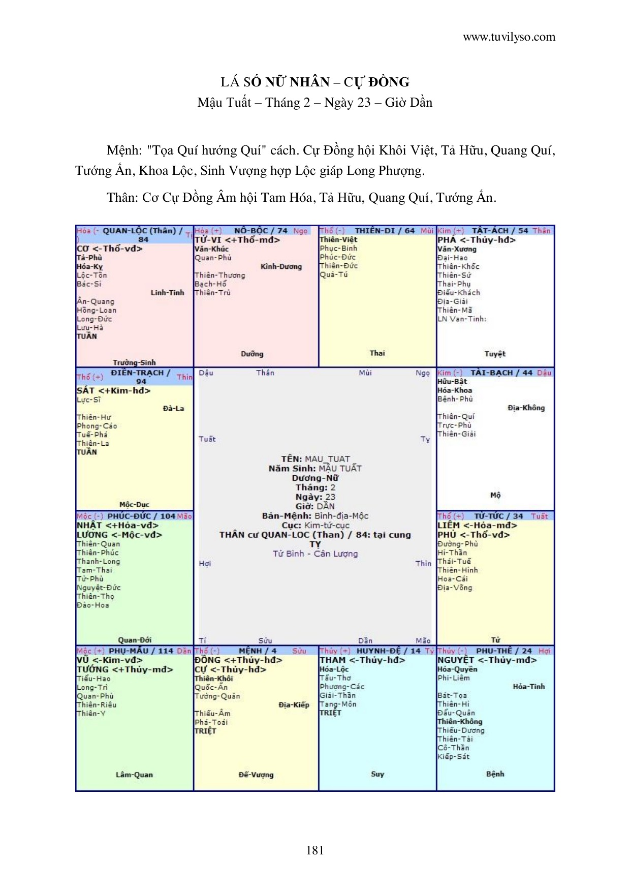

# Lá số mẫu nữ nhân Cự Đồng Mậu Tuất ("Tọa Quý hướng Quý")

> **Phần:** Lá số mẫu › TVTH
> **Trả lời câu hỏi:** "Nữ mệnh Cự Đồng hãm luận thế nào?" · "Tọa Quý hướng Quý là gì?" · "Đồng hãm báo bệnh gì?"
> **Từ khóa:** Cự Đồng, Mậu Tuất, Tọa Quý hướng Quý, Khôi Việt, Tam Hóa, Thiên Đồng hãm, nữ mệnh
> **Nguồn chính:** TVTH tr.181–182 (`06_So-Tu-Vi-mau/13_Nu-nhan-Cu-Dong-Mau-Tuat.md`)

## Tóm tắt
Dương nữ Mậu Tuất, Mệnh Cự Đồng tại Sửu, Thân cư Quan Lộc (Thiên Cơ tại Tỵ). Mệnh Thân đều có nhiều trung tinh hội nhưng Cự Đồng hãm: báo hiệu tật ở mắt hay nội thương, nữ có tướng lạ ai trông cũng ưa nhưng chua ngoa, tình ái dang dở. Bù lại, âm dương cục đắc cách nên đời thừa thãi, đại hạn 24 có tiền, ngoài 36 ung dung.

## Nội dung chi tiết

### Dữ kiện
Mậu Tuất, tháng 2, ngày 23, giờ Dần; Dương Nữ. Bản mệnh Bình Địa Mộc, Kim tứ cục. Thân cư Quan Lộc (Tỵ) (TVTH tr.181).

### Bố trí sao chính (đọc từ ảnh)
- **Mệnh (Sửu):** Thiên Đồng, Cự Môn, Thiên Khôi, Quốc Ấn, Tướng Quân, Địa Kiếp, Thiếu Âm, Phá Toái, Triệt; cung Đế Vượng.
- **Thân/Quan Lộc (Tỵ):** Thiên Cơ, Tả Phù, Hóa Kỵ, Lộc Tồn, Bác Sĩ, Linh Tinh, Ân Quang, Hồng Loan, Long Đức, Lưu Hà, Tuần.
- Phu Thê (Hợi): Thái Âm, Hóa Quyền, Hỏa Tinh. Huynh Đệ (Tý): Tham Lang, Hóa Lộc. Phúc (Mão): Thái Dương, Thiên Lương. Tài Bạch (Dậu): Hữu Bật, Hóa Khoa, Địa Không.

### Cách cục nhận ra
Mệnh: "Tọa Quí hướng Quí" cách; Cự Đồng hội Khôi Việt, Tả Hữu, Quang Quí, Tướng Ấn, Khoa Lộc, Sinh Vượng, hợp Lộc giáp Long Phượng. Thân: Cơ Cự Đồng Âm hội Tam Hóa, Tả Hữu, Quang Quí, Tướng Ấn (TVTH tr.181).

### Luận theo sách
- Cự Đồng hãm địa: Đồng báo hiệu tật bệnh ở mắt hay nội thương. Cự hãm đối với nữ mệnh: có tướng lạ, ai trông cũng ưa, nhưng chua ngoa, đời tình ái dang dở, tính lẳng lơ.
- Xét âm dương thì cung Mệnh – Cục đắc cách nên cuộc đời cũng thừa thãi; trung niên đa bất mãn.

### Vận hạn được nói đến
Đại hạn 24 tuổi có tiền của; ngoài 36 tuổi được ung dung (TVTH tr.182).

### Bài học áp dụng
Mệnh nhiều trung tinh vẫn phải xét chính tinh hãm; đối với nữ mệnh, Cự hãm bị luận mạnh về tình duyên.

## Ví dụ cụ thể
Dữ kiện: nữ, Cự Đồng hãm tại Mệnh có Khôi Việt, Tả Hữu → sách kết luận tướng lạ dễ ưa, tính chua ngoa, tình ái dang dở; vật chất vẫn thừa vì cục đắc cách.

## Dị bản & lưu ý
Lời sách nói Tam Hóa hội Thân; ảnh cho thấy Hóa Kỵ đồng cung Thân (Tỵ), Hóa Lộc ở Tý, Hóa Quyền ở Hợi, Hóa Khoa ở Dậu.

## Liên quan
- [Cự Môn nữ mệnh](../04_Chinh-tinh/10_Cu-Mon/04_Nam-menh-nu-menh.md)
- [Thiên Đồng](../04_Chinh-tinh/05_Thien-Dong/02_Mieu-ham-va-12-vi-tri.md)
- [Cự Đồng – Cự Nhật](../09_Cach-cuc/01_Cach-tot/14_Cu-Nhat.md)
- [Mục lục](00_Muc-luc-la-so-mau.md)
