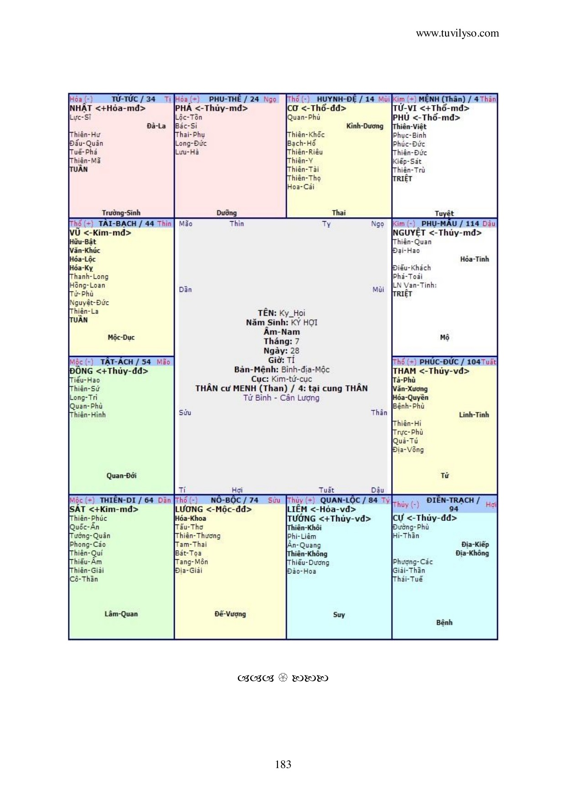

# Lá số mẫu nam Kỷ Hợi (Tử Phủ tại Thân, "Tuyệt xứ phùng sinh")

> **Phần:** Lá số mẫu › TVTH
> **Trả lời câu hỏi:** "Tuyệt xứ phùng sinh là gì?" · "Đào Hoa cư Quan có tốt không?" · "Thiên Khố thủ Mệnh tuổi Kỷ?"
> **Từ khóa:** Kỷ Hợi, Tử Phủ Vũ Tướng, Tuyệt xứ phùng sinh, Đào Hoa cư Quan, Thiên Khố, Khôi Việt
> **Nguồn chính:** TVTH tr.182–183 (`06_So-Tu-Vi-mau/14_Nam-Ky-Hoi.md`)

## Tóm tắt
Âm nam Kỷ Hợi, Mệnh/Thân cùng cung Thân có Tử Vi Thiên Phủ nhưng ở cung Tuyệt; sách gọi cách "Tuyệt xứ phùng sinh" (có Khôi Việt, Tử Phủ cứu giải) nên đời lên xuống nhanh. Đào Hoa cư Quan gặp Khôi Việt: học giỏi, có tiền; Thiên Khố thủ Mệnh năm Kỷ là đắc cách.

## Nội dung chi tiết

### Dữ kiện
Kỷ Hợi, tháng 7, ngày 28, giờ Tý; Âm Nam. Bản mệnh Bình Địa Mộc, Kim tứ cục. Thân cư Mệnh (Thân) (TVTH tr.183).

### Bố trí sao chính (đọc từ ảnh)
- **Mệnh/Thân (Thân):** Tử Vi, Thiên Phủ, Thiên Việt, Phục Binh, Phúc Đức, Thiên Đức, Kiếp Sát, Thiên Trù, Triệt; cung Tuyệt.
- **Quan Lộc (Tỵ):** Liêm Trinh, Thiên Tướng, Thiên Khôi, Ân Quang, Thiên Không, Thiếu Dương, Đào Hoa. **Tài Bạch (Thìn):** Vũ Khúc, Hữu Bật, Văn Khúc, Hóa Lộc, Hóa Kỵ, Hồng Loan, Nguyệt Đức, Tuần.
- Phúc (Tuất): Tham Lang, Tả Phù, Văn Xương, Hóa Quyền, Linh Tinh. Phụ Mẫu (Dậu): Thái Âm, Hỏa Tinh, Triệt. Phu Thê (Ngọ): Phá Quân, Lộc Tồn.

### Cách cục nhận ra
"Tử Phủ Vũ Tướng cách hội Khôi Việt, Quang Quí, Tướng Ấn, Đào Hồng, Hóa Lộc. Đào Hoa cư Quan. Thiên Khố thủ mệnh" (TVTH tr.182).

### Luận theo sách
- Tuổi Kỷ Hợi, Mệnh Mộc an cung Thân là tuyệt địa; có Tử Phủ, Khôi Việt nên gọi "Tuyệt xứ phùng sinh" (cứu giải tuyệt địa), song cuộc đời không tránh được thăng trầm nhanh chóng.
- Đào cư Quan gặp Khôi Việt: học giỏi và có tiền. Phú: "Đào Hoa cư Quan rất hay / Giàu sang số đã sẵn tay trời dành".
- Thiên Khố thủ Mệnh năm Kỷ đắc cách: "Hỏi ai Giáp Kỷ mấy người / Gặp sao Thiên Khố tiền rời bạc muôn" (TVTH tr.183).

### Vận hạn được nói đến
Tiểu hạn các năm 25, 26, 37, 39, 51 đáng lo biến cố.

### Bài học áp dụng
Cung Tuyệt không phải kết luận xấu nếu có cách giải (Tuyệt xứ phùng sinh); vẫn nhắc "thăng trầm nhanh".

## Ví dụ cụ thể
Dữ kiện: Mệnh đóng cung Tuyệt có Tử Phủ + Khôi Việt → quy tắc "Tuyệt xứ phùng sinh" → thành cách nhưng thăng trầm.

## Dị bản & lưu ý
Ảnh cung Thân không hiển thị Thiên Khố trong ô Mệnh; lời sách ghi "Thiên Khố thủ mệnh". Ghi nguyên lời sách.

## Liên quan
- [Tuyệt xứ phùng sinh](../09_Cach-cuc/01_Cach-tot/22_Tuyet-xu-phung-sinh.md)
- [Tử Phủ đồng cung](../09_Cach-cuc/01_Cach-tot/02_Tu-Phu-dong-cung.md)
- [Đào Hoa](../05_Phu-tinh-sat-tinh-tu-hoa/05_Sao-tinh-cam/01_Dao-Hoa.md)
- [Mục lục](00_Muc-luc-la-so-mau.md)
