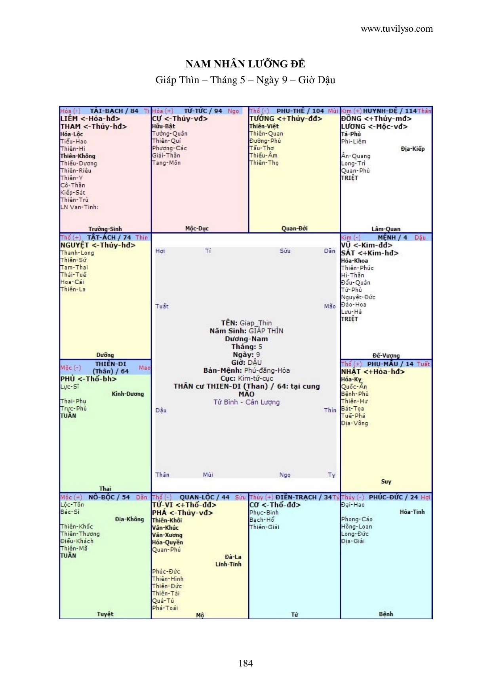

# Lá số mẫu nam nhân Lưỡng Đế Giáp Thìn (Vũ Sát tại Dậu)

> **Phần:** Lá số mẫu › TVTH
> **Trả lời câu hỏi:** "Lưỡng Đế hội Tam Hóa là gì?" · "Vũ Khúc hợp Văn Khúc ra sao?" · "Mệnh Cục tương khắc mà vẫn đắc cách?"
> **Từ khóa:** Giáp Thìn, Lưỡng Đế, Tam Hóa, Vũ Sát, Sát Phá Liêm Tham, Vũ Khúc Văn Khúc, Kim tứ cục
> **Nguồn chính:** TVTH tr.184–185 (`06_So-Tu-Vi-mau/15_Nam-nhan-Luong-De-Giap-Thin.md`)

## Tóm tắt
Dương nam Giáp Thìn, Mệnh Vũ Khúc Thất Sát tại Dậu, Thân cư Thiên Di (Thiên Phủ, Mão). Sách luận Sát Phá Liêm Tham hội Tam Hóa, Xương Khúc, lưỡng Đế: chủ uy quyền lãnh đạo, anh hùng, thi cử dễ đạt, văn chương lỗi lạc, âm nhạc tinh thông. Hung tinh (Đà Kình Linh Kiếp) được Tử Vi hóa giải; "một lá số đẹp ít thấy".

## Nội dung chi tiết

### Dữ kiện
Giáp Thìn, tháng 5, ngày 9, giờ Dậu; Dương Nam. Bản mệnh Phú Đăng Hỏa, Kim tứ cục. Thân cư Thiên Di (Mão) (TVTH tr.184).

### Bố trí sao chính (đọc từ ảnh)
- **Mệnh (Dậu):** Vũ Khúc, Thất Sát, Hóa Khoa, Thiên Phúc, Hỉ Thần, Đẩu Quân, Tử Phù, Nguyệt Đức, Đào Hoa, Lưu Hà, Triệt; cung Đế Vượng.
- **Thân/Thiên Di (Mão):** Thiên Phủ, Lục Sĩ, Kình Dương, Thái Phụ, Trực Phù, Tuần.
- **Tài Bạch (Tỵ):** Liêm Trinh, Tham Lang, Hóa Lộc, Thiên Không, Kiếp Sát. **Quan Lộc (Sửu):** Tử Vi, Phá Quân, Thiên Khôi, Văn Khúc, Văn Xương, Hóa Quyền, Đà La, Linh Tinh.
- Phu Thê (Mùi): Thiên Tướng. Tử Tức (Ngọ): Cự Môn, Hữu Bật. Phụ Mẫu (Tuất): Thái Dương, Hóa Kỵ. Huynh Đệ (Thân): Đồng, Lương, Tả Phù, Địa Kiếp, Triệt.

### Cách cục nhận ra
"Sát Phá Liêm Tham cách hội Tam Hóa, Xương Khúc, lưỡng Đế. Mệnh Cục tương khắc nhưng Cục hợp với Cung và chính tinh thành ra đắc cách" (TVTH tr.184).

### Luận theo sách
- Lưỡng Đế hội Tam Hóa chủ uy quyền lãnh đạo. Vũ Khúc hợp Văn Khúc tính chất anh hùng nhất là tuổi Giáp, dẫu có Đà Kình Linh Kiếp nhưng gặp Tử Vi hóa giải cả.
- Tam Hóa: Lộc ở Tài, Quyền ở Quan, Khoa ở Mệnh. Thi cử dễ, văn chương lỗi lạc, âm nhạc tinh thông. "Vì gặp ác tinh được giải, gặp cát tinh đắc cách."
- Phú: "Tham Liêm Vũ Phá chiếu vào / Mệnh viên có Đế dồi dào lắm thay… Vũ Khúc Văn Khúc rất hay / Ở nơi đắc địa là tay anh hùng" (TVTH tr.185).

### Vận hạn được nói đến
Đại hạn 34 tuổi và 44 tuổi mới thật rực rỡ.

### Bài học áp dụng
Mệnh Cục khắc vẫn có thể đắc cách nếu Cục hợp Cung và chính tinh; sao đế (Tử Vi) có sức giải hung tinh.

## Ví dụ cụ thể
Dữ kiện: Khoa ở Mệnh, Lộc ở Tài, Quyền ở Quan; hung tinh Đà Kình Linh Kiếp đủ mặt → quy tắc "Tử Vi giải hung" → kết luận đại quý.

## Dị bản & lưu ý
Sách nói "lưỡng Đế"; ảnh cho thấy Tử Vi ở Quan Lộc (Sửu) và Thiên Phủ ở Thiên Di (Mão), cùng tam phương/xung chiếu với Mệnh. Ảnh cho thấy Kình Dương ở Mão, Đà La ở Sửu.

## Liên quan
- [Tam Hóa liên châu](../09_Cach-cuc/01_Cach-tot/16_Tam-hoa-lien-chau.md)
- [Vũ Khúc](../04_Chinh-tinh/04_Vu-Khuc/03_Sao-dong-cung-va-cach-cuc.md)
- [Sát Phá Liêm Tham](../09_Cach-cuc/01_Cach-tot/12_Sat-Pha-Liem-Tham.md)
- [Mục lục](00_Muc-luc-la-so-mau.md)
