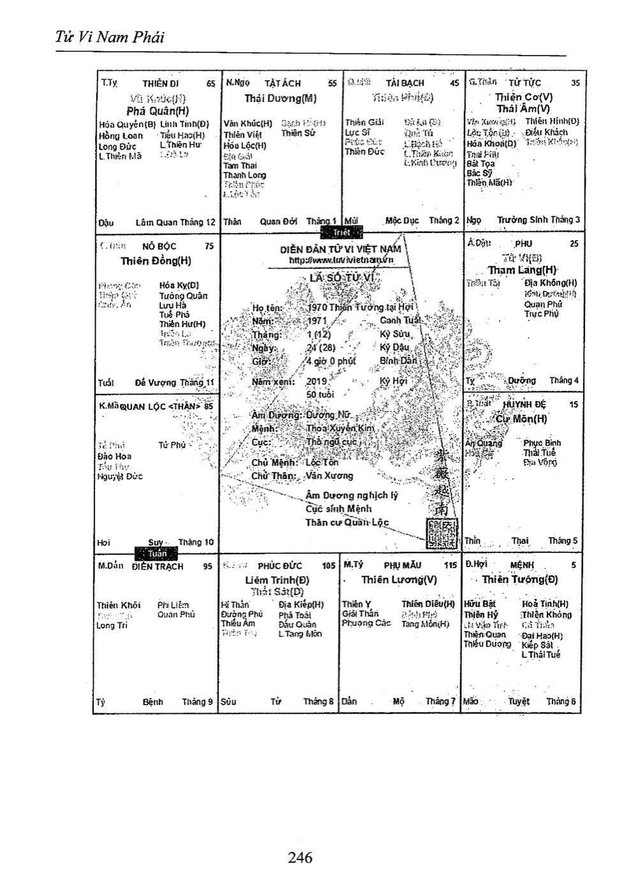

# Lá số mẫu NP1 số 1: nữ Canh Tuất, Thiên Tướng tại Hợi

> **Phần:** Lá số mẫu › NP1
> **Trả lời câu hỏi:** "Nữ mệnh Thiên Tướng luận thế nào?" · "Thiên Tướng gặp Không Kiếp Kình Đà Linh Hỏa?" · "Mệnh Tuyệt, Thiên Không, Thiên Quan là người thế nào?"
> **Từ khóa:** Thiên Tướng, Hợi, Canh Tuất, Thiên Không, Thiên Quan, Tuyệt xứ phùng sinh, phi hóa, Song Hao
> **Nguồn chính:** NP1 tr.246–248 (`Tu-Vi-Nam-Phai_Phan-1/05_La-so-mau/01_La-so-mau-1.md`)

## Tóm tắt
Lá số nữ Dương, Mệnh Thiên Tướng tại Hợi (cung Tuyệt), Thân cư Quan Lộc vô chính diệu. Giảng viên luận: ôn hòa, khẳng khái, gánh vác gia đình; duyên phận vất vả vì Đào Hồng Thiên Không Kiếp Sát; Thiên Tướng chủ thọ nên thọ cao, 97 tuổi gặp Không Kiếp Kình Đà Linh Hỏa Phá Toái thì mất vì bệnh phổi. Chữ OCR nhiều lỗi, đã sửa khi chắc chắn.

## Nội dung chi tiết

### Dữ kiện (đọc từ ảnh)
Canh Tuất (1970; âm lịch 1971, tháng 12 Kỷ Sửu, ngày 28 Kỷ Dậu), giờ Bính Dần (4 giờ). Dương Nữ, bản mệnh Thoa Xuyến Kim, Thổ ngũ cục, Chủ Mệnh Lộc Tồn, Chủ Thân Văn Xương; "Âm Dương nghịch lý, Cục sinh Mệnh, Thân cư Quan Lộc". Năm xem 2019 (Kỷ Hợi), 50 tuổi.

### Bố trí sao chính (đọc từ ảnh, chỉ ghi chữ rõ)
- **Mệnh (Hợi):** Thiên Tướng (Đắc), Hữu Bật, Hỏa Tinh, Thiên Hỉ, Thiên Không, Thiên Quan, Đại Hao, Kiếp Sát, Thiếu Dương; cung Tuyệt.
- **Thân/Quan Lộc:** vô chính diệu (Đào Hoa, Nguyệt Đức, Tử Phù).
- Tài Bạch: Thiên Phủ. Tật Ách: Thái Dương (Miếu), Văn Khúc, Thiên Việt, Hóa Lộc. Thiên Di: Vũ Khúc, Phá Quân, Hóa Quyền, Hồng Loan, Linh Tinh. Nô Bộc: Thiên Đồng (Hãm), Hóa Kỵ, Tướng Quân. Phu Thê: Tử Vi, Tham Lang, Địa Không. Tử Tức: Thiên Cơ, Thái Âm. Phúc Đức: Liêm Trinh, Thất Sát, Địa Kiếp. Phụ Mẫu: Thiên Lương.

### Cách cục và luận theo giảng viên
- Thiên Tướng tại Hợi "quân tử", biết trước biết sau, nói đi đôi với làm; nữ Thiên Tướng thay chồng gánh vác, tham mưu tốt, kinh doanh không thua kém.
- Thiên Tướng Tả Hữu đồng lai: đường quan lộ phát triển rực rỡ. Thiên Tướng + Đào Hồng + Thiên Không + Kiếp Sát: nữ vất vả đường duyên; Tả Hữu nhập Mệnh: cầu chồng khó thành gia thất.
- Mệnh Thủy, bản mệnh Kim: "Kim đặt trong bể thì thêm sáng". Mệnh Tuyệt: kín đáo; "Tuyệt xứ phùng sinh" càng gian nan càng thể hiện bản lĩnh.
- Phi Hóa Lộc từ Mệnh nhập Tử: quan tâm con cái; phi Kỵ nhập Huynh Đệ: anh em không nhờ vả nhau.
- Phu Thê có Địa Không Địa Kiếp Kình Linh: duyên khó bền, càng cản càng lấy. Tử có Mã ngộ Trường Sinh: con ra xa lập nghiệp; Tử có Khoa Quyền Xương Khúc: con học giỏi.
- Tài có Thiên Phủ: khá giả, giỏi quản lý; Phủ gặp Triệt: tiền bần hậu phú. Điền có Long Trì: nhà có mái lớn, giếng bỏ hoang. Tật có Thái Dương: bệnh mắt, mạch máu não.

### Vận hạn được nói đến
- 97 tuổi gặp Không Kiếp Kình Đà Linh Hỏa Phá Toái: mất vì lao phổi.
- Lưu Thiên Mã ở Thiên Di: đi nhiều; Lưu Tang Môn nhập Phúc: có tang xa; Lưu Khốc, Lưu Đà, Lưu Hổ: xuất khoản tiền lớn để đầu tư.

### Bài học áp dụng
Giảng viên đi lần lượt từng cung (Mệnh, Phu, Tử, Tài, Phụ Mẫu, Điền, Quan, Nô, Tật) rồi mới sang lưu hạn; dùng phi hóa tứ hóa từ cung Mệnh để xem quan hệ Tử và Huynh Đệ.

## Ví dụ cụ thể
Dữ kiện: nữ, Thiên Tướng + Tả Hữu tại Mệnh, tam hợp Đào Hồng Thiên Không Kiếp Sát → giảng viên kết luận quan lộ rực rỡ nhưng đường duyên vất vả (NP1 tr.246).

## Dị bản & lưu ý
Chữ OCR đôi chỗ sai ("căn đồng số lính", "Phú thương có tai"); chỉ trích những câu hiểu được. Một số câu về tuổi thọ 97 mâu thuẫn với năm xem 2019 (50 tuổi), là lời dạy tổng quát.

## Liên quan
- [Thiên Tướng](../04_Chinh-tinh/11_Thien-Tuong/03_Sao-dong-cung-va-cach-cuc.md)
- [Thiên Không](../05_Phu-tinh-sat-tinh-tu-hoa/06_Sao-tinh-cach-khac/08_Thien-Khong.md)
- [Địa Không – Địa Kiếp](../05_Phu-tinh-sat-tinh-tu-hoa/02_Luc-sat-tinh/04_Dia-Khong-Dia-Kiep.md)
- [Mục lục](00_Muc-luc-la-so-mau.md)
