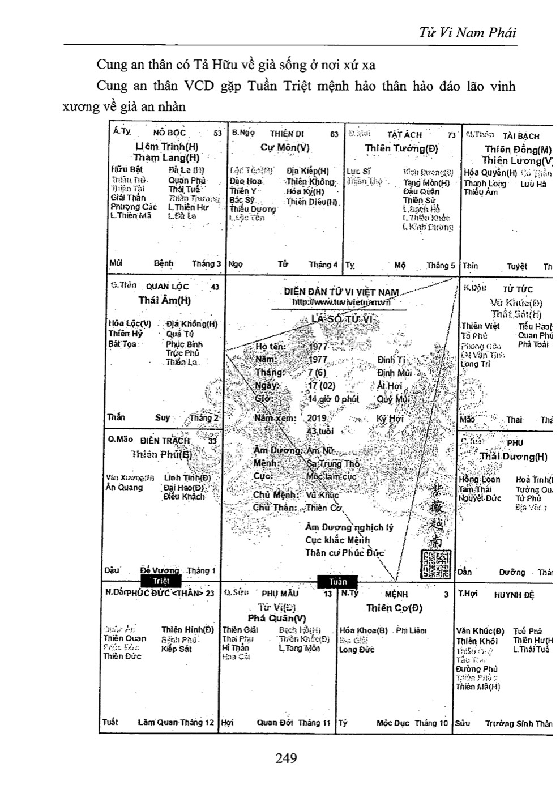

# Lá số mẫu NP1 số 2: âm nữ Đinh Tỵ, Thiên Cơ, Thân cư Phúc

> **Phần:** Lá số mẫu › NP1
> **Trả lời câu hỏi:** "Mệnh Thiên Cơ Hóa Khoa luận thế nào?" · "Thân cư Phúc nghĩa là gì?" · "Vận Thái Âm Hóa Lộc gặp Địa Không?"
> **Từ khóa:** Thiên Cơ, Hóa Khoa, Tam Hóa liên châu, Thân cư Phúc, Tuần Triệt, Địa Không, Đào Hoa Không Kiếp
> **Nguồn chính:** NP1 tr.249–252 (`05_La-so-mau/02_La-so-mau-2.md`)

## Tóm tắt
Âm nữ Đinh Tỵ, Mệnh Thiên Cơ (đắc) có Hóa Khoa, Thân cư Phúc Đức vô chính diệu. Bài giảng luận từng cung: Mệnh thông minh, kín đáo, học giỏi; Thân cư Phúc nặng chuyện gia đình, tâm linh; Phu Thê bất ổn (Hồng Loan, Đào Hoa Không Kiếp); vận Thái Âm Hóa Lộc gặp Địa Không: "tĩnh thì sống, động thì chết", không đầu tư lớn.

## Nội dung chi tiết

### Dữ kiện (đọc từ ảnh)
Đinh Tỵ (1977), tháng 7 (âm 6) Đinh Mùi, giờ 14h Quý Mùi; Âm Nữ; bản mệnh Sa Trung Thổ; Mộc tam cục; Chủ Mệnh Vũ Khúc, Chủ Thân Thiên Cơ; "Âm Dương nghịch lý, Cục khắc Mệnh, Thân cư Phúc Đức". Năm xem 2019, 43 tuổi.

### Bố trí sao chính (đọc từ ảnh)
- **Mệnh:** Thiên Cơ (Đắc), Hóa Khoa, Phi Liêm, Long Đức; cung Mộc Dục. **Thân/Phúc Đức:** vô chính diệu (Quốc Ấn, Thiên Hình, Thiên Quan, Thiên Đức, Kiếp Sát).
- Phụ Mẫu: Tử Vi, Phá Quân, Bạch Hổ, Hoa Cái. Tử Tức: Vũ Khúc, Thất Sát. Phu Thê: Thái Dương (Hãm), Hồng Loan. Điền: Thiên Phủ. Tài Bạch: Thiên Đồng, Thiên Lương, Hóa Quyền. Quan Lộc: Thái Âm, Hóa Lộc, Địa Không. Nô: Liêm Trinh, Tham Lang. Thiên Di: Cự Môn, Địa Kiếp, Đào Hoa, Thiên Không, Hóa Kỵ. Tật Ách: Thiên Tướng.

### Luận theo giảng viên
- Mệnh Thiên Cơ đắc địa: thông minh, điềm đạm, sâu sắc, kín đáo ("điều cơ mật trời đất"). Cơ Tuần Triệt: "thạch trung ẩn ngọc", tuổi ấu thơ vất vả. Cơ Hóa Khoa: học ít biết nhiều, hợp y dược, sư phạm.
- "Mệnh này đẹp được Tam Hóa liên châu", Hóa Khoa ở Mệnh nên thi cử dễ, "nạn lớn thành nạn nhỏ".
- Thân cư Phúc: chuyện gia đình, thờ cúng, tâm linh; nữ có thể đưa chồng về ở rễ hoặc lấy chồng phương xa. Thân có Thiên Hình: về già khắc khe; Thân có Thiên Quan: thích tụng kinh niệm Phật.
- Phu Thê: Hồng Loan ở đất Tuất (Thổ Thủy tương phá), chồng cao gầy, da trắng (Thái Dương). Thiên Di Đào Hoa Không Kiếp: "tình sớm nở cũng sớm tàn".
- Quan có Âm Dương lạc hãm: công danh không còn lớn. Nô có Thái Tuế: nghị lực.

### Vận hạn được nói đến
- Đang ở vận Thái Âm Hóa Lộc Địa Không: "tĩnh thì sống mà động thì chết", không đầu tư ra ngoài vì vận Không Kiếp kinh doanh là trắng tay.
- Thái Âm Thủy, mệnh Thổ, Thổ Thủy tương khắc, Địa Không Tướng Quân chiếu: lo sức khỏe. 49 tuổi Bạch Hổ cẩn thận; qua 54 tuổi mới thọ. Lưu Tang Môn ở Phụ Mẫu: bố mẹ ốm.

### Bài học áp dụng
Khi vận có Địa Không Địa Kiếp, giảng viên khuyên giữ nguyên, không mở rộng đầu tư. Xem cung Quan, Tài cùng đại vận.

## Ví dụ cụ thể
Dữ kiện: đại vận ở Quan có Thái Âm Hóa Lộc + Địa Không → quy tắc "Không Kiếp kinh doanh trắng tay" → khuyên duy trì công việc bình thường (NP1 tr.251).

## Dị bản & lưu ý
Bản OCR có nhiều chỗ đứt dòng; văn bản nói "Phúc có Đồng Lương" nhưng ảnh cho thấy Đồng Lương ở cung Tài Bạch.

## Liên quan
- [Thiên Cơ](../04_Chinh-tinh/02_Thien-Co/04_Nam-menh-nu-menh.md)
- [Tam Hóa liên châu](../09_Cach-cuc/01_Cach-tot/16_Tam-hoa-lien-chau.md)
- [Hóa Khoa](../05_Phu-tinh-sat-tinh-tu-hoa/03_Tu-hoa/04_Hoa-Khoa.md)
- [Mục lục](00_Muc-luc-la-so-mau.md)
