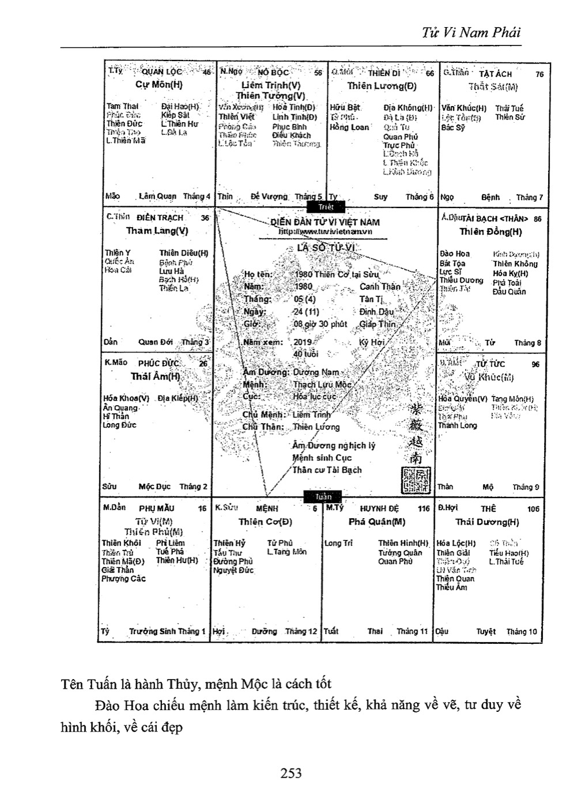

# Lá số mẫu NP1 số 3: nam Canh Thân, Thiên Cơ tại Sửu, Thân cư Tài

> **Phần:** Lá số mẫu › NP1
> **Trả lời câu hỏi:** "Cơ Linh Hỏa luận thế nào?" · "Đọc đại vận Điền Trạch ra sao?" · "Tiểu hạn và lưu hạn khác nhau thế nào?"
> **Từ khóa:** Thiên Cơ, Sửu, Canh Thân, Thân cư Tài, đại vận Điền, Tham Lang, Trúc La, Hóa Lộc, lưu Thái Tuế
> **Nguồn chính:** NP1 tr.253–255 (`05_La-so-mau/03_La-so-mau-3.md`)

## Tóm tắt
Nam Dương Canh Thân, Mệnh Thiên Cơ (đắc) tại Sửu, Thân cư Tài Bạch (Thiên Đồng). Bài giảng luận Mệnh Cơ (kỹ thuật, tham mưu), Tài Đồng (hưởng thụ), Thê có Hóa Lộc, rồi đọc đại vận 36–46 ở Điền ôm vòng Thái Tuế (thịnh vượng) và hạn 40, 44 tuổi.

## Nội dung chi tiết

### Dữ kiện (đọc từ ảnh)
Canh Thân (1980), tháng 4 Tân Tỵ, ngày 11 Đinh Dậu, giờ Giáp Thìn (8h30); Dương Nam; bản mệnh Thạch Lựu Mộc; Hỏa lục cục; Chủ Mệnh Liêm Trinh, Chủ Thân Thiên Lương; "Âm Dương nghịch lý, Mệnh sinh Cục, Thân cư Tài Bạch". Năm xem 2019, 40 tuổi.

### Bố trí sao chính (đọc từ ảnh)
- **Mệnh:** Thiên Cơ (Đắc), Thiên Hỉ, Tử Phù, Tấu Thư, Đường Phù, Nguyệt Đức, Lưu Tang Môn. **Thân/Tài Bạch:** Thiên Đồng (Hãm), Đào Hoa, Kình Dương, Hóa Kỵ, Thiên Không, Bát Tọa.
- Thê (Phu Thê): Thái Dương (Hãm), Hóa Lộc, Thiên Quan. Phụ Mẫu: Tử Vi, Thiên Phủ. Huynh Đệ: Phá Quân, Thiên Hình. Tử Tức: Vũ Khúc, Hóa Quyền, Tang Môn. Tật Ách: Thất Sát, Văn Khúc, Thái Tuế. Thiên Di: Thiên Lương, Địa Không, Đà La, Hồng Loan. Nô: Liêm Trinh, Thiên Tướng, Hỏa Tinh, Linh Tinh. Quan: Cự Môn. Điền: Tham Lang, Thiên Diêu. Phúc: Thái Âm, Hóa Khoa, Địa Kiếp.

### Luận theo giảng viên
- Tên Tuấn hành Thủy, mệnh Mộc là cách tốt. Đào Hoa chiếu Mệnh: hợp kiến trúc, thiết kế. Mệnh Thiên Cơ: kỹ thuật, máy móc, điềm đạm, giỏi lập kế hoạch, tham mưu, ứng biến.
- Tài Thiên Đồng: hưởng thụ, vừa làm vừa chơi, chạy ngoài đường suốt ngày. Thê có Hóa Lộc: được vợ chăm sóc; Thê Thái Dương: vợ nhanh nhẹn, kinh tế ổn định; Thê Cô Thần Thái Dương: bản thân thọ hơn vợ.
- Cự Môn cư Quan: tư vấn, đàm phán. Thiên Di Hồng Loan: lấy vợ xa quê. Không Kiếp cư Phúc: không nhờ được họ hàng, nặng gánh hai bên gia đình. Vũ Khúc cư Tử: tối thiểu 3 con, có con trai.

### Vận hạn được nói đến
- Đại vận 36–46 ở cung Điền, "ôm vòng Thái Tuế": thịnh vượng; Tham Lang Thủy hợp mệnh Mộc, không Không Kiếp nên thành công; có Hoa Cái Long Trì sinh đẻ được. Vận Tham Lang: cầu đạo, tâm linh; Tham Đào Riêu: tiệc tùng. Vận Thất Sát là vận sinh tử; Bạch Hổ: đề phòng tai nạn. Vận có Linh Hỏa trong khi Mệnh Cơ: xấu vì Cơ sợ Linh Hỏa.
- Quy tắc nêu rõ: đại vận ở Điền thì vận mệnh rơi vào Điền, Phụ Mẫu rơi vào Quan, Quan rơi vào Tật Ách. "Tiểu hạn là nguyên nhân, Lưu hạn là kết quả cuối cùng của một năm."
- Tiểu hạn 40 tuổi tại Mệnh; lưu hạn 40 về cung Thê (Thái Dương), Lưu Thái Tuế kích Thê; Lưu Mã nhập Quan: đi nhiều; Lưu Tang Môn nhập Mệnh: dự tính khó thành; Thái Dương Hóa Lộc gặp Lưu Thái Tuế: làm ăn tốt. Hạn 44 tuổi gặp Không Kiếp xấu, may có Hóa Khoa qua được.

### Bài học áp dụng
Đọc đại vận bằng cách "xoay" các cung theo cung đại vận; xét thêm hành đại vận so với mệnh.

## Ví dụ cụ thể
Dữ kiện: đại vận 36–46 ở Điền có Tham Lang (Thủy), mệnh Mộc, không Không Kiếp → giảng viên kết luận đại vận thành công (NP1 tr.254).

## Dị bản & lưu ý
Văn bản OCR có lỗi ("chăm bằm", "tạo duyên"). Giờ sinh trên ảnh 8h30 (Thìn).

## Liên quan
- [Đọc một đại vận](../10_Van-han/01_Dai-van/02_Doc-mot-dai-van.md)
- [Tiểu hạn](../10_Van-han/02_Tieu-han/02_Doc-tieu-han.md)
- [Thiên Cơ](../04_Chinh-tinh/02_Thien-Co/05_O-cac-cung-ngoai-Menh.md)
- [Mục lục](00_Muc-luc-la-so-mau.md)
