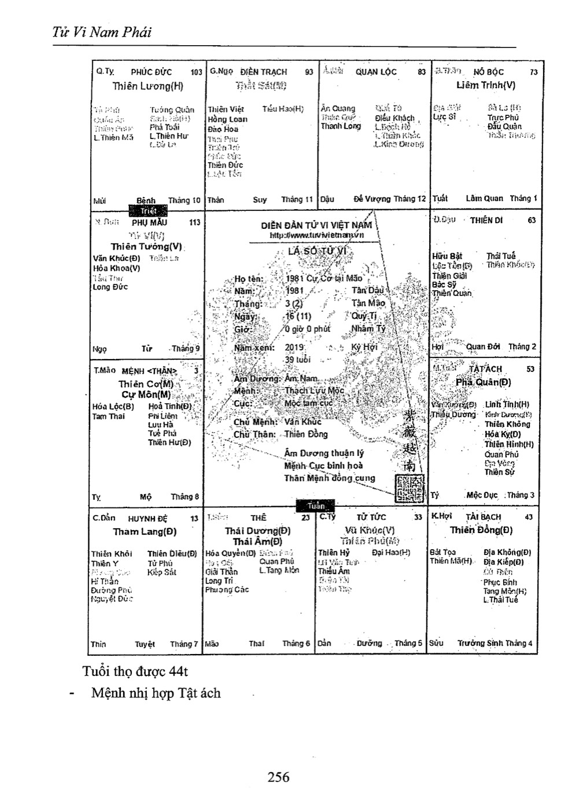

# Lá số mẫu NP1 số 4: nam Tân Dậu, Cơ Cự tại Mão, Thân Mệnh đồng cung

> **Phần:** Lá số mẫu › NP1
> **Trả lời câu hỏi:** "Cơ Linh Hỏa gây nóng giận thế nào?" · "Thiên Hình nhập cung Tật ách là gì?" · "Cự Môn Hóa Lộc mở miệng ra tiền?"
> **Từ khóa:** Cơ Cự, Mão, Tân Dậu, Cự Môn Hóa Lộc, Linh Hỏa, Thiên Hình, cung Tật, Thân Mệnh đồng cung
> **Nguồn chính:** NP1 tr.256–257 (`05_La-so-mau/04_La-so-mau-4.md`)

## Tóm tắt
Nam Âm Tân Dậu, Thân Mệnh đồng cung với Cơ Cự tại Mão, Cự Môn Hóa Lộc, Hỏa Tinh. Bài giảng tập trung vào cung Tật Ách (Xương Khúc, Kình, Thiên Không, Thiên Hình, Hóa Kỵ, Quan Phủ), tính cách Cơ gặp Linh Hỏa (nóng giận mất kiểm soát) và các hạn 39, 44 tuổi. Ghi chú trên ảnh: tuổi thọ 44.

## Nội dung chi tiết

### Dữ kiện (đọc từ ảnh)
Tân Dậu (1981), tháng 2 Tân Mão, ngày 11 Quý Tỵ, giờ Nhâm Tý (0 giờ); Âm Nam; bản mệnh Thạch Lựu Mộc; Mộc tam cục; Chủ Mệnh Văn Khúc, Chủ Thân Thiên Đồng; "Âm Dương thuận lý, Mệnh Cục bình hòa, Thân Mệnh đồng cung". Năm xem 2019, 39 tuổi.

### Bố trí sao chính (đọc từ ảnh)
- **Mệnh/Thân (Mão):** Thiên Cơ (Miếu), Cự Môn (Miếu), Hóa Lộc, Hỏa Tinh, Tam Thai, Phi Liêm, Lưu Hà, Tuế Phá, Thiên Hư.
- Tật Ách: Phá Quân (Đắc), Văn Xương, Linh Tinh, Kình Dương, Thiên Không, Hóa Kỵ, Thiên Hình, Quan Phủ, Địa Võng, Thiên Sứ. Tài Bạch: Thiên Đồng, Địa Không, Địa Kiếp, Tang Môn, L. Thái Tuế (lưu niên 2019). Phụ Mẫu: Thiên Tướng, Văn Khúc, Hóa Khoa. Phúc: Thiên Lương. Điền: Thất Sát. Nô: Liêm Trinh. Thiên Di: Hữu Bật, Lộc Tồn. Phu Thê: Thái Dương, Thái Âm. Tử Tức: Vũ Khúc. Huynh Đệ: Tham Lang, Thiên Khôi.

### Luận theo giảng viên
- Tật có Xương Khúc, Kình, Thiên Không, Thiên Hình, Hóa Kỵ, Quan Phủ: "toàn những sao xấu nhập về Tật sẽ làm giảm thọ"; Tật có Văn Xương nặng hơn Văn Khúc.
- Thiên Hình nhập Tật: tù tội, pháp luật, lằn tên mũi đạn, chết đau đớn. Tật có Mộc Dục: sinh lý tốt. Tật có Kình Dương: quái dị chuyện chăn gối. Thiên Không cư Tật đánh tan bệnh tật nhưng không đánh tan được họa.
- Mệnh Hóa Lộc: khéo, mồm mép, khôn ngoan; Mệnh Cự Môn Hóa Lộc: "mở miệng ra tiền", nhưng "chết cũng do cái miệng"; Cự Môn là sao đào hoa. Thiên Cơ là thiện tinh; do ảnh hưởng Cự Môn lớn lên thân phì.
- Cơ + Linh Hỏa (Mộc gặp Hỏa): người rồ dại, nóng giận như "Chí Phèo"; lá số này làm lò mổ, giết 3 mạng người; không nên kìm nén lâu. Mệnh Tuế Hư: răng xấu, đa đoan, gian dối.

### Vận hạn được nói đến
39 tuổi tiểu hạn nằm Thiên Di; lưu vận nhập Mệnh. 44 tuổi lưu vận nhập đúng cung Tật; tiểu hạn 44 gặp Tham Lang "tam vận Trúc La". Mệnh Mộc gặp vận Vũ Khúc (Kim), Phủ (Thổ): xấu.

### Bài học áp dụng
Cung Tật ách là "tổng hòa tất cả hành động, tạo duyên thì hưởng phước, tạo nghiệp thì hưởng nghiệp"; khi nhiều sát tinh nhập Tật cần cảnh giác ở hạn lưu vào cung đó.

## Ví dụ cụ thể
Dữ kiện: Mệnh Thiên Cơ (Mộc) đồng cung Hỏa Tinh → quy tắc Cơ sợ Linh Hỏa → giảng viên kết luận dễ bốc hỏa mất kiểm soát (NP1 tr.256–257).

## Dị bản & lưu ý
Ví dụ giết người chỉ là bài giảng minh họa, không phải kết luận tất yếu. Bản OCR có lỗi chính tả.
- Đối chiếu ảnh trang 256: ô Tài Bạch (Hợi) ghi "L.Thái Tuế", tức Thái Tuế lưu năm xem 2019 (Kỷ Hợi); Thái Tuế gốc năm Dậu ở cung Dậu.

## Liên quan
- [Hỏa Tinh – Linh Tinh](../05_Phu-tinh-sat-tinh-tu-hoa/02_Luc-sat-tinh/03_Hoa-Tinh-Linh-Tinh.md)
- [Cung Tật Ách](../03_Muoi-hai-cung/08_Cung-Tat-Ach/01_Y-nghia-va-cach-xem.md)
- [Thiên Hình](../05_Phu-tinh-sat-tinh-tu-hoa/06_Sao-tinh-cach-khac/01_Thien-Hinh.md)
- [Mục lục](00_Muc-luc-la-so-mau.md)
