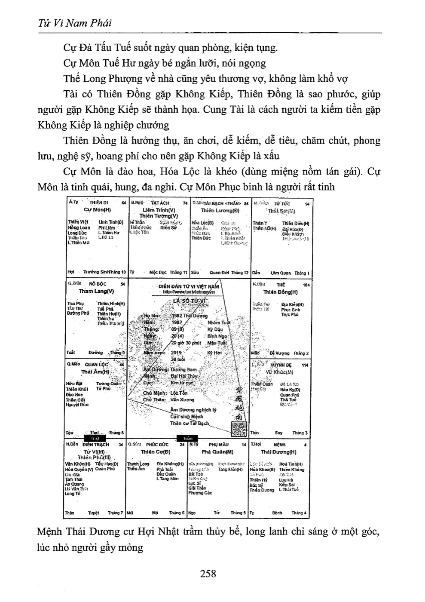

# Lá số mẫu NP1 số 5: nam Nhâm Tuất, Thái Dương tại Hợi, Thân cư Tài

> **Phần:** Lá số mẫu › NP1
> **Trả lời câu hỏi:** "Thái Dương cư Hợi luận thế nào?" · "Không Kiếp ở cung Tài là sao?" · "Quan gặp Triệt thì sao?"
> **Từ khóa:** Thái Dương Hợi, Nhật trầm thủy để, Nhâm Tuất, Triệt, Không Kiếp cung Tài, Đào Hồng, Thiên Không
> **Nguồn chính:** NP1 tr.258–259 (`05_La-so-mau/05_La-so-mau-5.md`)

## Tóm tắt
Nam Dương Nhâm Tuất, Mệnh Thái Dương (hãm) tại Hợi; Thân cư Tài Bạch (Thiên Lương, Hóa Lộc). Bài giảng nêu Nhật "trầm thủy để" (chìm đáy nước), Mệnh Thiên Không (nghệ sĩ, mộ đạo), Quan gặp Triệt, Không Kiếp cư Tài và cư Phu Thê, cùng các hạn 34–44 và 38 tuổi.

## Nội dung chi tiết

### Dữ kiện (đọc từ ảnh)
Nhâm Tuất (1982), tháng 8 Kỷ Dậu, ngày 4 Bính Ngọ, giờ Mậu Tuất (20h30); Dương Nam; bản mệnh Đại Hải Thủy; Kim tứ cục; Chủ Mệnh Lộc Tồn, Chủ Thân Văn Xương; "Âm Dương nghịch lý, Cục sinh Mệnh, Thân cư Tài Bạch". Năm xem 2019, 38 tuổi.

### Bố trí sao chính (đọc từ ảnh)
- **Mệnh (Hợi):** Thái Dương (Hãm), Lộc Tồn, Hỏa Tinh, Hóa Khoa, Thiên Không, Thiên Hỉ, Bác Sĩ, Kiếp Sát, Lưu Hà, Thiếu Dương.
- **Thân/Tài Bạch:** Thiên Lương (Đắc), Hóa Lộc, Quốc Ấn. Thiên Di: Cự Môn (Hãm). Quan Lộc: Thái Âm (Hãm), Hữu Bật, Thiên Khôi, Đào Hoa, Tướng Quân. Nô: Tham Lang, Thiên Hình, Tuế Phá. Phu Thê: Thiên Đồng, Địa Kiếp. Huynh Đệ: Vũ Khúc, Đà La, Hóa Kỵ. Phụ Mẫu: Phá Quân. Phúc: Thiên Cơ, Địa Không. Điền: Tử Vi, Thiên Phủ. Tật: Liêm Trinh, Thiên Tướng. Tử: Thất Sát. Triệt và Tuần xuất hiện quanh Quan Lộc và Điền.

### Luận theo giảng viên
- Mệnh Thái Dương cư Hợi: "Nhật trầm thủy bể, long lanh chỉ sáng ở một góc", lúc nhỏ gầy mỏng. Mệnh Thiên Không: nghệ sĩ, tính hơi dị, mộ đạo, thích tĩnh lặng. Mệnh được Đào Hồng chiếu: nữ đẹp, nam phong lưu, đẹp trai; Đào Hồng làm kiến trúc, kỹ thuật, cơ khí. Thiên Hỉ cư Mệnh: vui vẻ, dễ gần. Âm Dương hãm địa: không gặp thời gặp vận.
- Quan gặp Triệt: quan quyền quan chức là không; Quan Thái Âm gặp Triệt làm Âm Dương sáng lên, có thể làm chủ kho xưởng. Văn tinh (Khôi Việt Xương Khúc) không ưa Triệt, Hóa Kỵ nhưng trí tuệ vẫn nằm trong đầu.
- Cung Tài là cách kiếm tiền: gặp Không Kiếp là "nghiệp chướng"; Thiên Đồng (hưởng thụ, nghệ sĩ, hoang phí) gặp Không Kiếp là xấu.
- Cự Môn tinh quái, hung, đa nghi; Cự Phục Binh rất tinh; Cự Đà Tấu Tuế: quan phòng, kiện tụng; Cự Tuế Hư: ngày bé ngắn lưỡi, nói ngọng.
- Không Kiếp cư Phu Thê: nhanh quen nhanh cưới, hay cãi nhau; Thê Thiên Đồng: vợ béo tốt, đảm, hay lấy vợ phương xa; Thế Long Phượng: yêu thương vợ.
- Liêm Trinh cư Tật: khối u.

### Vận hạn được nói đến
Tiểu hạn Hồng Loan là tốt. Đại vận Tử Phủ là đẹp, không sợ lưu tiểu vận 38 tuổi có Không Kiếp. Đại vận 34–44 ở cung Điền phát động cung Tử: lấy vợ, sinh con (NP1 tr.259).

### Bài học áp dụng
Cung Tài mà gặp Không Kiếp cần chú ý nghề nghiệp đang làm; Tuần Triệt đổi nghĩa tùy chính tinh nó chạm vào.

## Ví dụ cụ thể
Dữ kiện: đại vận 34–44 ở Điền, cung Tử bị phát động → giảng viên kết luận giai đoạn lấy vợ sinh con.

## Dị bản & lưu ý
Phần đầu bản OCR bị đứt (bắt đầu giữa câu). Ảnh trang 258 chứa chung phần chữ trang trước và chart.

## Liên quan
- [Thái Dương](../04_Chinh-tinh/03_Thai-Duong/02_Mieu-ham-va-12-vi-tri.md)
- [Triệt](../07_Tuan-Triet/01_Ban-chat-Tuan-Triet.md)
- [Địa Không – Địa Kiếp](../05_Phu-tinh-sat-tinh-tu-hoa/02_Luc-sat-tinh/04_Dia-Khong-Dia-Kiep.md)
- [Mục lục](00_Muc-luc-la-so-mau.md)
