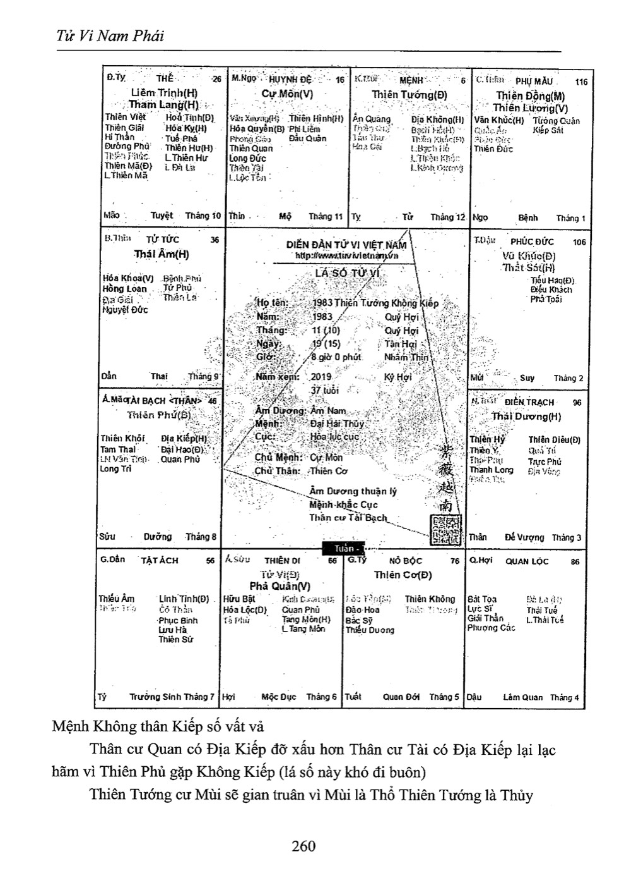

# Lá số mẫu NP1 số 6: nam Quý Hợi, Thiên Tướng Không Kiếp

> **Phần:** Lá số mẫu › NP1
> **Trả lời câu hỏi:** "Mệnh Không Thân Kiếp luận thế nào?" · "Thân cư Quan có Địa Kiếp khác gì Thân cư Tài?" · "Thiên Tướng Quang Quý nên làm nghề gì?"
> **Từ khóa:** Thiên Tướng, Địa Không, Địa Kiếp, Thân cư Tài, Thiên Phủ, Quý Hợi, Tang Hổ, Quang Quý, Tuần Triệt
> **Nguồn chính:** NP1 tr.260–264 (`05_La-so-mau/06_La-so-mau-6.md`)

## Tóm tắt
Nam Âm Quý Hợi, Mệnh Thiên Tướng có Địa Không (Kiếp ở Thân Tài), Thân cư Tài Bạch có Thiên Phủ gặp Địa Kiếp. Giảng viên luận: Tướng hiếu học, khiêm nhường; Không Kiếp vừa làm xấu thọ vừa thiệt thòi; Phủ gặp Không Kiếp nên khó đi buôn; dạy cách xét Tuần Triệt, "ngũ đại chính tinh", rồi luận lần lượt các cung và tháng hạn. Văn bản dài nhất trong NP1, nhiều chỗ OCR lỗi.

## Nội dung chi tiết

### Dữ kiện (đọc từ ảnh)
Quý Hợi (1983), tháng 10 Quý Hợi, ngày 15 Tân Hợi, giờ Nhâm Thìn (8 giờ); Âm Nam; bản mệnh Đại Hải Thủy; Hỏa lục cục; Chủ Mệnh Cự Môn, Chủ Thân Thiên Cơ; "Âm Dương thuận lý, Mệnh khắc Cục, Thân cư Tài Bạch". Năm xem 2019, 37 tuổi.

### Bố trí sao chính (đọc từ ảnh)
- **Mệnh:** Thiên Tướng (Đắc), Ân Quang, Địa Không (Hãm), Bạch Hổ (Hãm), Thiên Khốc, Tấu Thư, Hoa Cái.
- **Thân/Tài Bạch:** Thiên Phủ (Đắc), Địa Kiếp (Hãm), Thiên Khôi, Tam Thai, Đại Hao, Quan Phủ, Long Trì.
- Phu Thê: Liêm Trinh, Tham Lang, Hỏa Tinh, Hóa Kỵ, Thiên Mã. Huynh Đệ: Cự Môn, Hóa Quyền, Thiên Hình, Văn Xương. Phụ Mẫu: Thiên Đồng, Thiên Lương, Văn Khúc. Tử Tức: Thái Âm, Hóa Khoa, Hồng Loan. Phúc: Vũ Khúc, Thất Sát. Điền: Thái Dương. Quan Lộc: vô chính diệu. Nô: Thiên Cơ, Lộc Tồn, Đào Hoa. Thiên Di: Tử Vi, Phá Quân, Hữu Bật, Hóa Lộc.

### Luận theo giảng viên
- "Mệnh Không thân Kiếp số vất vả. Thân cư Quan có Địa Kiếp đỡ xấu hơn Thân cư Tài có Địa Kiếp lại lạc hãm vì Thiên Phủ gặp Không Kiếp (lá số này khó đi buôn)." (NP1 tr.260)
- Người Thiên Tướng hiếu học, hiếu nghĩa, khiêm nhường; Thiên Tướng giàu mà Thiên Phủ ở Tài sinh lòng tham, tham thì hao phúc nên khó thọ. Thiên Tướng Quang Quý tuổi thọ tốt nhưng gặp Không Kiếp Tang Hổ thì giảm: "Kiếp Không dù đắc địa chết vòng trung niên".
- Xét Tuần Triệt: ở Phúc có Thất Sát lạc hãm thì làm sáng cung Phúc; Tuần Triệt ở Tài và Tật để hãm Địa Kiếp. "Ngũ đại chính tinh": Tử Vi gặp Tuần Triệt mất đường công danh; Phủ Tướng sợ Không Kiếp nhưng chỉ hãm lại Không Kiếp.
- Mệnh Bạch Hổ Tang Môn: gia đình không giàu, nội tâm, ngày nhỏ khó nuôi, lo xa; Tang Hổ đắc địa ăn nói khéo.
- Không Kiếp ở Mệnh: da không trắng, tính nóng; gặp Tướng Quang Quý giảm hung nhưng thành cách vất vả ("làm 1 hưởng 2, 3 con Không Kiếp làm chỉ hưởng 1"); thích làm cái khó, thức đêm, đam mê tìm hiểu vận số. Thiên Tướng Quang Quý nên học dược, Đông y; Thiên Tướng Tả Hữu học Tử Vi.
- Xương Khúc hãm gặp Hình Kỵ: học khó lên cao, "cần cù bù thông minh". Văn Xương khởi từ Thìn đi thuận; Văn Khúc từ Tuất đi nghịch.
- Phu Thê: Phi Hóa Kỵ, Hóa Kỵ Phu Thê: khó hòa hợp; Liêm Tham Hóa Kỵ: vợ đảm, khỏe; Thê Tham Hỏa: vợ kiếm tiền giỏi; Tuyệt cư Phu Thê: vợ kín đáo. Thiên Mã cư Thê: có quãng xa cách.
- Tử có Âm Dương/Đào Hồng: con cái tốt; Điền có Cô Quả: giữ nghiệp cha ông.

### Vận hạn được nói đến
- Tháng 6 Lưu Tang Môn: ngã xe, mất xe. Tháng 7 Phục Binh: bị lừa. Tháng 8 Địa Kiếp: ốm; Thiên Phủ: hao tiền. Tháng 10 Hóa Kỵ: cãi nhau; Lưu Mã: đi xa. Tháng 12: ốm.
- Lưu Tang Môn nhập Thiên Di: đi xa học được, đi công việc không được việc. Lưu Thái Tuế kích Quan: đổi nghề.
- Đại vận 66 có Kình Dương, Linh Hỏa, tổ hợp Sát Phá Liêm Tham: kịch thọ 66–75; 68 tuổi Tướng Quân Kiếp Sát; 69 có Quang Quý thì ổn; 73 Không Kiếp, qua tuổi này mới thọ; vận 46 Không Kiếp sức khỏe đi xuống.

### Bài học áp dụng
Cùng sát tinh (Địa Kiếp) nhưng tính chất khác tùy cung nó rơi (Quan nhẹ hơn Tài). Dùng Tuần Triệt để hãm sao xấu; xét tháng hạn bằng lưu tinh.

## Ví dụ cụ thể
Dữ kiện: Thân cư Tài, Thiên Phủ + Địa Kiếp → quy tắc Phủ sợ Không Kiếp → lá số khó đi buôn.

## Dị bản & lưu ý
Giảng viên nói Địa Không ở Mệnh và Địa Kiếp ở Thân Tài (cùng gọi "Không Kiếp"). Một số mốc tuổi 66–75 là hạn tổng quát. OCR lỗi ("hiêu học", "Thiên Tuóng").

## Liên quan
- [Địa Không – Địa Kiếp](../05_Phu-tinh-sat-tinh-tu-hoa/02_Luc-sat-tinh/04_Dia-Khong-Dia-Kiep.md)
- [Thiên Tướng](../04_Chinh-tinh/11_Thien-Tuong/03_Sao-dong-cung-va-cach-cuc.md)
- [Tuần Triệt ở Mệnh](../07_Tuan-Triet/03_Tuan-Triet-o-Menh-va-cung-chieu.md)
- [Lưu nguyệt hạn](../10_Van-han/05_Nguyet-han-nhat-han/01_Dau-Quan-va-luu-nguyet.md)
- [Mục lục](00_Muc-luc-la-so-mau.md)
