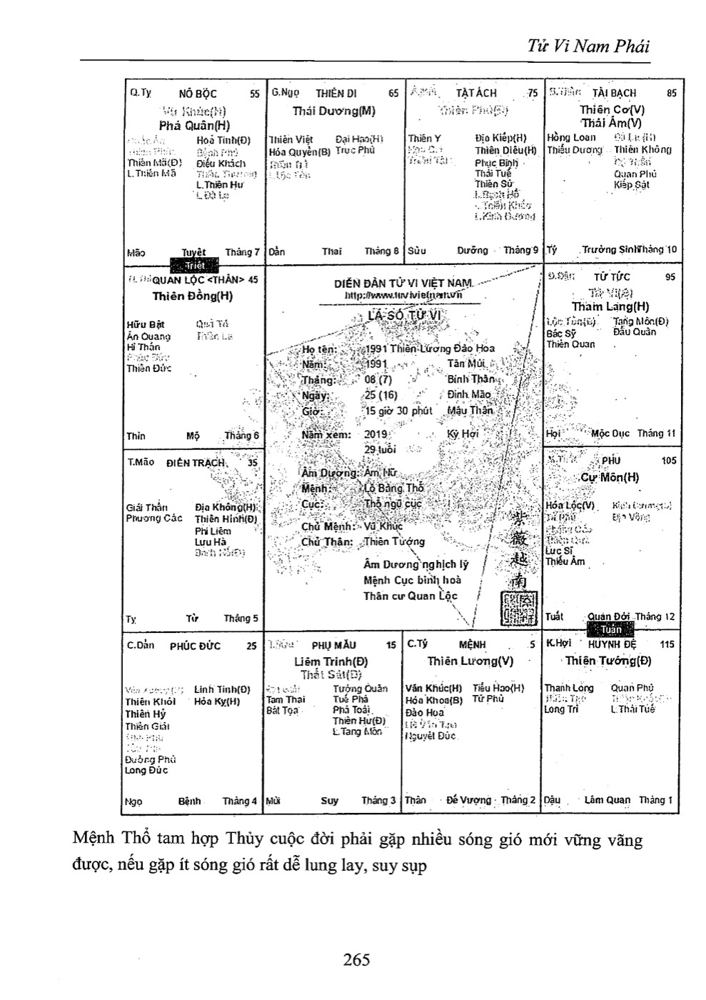

# Lá số mẫu NP1 số 7: nữ Tân Mùi, Thiên Lương Đào Hoa

> **Phần:** Lá số mẫu › NP1
> **Trả lời câu hỏi:** "Nữ mệnh Thiên Lương Đào Hồng hợp nghề gì?" · "Phúc có Hóa Kỵ ảnh hưởng gì tới hôn nhân?" · "Phụ Mẫu có Thất Sát thế nào?"
> **Từ khóa:** Thiên Lương, Đào Hoa, Hóa Khoa, Văn Khúc hãm, Nguyệt Đức, Phúc Hóa Kỵ, Thân cư Quan, Tân Mùi
> **Nguồn chính:** NP1 tr.265–268 (`05_La-so-mau/07_La-so-mau-7.md`)

## Tóm tắt
Nữ Âm Tân Mùi, Mệnh Thiên Lương (vượng) có Văn Khúc, Hóa Khoa, Đào Hoa, Nguyệt Đức; Thân cư Quan Lộc (Thiên Đồng). Bài giảng luận dung mạo, thiên hướng nghệ thuật, trí tuệ, tu hành; Phúc có Hóa Kỵ nên đường duyên vất vả; giai đoạn 35–45 vợ chồng lục đục (Điền vận có Không Kiếp Hình Diệu).

## Nội dung chi tiết

### Dữ kiện (đọc từ ảnh)
Tân Mùi (1991), tháng 7 Bính Thân, ngày 16 Đinh Mão, giờ Mậu Thân (15h30); Âm Nữ; bản mệnh Lộ Bàng Thổ; Thổ ngũ cục; Chủ Mệnh Vũ Khúc, Chủ Thân Thiên Tướng; "Âm Dương nghịch lý, Mệnh Cục bình hòa, Thân cư Quan Lộc". Năm xem 2019, 29 tuổi.

### Bố trí sao chính (đọc từ ảnh)
- **Mệnh:** Thiên Lương (Vượng), Văn Khúc (Hãm), Hóa Khoa, Đào Hoa, Tiểu Hao, Tử Phù, Nguyệt Đức; cung Đế Vượng.
- **Thân/Quan Lộc:** Thiên Đồng (Hãm), Hữu Bật, Ân Quang, Hỉ Thần, Thiên Đức, Triệt.
- Huynh Đệ: Thiên Tướng, Thanh Long, Long Trì. Phụ Mẫu: Liêm Trinh, Thất Sát, Tướng Quân. Phúc: vô chính diệu (Linh Tinh, Hóa Kỵ, Thiên Khôi, Thiên Hỉ). Điền: vô chính diệu (Địa Không, Thiên Hình); Thiên Diêu ở Tật Ách (Mùi). Phu Thê: Cự Môn, Hóa Lộc, Lục Sĩ. Tử Tức: Tham Lang, Tang Môn. Tài Bạch: Thiên Cơ, Thái Âm, Hồng Loan, Thiên Không. Thiên Di: Thái Dương, Hóa Quyền. Nô: Vũ Khúc, Phá Quân.

### Luận theo giảng viên
- Mệnh Thổ tam hợp Thủy: "cuộc đời phải gặp nhiều sóng gió mới vững vàng". Mệnh trong tam hợp Đào Hồng: nữ sắc nước hương trời, trẻ lâu. Mệnh Đào Hoa: thanh tú, da trắng, tóc dày, thích thời trang, có sức hút.
- Thiên Lương Đào Hồng: hợp nghệ thuật (múa, đàn, hát, viết, vẽ, kiến trúc), cũng có thể học y dược. Mệnh Xương Khúc Hóa Khoa: làm việc trí tuệ cao như IT.
- Khúc Xương hãm: học khó lên cao, hợp nghề văn chương, báo chí; "đừng mong học ngành nào làm ngành đó".
- Mệnh Nguyệt Đức: tính thiện, ôn hòa; Thiên Lương Nguyệt Đức: có duyên tu hành. Mệnh giáp Long Phượng: xa quê lập nghiệp mới tốt.
- Phúc có Hóa Kỵ trong khi Mệnh Đào Hồng: chuyện một vợ một chồng suốt đời rất khó; Phúc là "môi trường tổng hòa" gồm duyên nghiệp, gia đình chồng; Hóa Kỵ ở Phúc: "yêu ai khổ đó". Kình Dương Hóa Kỵ cư Phúc: duyên chồng bị lục đục vì gia đình nhà chồng.
- Phụ Mẫu có Thất Sát: phá đường duyên và tuổi thọ cha mẹ. Phu có Cự Môn Hóa Lộc: chồng làm nghề giảng dạy, nói; Cự Môn: vợ chồng hay cãi.
- Điền có Không Kiếp Thiên Hình: nhà gần doanh trại, công an. Quan Thiên Đồng: nghề hưởng thụ (ăn uống, dịch vụ, du lịch). Thiên Di Thái Dương: đi nước ngoài liên tục; Thái Dương Hóa Quyền: ra ngoài được nhiều người biết. Tài Thiên Không: có lúc trắng tay nhưng có Đào Hồng dựng lại được.

### Vận hạn được nói đến
Giai đoạn 35–45: đại vận Điền có Không Kiếp Hình Diệu, Tang Hổ; Phu Thê có Liêm Sát: vợ chồng lục đục, đường duyên lỡ dở rồi về ở với cha mẹ.

### Bài học áp dụng
Cung Phúc là tổng hòa; Hóa Kỵ ở Phúc ảnh hưởng hôn nhân của nữ mệnh có Đào Hồng. Đào Hồng thể hiện qua ngoại hình, phong cách.

## Ví dụ cụ thể
Dữ kiện: Mệnh Thiên Lương + Đào Hồng chiếu, Phúc có Hóa Kỵ → giảng viên kết luận khó một vợ một chồng suốt đời (NP1 tr.266).

## Dị bản & lưu ý
Văn bản nói "Mệnh giáp Long Phượng" (không kiểm được trên ảnh). Bản OCR lỗi ("đích tóp").
- Đối chiếu ảnh trang 265: ô Điền Trạch (Mão) chỉ có Giải Thần, Phượng Các, Địa Không, Thiên Hình, Phi Liêm, Lưu Hà; Thiên Diêu nằm ở ô Tật Ách (Mùi).

## Liên quan
- [Thiên Lương](../04_Chinh-tinh/12_Thien-Luong/04_Nam-menh-nu-menh.md)
- [Hóa Kỵ](../05_Phu-tinh-sat-tinh-tu-hoa/03_Tu-hoa/05_Hoa-Ky.md)
- [Cung Phúc Đức](../03_Muoi-hai-cung/03_Cung-Phuc-Duc/01_Y-nghia-va-cach-xem.md)
- [Hồng Loan – Thiên Hỷ](../05_Phu-tinh-sat-tinh-tu-hoa/05_Sao-tinh-cam/02_Hong-Loan-Thien-Hy.md)
- [Mục lục](00_Muc-luc-la-so-mau.md)
