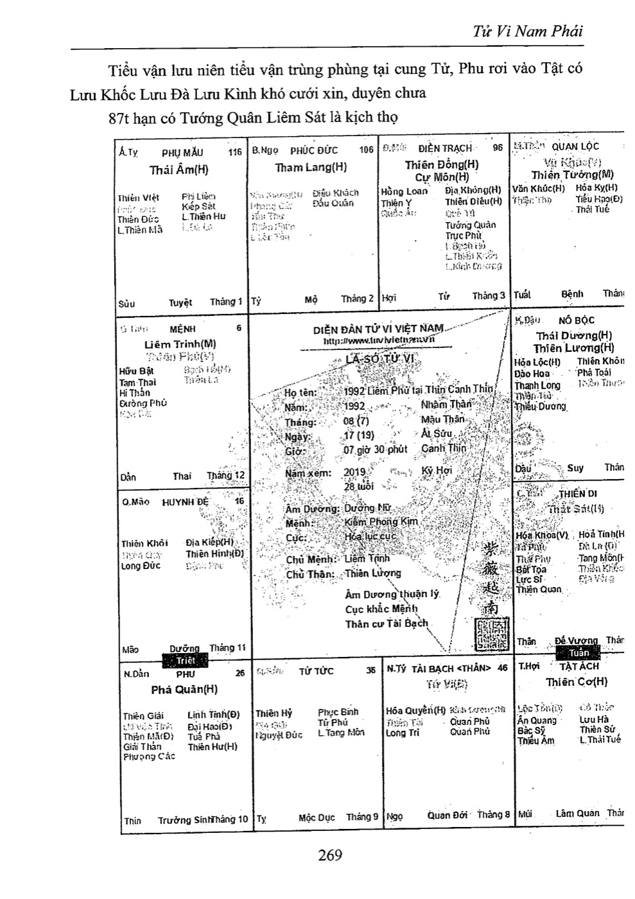

# Lá số mẫu NP1 số 8: nữ Nhâm Thân, Liêm Phủ tại Thìn, Thân cư Tài

> **Phần:** Lá số mẫu › NP1
> **Trả lời câu hỏi:** "Mệnh Liêm Phủ nữ luận thế nào?" · "Hoa Cái Bạch Hổ đồng cung có tốt không?" · "Xem tiểu vận năm cưới hỏi thế nào?"
> **Từ khóa:** Liêm Phủ, Thìn, Nhâm Thân, Hoa Cái, Bạch Hổ, Tả Hữu nhập Mệnh, Thân cư Tài, Thái Tuế cư Quan
> **Nguồn chính:** NP1 tr.269–271 (`05_La-so-mau/08_La-so-mau-8.md`)

## Tóm tắt
Nữ Dương Nhâm Thân, Mệnh Liêm Trinh Thiên Phủ tại Thìn, Thân cư Tài Bạch. Giảng viên luận: người giàu khá giả, hưởng thụ, nóng tính nhưng khí khái; Hoa Cái Bạch Hổ ở Mệnh mạnh về tình trường; Tả Hữu nhập Mệnh phải ly tông, dễ làm vợ hai; Quan Xương Khúc Hóa Kỵ nên bằng cấp bỏ xó; tiểu vận năm Hợi lấy chồng.

## Nội dung chi tiết

### Dữ kiện (đọc từ ảnh)
Nhâm Thân (1992), tháng 7 Mậu Thân, ngày 19 Ất Sửu, giờ Canh Thìn (7h30); Dương Nữ; bản mệnh Kiếm Phong Kim; Hỏa lục cục; Chủ Mệnh Liêm Trinh, Chủ Thân Thiên Lương; "Âm Dương thuận lý, Cục khắc Mệnh, Thân cư Tài Bạch". Năm xem 2019, 28 tuổi.

### Bố trí sao chính (đọc từ ảnh)
- **Mệnh:** Liêm Trinh (Miếu), Thiên Phủ (Vượng), Hữu Bật, Tam Thai, Hỉ Thần, Đường Phù, Bạch Hổ, Thiên La; cung Thai.
- Tài Bạch (Thân): chữ mờ, có Hóa Quyền, Quan Phù, Long Trì. Quan Lộc: Vũ Khúc, Thiên Tướng, Văn Khúc, Hóa Kỵ, Thái Tuế. Nô: Thái Dương, Thiên Lương, Hóa Lộc, Đào Hoa. Điền: Thiên Đồng, Cự Môn, Địa Không, Thiên Diêu. Phu Thê: Phá Quân, Linh Tinh, Đại Hao, Thiên Mã, Tuế Phá, Triệt. Phúc: Tham Lang. Phụ Mẫu: Thái Âm, Kiếp Sát. Tật: Thiên Cơ. Thiên Di: Thất Sát, Hóa Khoa, Hỏa Tinh, Đà La. Tử Tức: vô chính diệu (Thiên Hỉ, Phục Binh).

### Luận theo giảng viên
- Mệnh Liêm Phủ hai cung Thìn Tuất: giàu có khá giả; kinh doanh làm đẹp, nhà hàng, khách sạn. Liêm Trinh "đệ nhất hưởng thụ": ăn ngon mặc đẹp, nóng tính, khí khái, lúc hiền rất hiền lúc dữ vô cùng. Thiên Phủ da trắng.
- Mệnh Hoa Cái Bạch Hổ đồng cung là cách không hay chưa kể Hóa Kỵ chiếu từ Quan; Hoa Cái "cưng ai cưng lắm nhưng độ lì cao"; Mệnh Hoa Cái Thai: mạnh mẽ trong tình yêu. Mệnh Tả Hữu: phải ly tông; đàn bà dễ làm vợ hai.
- Quan có Xương Khúc Hóa Kỵ: bằng cấp bỏ xó, chuyển ngành. Vũ Khúc cư Quan: máu làm giàu. Thái Tuế cư Quan: làm đào tạo, giảng dạy; liên quan tài chính dễ ra tòa. Quan Hóa Kỵ: bon chen, áp lực.
- Nô Đào Hoa, Hóa Lộc: đi đến đâu cũng có người thích, kể cả sau khi lập gia đình. Phu Thiên Mã Long Phượng: lấy chồng phương xa, nhà chồng giàu. Phu có Tuế Phá Thiên Hư: răng xấu, giọng to. Phu xung Thái Tuế: liệu chừng dính pháp luật.
- Điền do Phu có Triệt: vợ chồng chia đôi tài sản; Không Kiếp cung Điền: nhanh mua nhanh bán. Cung Thân có Kình Dương: về già vất vả, giảm thọ.

### Vận hạn được nói đến
Tiểu vận năm Hợi có Đào Hồng Thiên Hỷ: vận cưới hỏi dù gặp Lưu Kình, Lưu Hổ, Lưu Khốc, vẫn có thể cưới cuối năm. Tiểu vận năm Tý có Tham Lang "tam vận Trúc La": làm ăn không tốt. Đại vận 26–36 Phá Quân: đi lại nhiều, hao tài. Đại vận xấu có Kình Dương: cẩn thận trắng tay, làm lại.

### Bài học áp dụng
Xét tiểu vận có Đào Hồng Hỉ cho việc cưới hỏi; lưu hạn xấu vẫn có thể thành việc vui ở cuối năm.

## Ví dụ cụ thể
Dữ kiện: nữ, Mệnh Hoa Cái + Bạch Hổ + Thai, Nô có Đào Hoa Hóa Lộc → giảng viên kết luận lắm người theo đuổi, tình trường mạnh mẽ.

## Dị bản & lưu ý
Một số cung trong ảnh bị mờ; chỉ ghi sao đọc được. OCR lỗi ("Lưu Hồ").

## Liên quan
- [Liêm Trinh](../04_Chinh-tinh/06_Liem-Trinh/04_Nam-menh-nu-menh.md)
- [Cung Phu Thê](../03_Muoi-hai-cung/11_Cung-Phu-The/01_Y-nghia-va-cach-xem.md)
- [Hồng Loan – Thiên Hỷ](../05_Phu-tinh-sat-tinh-tu-hoa/05_Sao-tinh-cam/02_Hong-Loan-Thien-Hy.md)
- [Mục lục](00_Muc-luc-la-so-mau.md)
