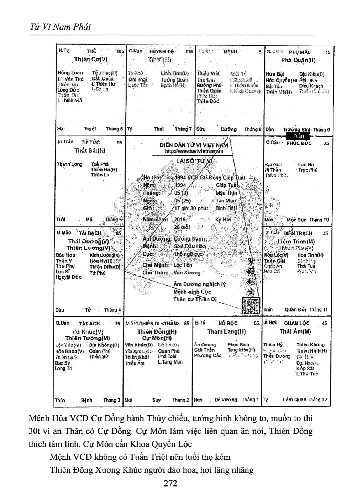

# Lá số mẫu NP1 số 9: nam Giáp Tuất, Mệnh vô chính diệu Cự Đồng chiếu

> **Phần:** Lá số mẫu › NP1
> **Trả lời câu hỏi:** "Mệnh VCD xem Thiên Di thế nào?" · "Quan có Thiên Hình Thiên Không thì Xương Khúc còn tốt không?" · "Thân có Xương Khúc Hồng Loan?"
> **Từ khóa:** Mệnh vô chính diệu, Cự Đồng, Giáp Tuất, Thiên Hình, Tam Thai Bát Tọa, Tam vận Trúc La, Thân cư Thiên Di
> **Nguồn chính:** NP1 tr.272–274 (`05_La-so-mau/09_La-so-mau-9.md`)

## Tóm tắt
Nam Dương Giáp Tuất, Mệnh vô chính diệu có Cự Đồng chiếu từ Thiên Di nơi Thân đóng. Giảng viên luận: học tốt trong thời gian ngắn, nên xuất ngoại; Quan có Thiên Hình, Thiên Không nên Xương Khúc chỉ còn "khéo, tỉ mỉ"; Điền có Phủ, Hoa Cái, Thái Tuế, Hóa Lộc tốt cho bất động sản; hạn 55–65 Tham Lang "tam vận Trúc La".

## Nội dung chi tiết

### Dữ kiện (đọc từ ảnh)
Giáp Tuất (1994), tháng 3 Mậu Thìn, ngày 25 Tân Mão, giờ Đinh Dậu (17h30); Dương Nam; bản mệnh Sơn Đầu Hỏa; Thổ ngũ cục; Chủ Mệnh Lộc Tồn, Chủ Thân Văn Xương; "Âm Dương nghịch lý, Mệnh sinh Cục, Thân cư Thiên Di". Năm xem 2019, 26 tuổi.

### Bố trí sao chính (đọc từ ảnh)
- **Mệnh:** vô chính diệu; Thiên Việt, Tấu Thư, Đường Phù, Thiên Quan, Thiên Đức, Bạch Hổ, Thiên Khốc; cung Dưỡng.
- **Thân/Thiên Di:** Thiên Đồng (Hãm), Cự Môn (Hãm), Văn Khúc, Đà La, Thiên Khôi, Quan Phủ, Phá Toái, Thiếu Âm.
- Phụ Mẫu: Phá Quân, Địa Kiếp, Hữu Bật, Hóa Quyền, Bát Tọa, Điếu Khách, Thiên Mã. Điền: Liêm Trinh, Thiên Phủ, Hóa Lộc, Hỏa Tinh, Thái Tuế, Hoa Cái. Quan Lộc: Thái Âm (Miếu), Thiên Hình, Thiên Không, Thiên Hỉ, Đại Hao, Kiếp Sát. Nô: Tham Lang. Tật Ách: Vũ Khúc, Thiên Tướng, Địa Không, Hóa Khoa, Lộc Tồn. Tài Bạch: Thái Dương, Thiên Lương, Đào Hoa, Kình Dương, Hóa Kỵ, Thiên Diêu. Phu Thê: Thiên Cơ, Hồng Loan. Huynh Đệ: Tử Vi, Tả Phù, Linh Tinh. Tử Tức: Thất Sát.

### Luận theo giảng viên
- Mệnh Hỏa VCD, Cự Đồng hành Thủy chiếu: tướng hình không to, "muốn to thì 30 tuổi vì an Thân có Cự Đồng". Cự Môn: làm việc liên quan ăn nói; Thiên Đồng: thích tâm linh; Cự Môn cần Khoa Quyền Lộc. Mệnh VCD không có Tuần Triệt nên tuổi thọ kém (câu trên ảnh).
- Mệnh giáp Tam Thai Bát Tọa: học tốt nhưng chỉ trong thời gian ngắn, nên xuất ngoại vì Thiên Di có Thiên Đồng. Mệnh được Âm Dương Xương Khúc chiếu: kinh doanh có tài. "Người muốn giàu có phải có Khúc Xương Khôi Việt."
- Quan có Thiên Hình Thiên Không: việc học bị hãm lại dù Xương Khúc đắc địa; "học hành không có công danh nên Xương Khúc chẳng có ý nghĩa gì, chỉ còn độ khéo, tỉ mỉ". Quan Thái Âm: xuất nhập khẩu, bất động sản.
- Tài Hóa Kỵ: cẩn thận tranh chấp, lừa đảo; Đào Hoa cư Tài: học công trình, xây dựng; Diêu đắc địa cư Tài: ăn chơi có mục đích.
- Thiên Di Thiên Khôi: nơi quý nhân; Xương Khúc ở Thiên Di: học đời không học nhà trường. Nô Tham Lang: môi trường đào hoa; Nô Long Phượng: bạn giàu có.
- Thế có Hồng Loan: vợ ở xa, vợ đẹp, lắm vợ; Thân có Xương Khúc thị Hồng Loan dễ lấy hai đời vợ. Huynh Đệ Tử Vi Tả Hữu: anh em khác dòng.

### Vận hạn được nói đến
Hạn 55–65 Tham Lang "tam vận Trúc La": tam hợp hạn hành Thủy, mệnh Hỏa, cẩn thận vì Mệnh VCD không có Tuần Triệt ở Tật.

### Bài học áp dụng
Với Mệnh VCD, xem Thiên Di và cung Thân. Xương Khúc đắc địa vẫn mất giá trị nếu Quan có Thiên Hình, Thiên Không.

## Ví dụ cụ thể
Dữ kiện: Mệnh VCD, Quan có Thiên Hình + Thiên Không → giảng viên kết luận việc học hạn chế, nên đi ngoài ghế nhà trường.

## Dị bản & lưu ý
OCR lỗi ("thì trường" nghĩa có thể là "thị trường" = thọ). Một số vị trí cung (Phu Thê) đọc theo ảnh.

## Liên quan
- [Nguyên tắc xem VCD](../04_Chinh-tinh/15_Menh-vo-chinh-dieu/01_Nguyen-tac-xem-VCD.md)
- [Thân cư Thiên Di](../02_Ban-menh/01_Menh-va-Than/06_Than-cu-Di.md)
- [Thiên Hình](../05_Phu-tinh-sat-tinh-tu-hoa/06_Sao-tinh-cach-khac/01_Thien-Hinh.md)
- [Mục lục](00_Muc-luc-la-so-mau.md)
