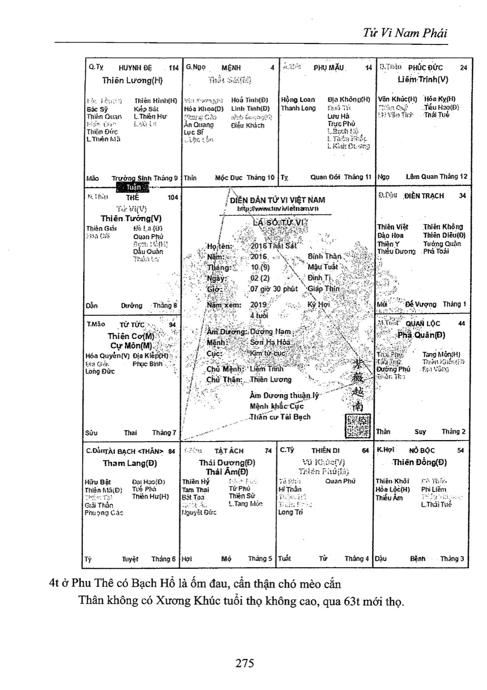

# Lá số mẫu NP1 số 10: nam Bính Thân, Thất Sát tại Mệnh (lá số trẻ nhỏ)

> **Phần:** Lá số mẫu › NP1
> **Trả lời câu hỏi:** "Thất Sát miếu địa hợp nghề gì?" · "Điếu Khách Thất Sát nên tránh gì?" · "Thân không Xương Khúc thọ ra sao?"
> **Từ khóa:** Thất Sát, Bính Thân, Hóa Khoa, Linh Hỏa, Điếu Khách, Kình Dương, Thân cư Tài, tuổi thọ
> **Nguồn chính:** NP1 tr.275–276 (`05_La-so-mau/10_La-so-mau-10.md`)

## Tóm tắt
Nam Dương Bính Thân (lá số em bé 4 tuổi vào năm xem 2019), Mệnh Thất Sát có Hóa Khoa, Linh Hỏa, Điếu Khách; Thân cư Tài Bạch (Tham Lang). Giảng viên luận tướng mạo, hợp ngành quân đội, công an, pháp lý; lưu ý cờ bạc, nợ nần; Thân không có Xương Khúc nên tuổi thọ không cao, qua 63 tuổi mới thọ.

## Nội dung chi tiết

### Dữ kiện (đọc từ ảnh)
Bính Thân (2016), tháng 9 Mậu Tuất, ngày 2 Đinh Tỵ, giờ Giáp Thìn (7h30); Dương Nam; bản mệnh Sơn Hạ Hỏa; Kim tứ cục; Chủ Mệnh Liêm Trinh, Chủ Thân Thiên Lương; "Âm Dương thuận lý, Mệnh khắc Cục, Thân cư Tài Bạch". Năm xem 2019, 4 tuổi.

### Bố trí sao chính (đọc từ ảnh)
- **Mệnh:** Thất Sát, Hỏa Tinh, Hóa Khoa, Linh Tinh, Ân Quang, Điếu Khách, Lục Sĩ; cung Mộc Dục.
- **Thân/Tài Bạch:** Tham Lang (Đắc), Hữu Bật, Đại Hao, Thiên Mã, Tuế Phá, Thiên Hư, Giải Thần, Phượng Các.
- Phu Thê: Thiên Tướng. Huynh Đệ: Thiên Lương, Thiên Hình, Kiếp Sát, Thiên Quan. Phụ Mẫu: vô chính diệu (Hồng Loan, Địa Không, Thanh Long). Phúc: Liêm Trinh, Văn Khúc, Hóa Kỵ. Điền: vô chính diệu (Thiên Không, Đào Hoa, Thiên Diêu). Quan: Phá Quân. Nô: Thiên Đồng, Thiên Khôi, Hóa Lộc. Thiên Di: Vũ Khúc, Thiên Phủ. Tật: Thái Dương, Thái Âm. Tử: Thiên Cơ, Cự Môn, Hóa Quyền, Địa Kiếp.

### Luận theo giảng viên
- Thất Sát miếu địa: thân to người lớn, mặt lộ xương, mắt to, tính nóng, bộc trực ở cái miệng; "số cô đơn cô độc". Hợp quân đội, công an, pháp lý, viện kiểm sát, tòa án.
- Mệnh Kình Dương/Lưu Kình: đi hơi gù; "Kình Dương Lưu Kình nhập Mệnh tai họa họa tại". Mệnh Điếu Khách: chi tiêu phóng khoáng, tránh cờ bạc, nợ nần; Điếu Khách Thất Sát nên tránh bạn ăn chơi. Mệnh Linh Hỏa đắc địa nhưng thọ giảm nhiều.
- Mệnh Xương Khúc Hóa Khoa: học giỏi, thông minh. Phong Cáo: có quyền uy; Ân Quang: phù trì người khác, thư ký cho lãnh đạo, nhiều Phật tính.
- Tài có Thiên Mã Long Phượng: dễ kiếm tiền; Tài Tham Lang song Hao: dễ ăn chơi. Thiên Di Vũ Phủ: kín đáo, có tiền không ai biết. Thê Thiên Tướng: vợ ôn hòa, nhẫn nhịn. Huynh Đệ Đào Hồng Thiên Không: anh em mỗi người một xứ. Phúc Lâm Quan: nhà tốt phước; Phúc Hóa Kỵ: còn oán nghiệt, họ hàng chưa đoàn kết. Âm Dương chiếu Điền: có đất đai nhà cửa. Tật có Thiên Hình chiếu: lần gãy tay què chân. Thân có Thiên Mã: về già chung thân bôn tẩu.

### Vận hạn được nói đến
- 4 tuổi ở Phu Thê có Bạch Hổ: ốm đau, cẩn thận chó mèo cắn.
- 19 tuổi Không Kiếp Phục Binh: cẩn thận đánh nhau ngoài đường; vận 14 Không Kiếp Đào Hồng: có tình yêu.
- Thân không có Xương Khúc: tuổi thọ không cao, qua 63 tuổi mới thọ (NP1 tr.275).

### Bài học áp dụng
Lá số trẻ em vẫn luận cả đời. Chú ý cặp "Mệnh Điếu Khách – Thất Sát": ăn chơi, bạn bè xấu.

## Ví dụ cụ thể
Dữ kiện: Thất Sát miếu địa + Linh Hỏa + Điếu Khách → kết luận hợp ngành quân đội, pháp lý; kỵ cờ bạc.

## Dị bản & lưu ý
Văn bản có "Ất ở Phu Thê" (OCR lỗi cho "4t ở Phu Thê"), "Tigười hay glen" (lỗi nặng); đã sửa theo ngữ cảnh. Ảnh ghi Thất Sát (độ sáng mờ).

## Liên quan
- [Thất Sát](../04_Chinh-tinh/13_That-Sat/04_Nam-menh-nu-menh.md)
- [Hỏa Tinh – Linh Tinh](../05_Phu-tinh-sat-tinh-tu-hoa/02_Luc-sat-tinh/03_Hoa-Tinh-Linh-Tinh.md)
- [Điếu Khách](../05_Phu-tinh-sat-tinh-tu-hoa/06_Sao-tinh-cach-khac/11_Cac-sao-khac.md)
- [Mục lục](00_Muc-luc-la-so-mau.md)
