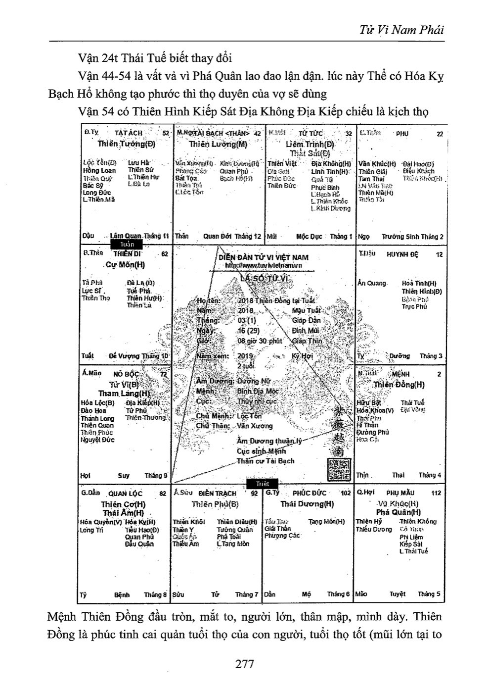

# Lá số mẫu NP1 số 11: nữ Mậu Tuất, Thiên Đồng, Thái Tuế, Hoa Cái

> **Phần:** Lá số mẫu › NP1
> **Trả lời câu hỏi:** "Mệnh Thái Tuế Hoa Cái luận thế nào?" · "Thiên Đồng hãm nữ mệnh ra sao?" · "Mã chiếu Thiên Di đi nước ngoài?"
> **Từ khóa:** Thiên Đồng, Thái Tuế, Hoa Cái, Hóa Khoa, Song Hao, Tuần ở Thiên Di, Mậu Tuất, Thân cư Tài
> **Nguồn chính:** NP1 tr.277–280 (`05_La-so-mau/11_La-so-mau-11.md`)

## Tóm tắt
Nữ Dương Mậu Tuất (lá số bé 2 tuổi năm 2019), Mệnh Thiên Đồng (hãm) có Hóa Khoa, Thái Tuế, Hoa Cái; Thân cư Tài (Thiên Lương). Giảng viên luận: nhẹ nhàng, nghệ sĩ, Thái Tuế độc lập, học giỏi; Thiên Di có Tuần nên giảm tai họa; Tật có Quang Quý; cùng nhiều chi tiết cung Phu và Quan Hóa Kỵ song Hao.

## Nội dung chi tiết

### Dữ kiện (đọc từ ảnh)
Mậu Tuất (2018), tháng 1 Giáp Dần, ngày 29 Đinh Mùi, giờ Giáp Thìn (8h30); Dương Nữ; bản mệnh Bình Địa Mộc; Thủy nhị cục; Chủ Mệnh Lộc Tồn, Chủ Thân Văn Xương; "Âm Dương thuận lý, Cục sinh Mệnh, Thân cư Tài Bạch". Năm xem 2019, 2 tuổi.

### Bố trí sao chính (đọc từ ảnh)
- **Mệnh:** Thiên Đồng (Hãm), Hữu Bật, Hóa Khoa, Thái Phụ, Hỉ Thần, Đường Phù, Hoa Cái, Thái Tuế, Địa Võng; cung Thai.
- **Thân/Tài Bạch:** Thiên Lương (Miếu), Văn Xương, Kình Dương, Phong Cáo, Quan Phù, Bát Tọa, Lộc Tồn, Bạch Hổ.
- Phụ Mẫu: Vũ Khúc, Phá Quân. Phúc: Thái Dương, Tang Môn. Điền: Thiên Phủ. Quan: Thiên Cơ, Thái Âm, Hóa Quyền, Hóa Kỵ. Nô: Tử Vi, Tham Lang, Hóa Lộc, Địa Kiếp, Đào Hoa. Thiên Di: Cự Môn, Đà La, Tuế Phá, Thiên Hư, Tuần. Tật: Thiên Tướng. Tử: Liêm Trinh, Thất Sát, Địa Không, Linh Tinh. Phu Thê: vô chính diệu (Văn Khúc, Đại Hao, Thiên Mã, Điếu Khách).

### Luận theo giảng viên
- Mệnh Thiên Đồng: đầu tròn, mắt to, thân mập; phúc tinh cai quản tuổi thọ. Thiên Đồng chủ hưởng thụ: nữ thích làm đẹp, lả lướt, ăn nói dịu dàng; Thiên Đồng lạc hãm: ham chơi, tính nghệ sĩ.
- Mệnh Thái Tuế: lý luận, ăn nói, độc lập, nghị lực, muốn đứng đầu; tính xấu là ăn thua. Hợp giáo dục, luật, hành chính, ngoại giao. Mệnh Hoa Cái Thái Tuế: không nể phục ai, làm bác sĩ giỏi. Hoa Cái là lọng che sĩ tử đi thi; Mệnh Hỏa Khoa Xương Khúc học giỏi, đạt nhiều giải.
- Mệnh Hóa Khoa: học ít biết nhiều. Mệnh Thai Phụ: khoan dung; Mệnh Đường Phù: đi thi đấu nhiều giải.
- Quan Hóa Kỵ song Hao: về sau ra làm tự do; song Hao đắc địa: xuất nhập khẩu, hàng không. Mệnh ôm vòng Thái Tuế, Quan Phù: người nắm luật, đứng đầu.
- Phúc Thái Dương, Phúc Mộ, Phúc Long Phượng: gia đình tấn tới; Phúc Tang Hổ: lo cho mọi người. Nô Hóa Lộc: biết dùng người, thích nấu ăn gọi bạn.
- Mã chiếu Thiên Di: đi học, định cư, lấy chồng nước ngoài. Thiên Di có Tuần: giảm tai họa; Thiên Di Cự Tuần: ít nói, kín tiếng. Tật gặp Tuần: ít ốm. Tật Lưu Hà: sinh con phải mổ, băng huyết, đề phòng sông nước. Tật Quang Quý: họa đến có người giúp; Thiên Tướng cư Tật: bệnh ngoài da, đường ruột.
- Thiên Di Cự Đà Tấu Tuế: "mỏi mòn chầu chực công môn", nên theo ngành luật pháp. Phu Thiên Mã: quen nhau xứ xa, định cư nước ngoài; Phu Mã Khốc Khách: chồng kinh doanh giỏi; Phu Văn Tinh: chồng học giỏi. Mệnh nhị hợp Đào Hồng, Tử Không Kiếp Linh Hỏa: dễ có tình yêu bên ngoài rồi quay về.

### Vận hạn được nói đến
Vận 24 tuổi Thái Tuế biết thay đổi; vận 44–54 vất vả vì Phá Quân lao đao, lúc này Thê có Hóa Kỵ Bạch Hổ: "không tạo phước thì thọ duyên của vợ sẽ dùng"; vận 54 Thiên Hình Kiếp Sát Địa Không Địa Kiếp chiếu là kịch thọ; vận Liêm Sát giai đoạn hơi vất vả (NP1 tr.277–280).

### Bài học áp dụng
Thái Tuế ở Mệnh là cách độc lập, chống đối, hợp luật; Tuần ở Di và Tật ngăn bệnh tai họa. Lá số trẻ em vẫn luận đủ các cung.

## Ví dụ cụ thể
Dữ kiện: Tuần ở Thiên Di và Tật → giảng viên kết luận ít ốm đau, giảm tai họa khi ra ngoài.

## Dị bản & lưu ý
Văn bản nêu "Phu Cơ Âm: chồng hiền lành" nhưng ảnh cho thấy Cơ Âm ở Quan Lộc; lời "Thê có Hóa Kỵ Bạch Hổ" ở phần vận 44–54 không thấy trong cung Phu (ảnh). Ghi nguyên văn.

## Liên quan
- [Thái Tuế](../06_Cac-vong-sao/01_Vong-Thai-Tue/01_Thu-tu-va-y-nghia-12-sao.md)
- [Thiên Đồng](../04_Chinh-tinh/05_Thien-Dong/04_Nam-menh-nu-menh.md)
- [Tuần Triệt ở cung chiếu](../07_Tuan-Triet/03_Tuan-Triet-o-Menh-va-cung-chieu.md)
- [Hoa Cái](../05_Phu-tinh-sat-tinh-tu-hoa/06_Sao-tinh-cach-khac/09_Hoa-Cai-Thien-Duc-Nguyet-Duc-Giai-than.md)
- [Mục lục](00_Muc-luc-la-so-mau.md)
