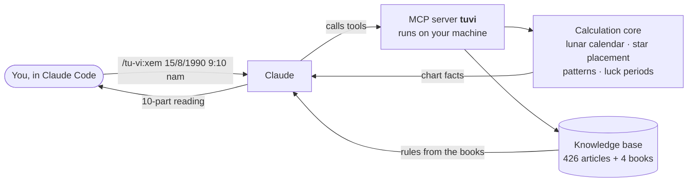
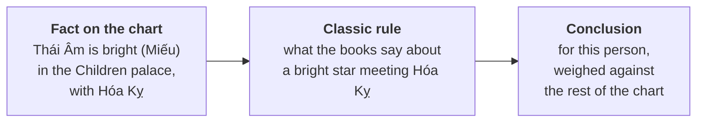
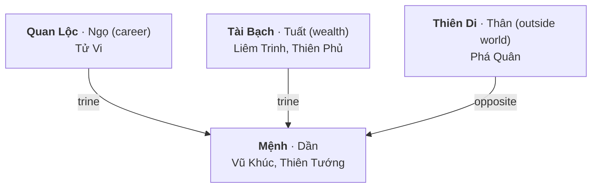
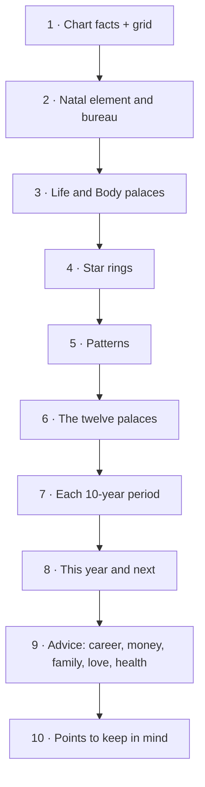
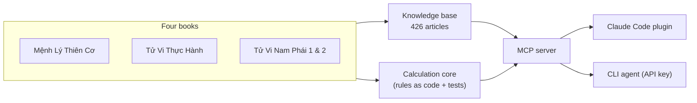

# Tử Vi Nam Phái

**English** · [Tiếng Việt](README.vi.md)

Read a Vietnamese Tử Vi (Zi Wei Dou Shu, Southern school) birth chart **inside Claude**, with every calculation done by code that follows the classic books — not guessed by the AI.

- **Claude Code plugin**: build a chart, interpret it, check yearly luck, compare two people. No API key needed.
- **Knowledge base**: 426 short articles, each answering one question, distilled from four Tử Vi Nam Phái books.
- **The four source books** as searchable text, split by chapter.
- **A TypeScript agent** for people who prefer the Claude API.

> All answers are written in Vietnamese, the language of the source books.

## How it works



Claude never computes a star position or a lunar date itself. It asks the local server, which follows the books' placement rules, then explains the result in plain language:



## Quick start (Claude Code)

You need [Claude Code](https://claude.com/claude-code) and [Node.js](https://nodejs.org) 22 or later.

**1. Install the plugin** (in a terminal):

```bash
claude plugin marketplace add baobeta/tuvinamphai
claude plugin install tu-vi@tuvinamphai
```

or inside Claude Code:

```
/plugin marketplace add baobeta/tuvinamphai
/plugin install tu-vi@tuvinamphai
```

**2. Start a new Claude Code session** and try:

| You want | Type |
|---|---|
| A full reading (solar date) | `/tu-vi:xem 15/8/1990 9:10 nam` |
| A full reading (lunar date, hour as a branch) | `/tu-vi:xem âm 25/6/1990 Tỵ nữ Lan` |
| Born in a leap month | `/tu-vi:xem âm nhuận 10/2/2023 Thìn nam` |
| One question | "Lá số của tôi (15/8/1990, 9h10, nam) năm 2027 thế nào?" |
| Find good years | "Từ 2025 đến 2035 năm nào thuận cho việc cưới hỏi?" |
| Compatibility | "So lá số của tôi với người sinh 3/2/1992, 20h, nữ" |
| Unsure of birth hour | "Tôi sinh khoảng 7 đến 10 giờ sáng, giúp tôi soát giờ" |

`nam` = male, `nữ` = female, `âm` = lunar calendar. The first time Claude uses a plugin tool, Claude Code asks for permission; allow it. `/tu-vi:xem` is pre-approved.

## Demo

All output below is real, produced by the plugin for a sample birth: **15 August 1990, 9:10 am, male** (not a real person).

### The chart (12 palaces)

The classic square layout: each cell is a palace with its role, stem-branch, the age its 10-year period starts (`ĐH`), main stars with brightness and transformations, then minor stars. The centre holds the birth data.

```
┌──────────────────────┬──────────────────────┬──────────────────────┬──────────────────────┐
│ ĐIỀN TRẠCH           │ QUAN LỘC [Triệt]     │ NÔ BỘC [Triệt]       │ THIÊN DI             │
│ Tân Tỵ · ĐH 35       │ Nhâm Ngọ · ĐH 45     │ Quý Mùi · ĐH 55      │ Giáp Thân · ĐH 65    │
│ Thiên Cơ (Bình)      │ Tử Vi (Miếu)         │ (vô chính diệu)      │ Phá Quân (Hãm)       │
│ ──────               │ ──────               │ ──────               │ ──────               │
│ Văn Xương, Hữu Bật,  │ Thiên Khôi,          │ Phong Cáo, Đà La,    │ Lộc Tồn, Lưu Hà,     │
│ Bát Tọa, Phá Toái,   │ Thiên Phúc, Lưu Tù,  │ Thiên Không,         │ Thiên Mã, Thiên Tài, │
│ Đại Hao, Tuyệt,      │ Thiên Thọ,           │ Thiên Thương,        │ Cô Thần, Bác Sĩ,     │
│ Trực Phù             │ Thiên Diêu, Thiên Y, │ Quan Phủ, Dưỡng,     │ Tràng Sinh, Tang Môn │
│                      │ Địa Không, Hỏa Tinh, │ Thiếu Dương          │                      │
│                      │ Đẩu Quân, Phục Binh, │                      │                      │
│                      │ Thai, Thái Tuế       │                      │                      │
├──────────────────────┼──────────────────────┴──────────────────────┼──────────────────────┤
│ PHÚC ĐỨC             │                                             │ TẬT ÁCH              │
│ Canh Thìn · ĐH 25    │                                             │ Ất Dậu · ĐH 75       │
│ Thất Sát (Hãm)       │                                             │ (vô chính diệu)      │
│ ──────               │                                             │ ──────               │
│ Ân Quang, Quốc Ấn,   │                                             │ Văn Khúc, Tả Phụ,    │
│ Phượng Các,          │                                             │ Tam Thai,            │
│ Giải Thần, Quả Tú,   │                 LÁ SỐ TỬ VI                 │ Kình Dương,          │
│ Địa Kiếp, Thiên La,  │       Dương lịch: 15/8/1990 lúc 09:10       │ Hồng Loan,           │
│ Bệnh Phù, Mộ,        │      Âm lịch: 25/6 năm Canh Ngọ (1990)      │ Thiên Khố, Thiên Sứ, │
│ Điếu Khách           │             Giờ Tỵ · Dương Nam              │ Lực Sĩ, Mộc Dục,     │
│                      │            Bản mệnh: Lộ Bàng Thổ            │ Thiếu Âm             │
├──────────────────────┤              Cục: Thổ ngũ cục               ├──────────────────────┤
│ PHỤ MẪU              │      Thổ và Thổ đồng hành (tương hòa)       │ TÀI BẠCH [Tuần]      │
│ Kỷ Mão · ĐH 15       │              Mệnh chủ: Lộc Tồn              │ Bính Tuất · ĐH 85    │
│ Thái Dương (Miếu,    │             Thân chủ: Hỏa Tinh              │ Liêm Trinh (Vượng),  │
│ Hóa Lộc),            │         Mệnh Dần · Thân cư Phu Thê          │ Thiên Phủ (Miếu)     │
│ Thiên Lương (Vượng)  │                                             │ ──────               │
│ ──────               │                                             │ Thiên Quý, Hoa Cái,  │
│ Đào Hoa, Thiên Đức,  │                                             │ Long Trì, Linh Tinh, │
│ Thiên Hỷ, Hỷ Thần,   │                                             │ Địa Võng,            │
│ Tử, Phúc Đức         │                                             │ Thanh Long,          │
│                      │                                             │ Quan Đới, Quan Phù   │
├──────────────────────┼──────────────────────┬──────────────────────┼──────────────────────┤
│ MỆNH                 │ HUYNH ĐỆ             │ PHU THÊ · THÂN       │ TỬ TỨC [Tuần]        │
│ Mậu Dần · ĐH 5       │ Kỷ Sửu · ĐH 115      │ Mậu Tý · ĐH 105      │ Đinh Hợi · ĐH 95     │
│ Vũ Khúc (Đắc, Hóa    │ Thiên Đồng (Hãm, Hóa │ Tham Lang (Bình)     │ Thái Âm (Miếu, Hóa   │
│ Quyền),              │ Khoa), Cự Môn (Hãm)  │ ──────               │ Kỵ)                  │
│ Thiên Tướng (Miếu)   │ ──────               │ Thiên Khốc,          │ ──────               │
│ ──────               │ Đường Phù,           │ Thiên Hư, Địa Giải,  │ Thai Phụ,            │
│ Thiên Việt,          │ Thiên Giải, Tấu Thư, │ Tướng Quân,          │ Thiên Quan,          │
│ Thiên Trù,           │ Suy, Long Đức        │ Đế Vượng, Tuế Phá    │ LN Văn Tinh,         │
│ Thiên Hình,          │                      │                      │ Kiếp Sát,            │
│ Phi Liêm, Bệnh,      │                      │                      │ Nguyệt Đức,          │
│ Bạch Hổ              │                      │                      │ Tiểu Hao, Lâm Quan,  │
│                      │                      │                      │ Tử Phù               │
└──────────────────────┴──────────────────────┴──────────────────────┴──────────────────────┘
```

How to read it: the Life palace (`MỆNH`) is at Dần, bottom left. Its "three sides and four squares" — the palaces Claude always reads together — are:



### One year at a glance (2026)

```
# Vận hạn năm Bính Ngọ (2026) · 37 tuổi âm
- Đại hạn: cung Điền Trạch (Tỵ), từ 35 đến 44 tuổi
- Tiểu hạn: cung Phúc Đức (Thìn)
- Tứ Hóa lưu niên (can Bính): Thiên Đồng Hóa Lộc tại Huynh Đệ (Sửu) · Thiên Cơ Hóa Quyền tại
  Điền Trạch (Tỵ) · Văn Xương Hóa Khoa tại Điền Trạch (Tỵ) · Liêm Trinh Hóa Kỵ tại Tài Bạch (Tuất)
```

The 10-year period (`Đại hạn`), the 1-year period (`Tiểu hạn`) and the year's four transformations, each landing in a palace of the birth chart.

### Scanning ten years in one call

"Which years from 2025 to 2034 favour marriage?" The plugin checks every year against the marriage rules from the books in about 5 ms (selected rows; decade-level codes omitted):

| Năm | Can chi | Tuổi | Đại hạn | Tiểu hạn | Khớp |
|---|---|---|---|---|---|
| 2025 | Ất Tỵ | 36 | Tỵ (Điền Trạch) | Mão (Phụ Mẫu) | C5 C8 |
| 2029 | Kỷ Dậu | 40 | Tỵ (Điền Trạch) | Mùi (Nô Bộc) | C6 |
| 2031 | Tân Hợi | 42 | Tỵ (Điền Trạch) | Dậu (Tật Ách) | C3 |
| 2032 | Nhâm Tý | 43 | Tỵ (Điền Trạch) | Tuất (Tài Bạch) | C7 C9 C13 |

Each code is one rule from the books (for example C5: Đào Hoa and Hồng Loan together with the Sun and Moon around the year's spouse palace). Good and bad rules are counted separately, so a year with a warning is never ranked as favourable.

### A full reading

`/tu-vi:xem` makes Claude gather the facts with the tools first, then write ten sections:



Two passages from a real reading Claude wrote with `/tu-vi:xem 15/8/1990 9:10 nam` (verbatim, in Vietnamese). Full reading: [docs/demo/xem-la-so-15-8-1990.md](docs/demo/xem-la-so-15-8-1990.md).

<details>
<summary><b>Part 3.1 · The Life palace</b> (fact → classic rule → conclusion)</summary>

### 3.1. Cung Mệnh (Dần): Vũ Khúc (Đắc, Hóa Quyền) và Thiên Tướng (Miếu)

**Chính tinh.**
- Vũ Khúc là sao tài, mang tính cương quyết và thực tế. Thiên Tướng là sao "ấn", chủ sự giúp đỡ, công bằng và trách nhiệm.
- Theo phép xem Tử Vi, Vũ Tướng ở Dần hoặc Thân là **người làm việc vất vả, phụ tá giỏi, có tay nghề, cả đời không lo đói**.
  - Nếu hội Tả Phù, Hữu Bật, Văn Xương, Văn Khúc thì nắm được quyền.
  - Nếu hội Lộc Tồn, Thiên Mã thì **làm giàu rồi về quê**.
- Lá số này có Lộc Tồn và Thiên Mã ở cung Thiên Di, đối diện chiếu thẳng về Mệnh. Vì vậy câu "Lộc Mã thì phát tài hoàn hương" ứng khá sát: anh có xu hướng phải **ra ngoài, đi xa mới kiếm được tiền**.

**Hóa Quyền trên Vũ Khúc.** Hóa Quyền là sao quyền lực, đi với Vũ Khúc là sao tài. Hai sao này cho tính **quyết đoán, muốn tự chủ và nắm việc**, đặc biệt là việc tiền nong và quản lý. Đây là điểm sáng nhất của cung Mệnh.

</details>

<details>
<summary><b>Part 9 · Career advice</b> (each piece of advice is tied to a fact on the chart)</summary>

### Sự nghiệp và công việc

**Nên làm:**
- Anh nên **chọn vai trò quản lý vận hành, tài chính, kỹ thuật, pháp chế hoặc đào tạo**, là những việc cần kỷ luật và trách nhiệm. Lý do: Vũ Tướng, Hóa Quyền, Hổ hàm kiếm và bộ Tuế Hổ Phù đều chỉ về tính chính trực, quyết đoán, hợp nghề có quy tắc.
- Anh nên **chủ động tìm việc cần đi lại, làm với đối tác bên ngoài, hoặc công tác xa**, vì Lộc Tồn và Thiên Mã ở Thiên Di cho thấy tiền đến từ bên ngoài.
- Anh nên **kiên nhẫn xây nền trong giai đoạn 35–44 tuổi để đón đại hạn 45–54**, khi Tử Vi miếu Hóa Quyền về đúng cung sự nghiệp. Đó mới là lúc nên nhận trách nhiệm lớn nhất.
- Anh nên **quý và giữ quan hệ với bề trên, thầy và người đi trước**, vì Phụ Mẫu có Nhật Lương sáng, Hóa Lộc, và Mệnh được giáp Khoa Lộc.

**Nên tránh:**
- Anh nên **tránh nhảy việc hoặc đổi ngành liên tục chỉ vì chán**. Triệt và Địa Không ở Quan Lộc cho thấy đổi hướng là khó tránh, nhưng mỗi lần đổi đều tốn công. Hãy đổi có kế hoạch.
- Anh nên **tránh va chạm trực diện với cấp trên trong năm 2026**, vì lưu Thái Tuế, lưu Kình và Hỏa Tinh cùng tụ ở Quan Lộc.
- Anh nên **tránh nhận việc ký thay, bảo lãnh, đứng tên giấy tờ cho người khác trong giai đoạn 35–44 tuổi**, vì Văn Xương Hóa Kỵ nằm ngay ở cung đại hạn.

</details>

## Accuracy

- Star placement follows *Tử Vi Thực Hành*, cross-checked with *Mệnh Lý Thiên Cơ*.
- Tested against **29 sample charts** printed in the books: all 888 star positions match, plus the four transformations, Life and Body palaces, bureau, and the patterns the books name.
- Lunar calendar uses Hồ Ngọc Đức's astronomical algorithm. Dates before 1968 use UTC+8, the calendar Vietnam used at the time; from 1968, UTC+7.
- Where the books disagree (for example the Canh-year transformations), the choice is an option, and the reading says which points are uncertain.
- 2,200+ automated tests.

## What's in this repo

| Folder | Contents |
|---|---|
| [`tu-vi-plugin/`](tu-vi-plugin) | The Claude Code plugin: prebuilt MCP server (runs with `node`), data, `/tu-vi:xem` command, skill |
| [`Kien-thuc-Tu-Vi-Nam-Phai/`](Kien-thuc-Tu-Vi-Nam-Phai/README.md) | Knowledge base, 426 articles in 13 branches: chart building, natal element, 12 palaces, main stars, minor stars, star rings, Tuần/Triệt, palace relations, patterns, luck periods, topics, principles, sample charts |
| [`agent/`](agent/README.md) | TypeScript source: calculation core, 29 tools, MCP server, command-line agent, tests |
| `Menh-Ly-Thien-Co_Tu-Vi-Nam-Phai/`, `Tu-Vi-Thuc-Hanh/`, `Tu-Vi-Nam-Phai_Phan-1/`, `Tu-Vi-Nam-Phai_Phan-2/` | Text of the four books, split by chapter |



| Book | Original | Notes |
|---|---|---|
| [Mệnh Lý Thiên Cơ – Tuyển tập Tử Vi Nam Phái](Menh-Ly-Thien-Co_Tu-Vi-Nam-Phai/README.md) (Lê Quang Lăng) | text PDF, 1000 pages | 5 chapters, 139 sections |
| [Tử Vi Thực Hành](Tu-Vi-Thuc-Hanh/README.md) (Dịch Lý Huyền Cơ) | text PDF, 201 pages | 8 parts, 132 sections, sample chart images |
| [Tử Vi Nam Phái – Phần 1](Tu-Vi-Nam-Phai_Phan-1/README.md) | scanned PDF, 282 pages | OCR text, may contain typos |
| [Tử Vi Nam Phái – Phần 2](Tu-Vi-Nam-Phai_Phan-2/README.md) | scanned PDF, 286 pages | OCR text, may contain typos |

## Other ways to use it

**Command-line agent (needs a Claude API key):**

```bash
cd agent
pnpm install
cp .env.example .env        # set ANTHROPIC_API_KEY
pnpm dev                    # then type: /xem 15/8/1990 9:10 nam
```

**Call a single tool, no API key** (for testing):

```bash
cd agent && pnpm install
pnpm tool --list
pnpm tool build_chart '{"birth":{"calendar":"solar","year":1990,"month":8,"day":15,"hour":9,"minute":10,"gender":"nam"}}' \
          render_chart_grid '{"chart_id":"@last"}'
```

**Change the code or knowledge base, then install the plugin from your copy:**

```bash
cd agent && pnpm install && pnpm test && pnpm build:plugin
cd .. && claude plugin marketplace add "$(pwd)"
claude plugin install tu-vi@tuvinamphai
```

Architecture and every tool: [agent/README.md](agent/README.md) (Vietnamese).

## Notes

- Tử Vi is for reflection, not prediction. A reading is no substitute for medical, legal or financial advice.
- Copyright of the four books belongs to their authors and publishers; the text here is for study.
- Charts you build are saved on your machine (the plugin's data folder) and are not sent anywhere beyond your own Claude session.
