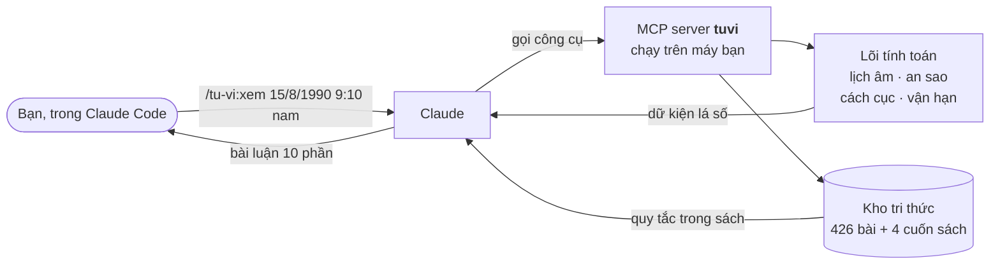
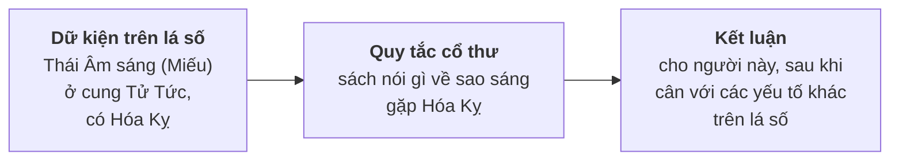
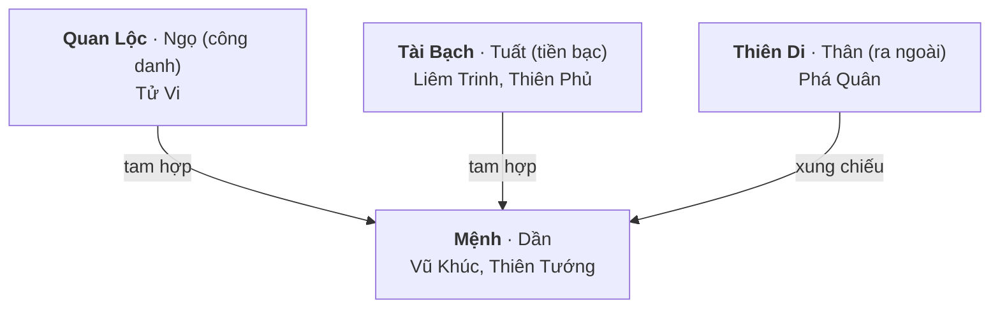
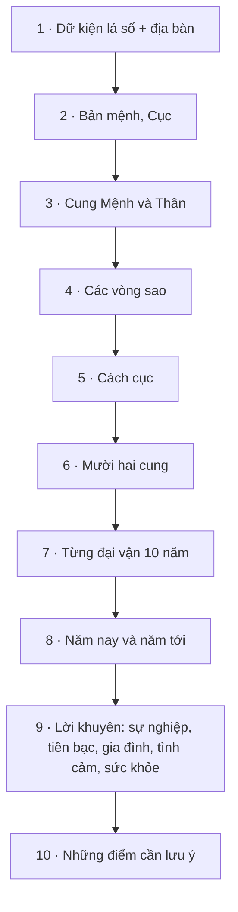
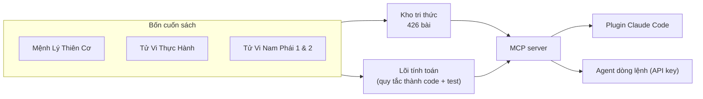

# Tử Vi Nam Phái

[English](README.md) · **Tiếng Việt**

Xem lá số Tử Vi Nam Phái **ngay trong Claude**. Mọi phép tính đều do code thực hiện theo quy tắc trong sách, không để AI tự nhẩm.

- **Plugin cho Claude Code**: lập lá số, luận giải, xem vận hạn, so hai lá số. Không cần API key.
- **Kho tri thức** 426 bài ngắn, mỗi bài trả lời một câu hỏi, tổng hợp từ bốn cuốn sách Tử Vi Nam Phái.
- **Bản chữ của bốn cuốn sách** gốc, chia theo chương mục, tra cứu được.
- **Agent dòng lệnh** (TypeScript) cho ai muốn chạy bằng Claude API.

## Cách hoạt động



Claude không tự tính vị trí sao hay ngày âm lịch. Claude hỏi server chạy trên máy bạn, server an sao đúng theo sách, rồi Claude giải thích bằng lời thường. Mỗi ý trong bài luận đi theo ba bước:



## Bắt đầu nhanh (Claude Code)

Cần có [Claude Code](https://claude.com/claude-code) và [Node.js](https://nodejs.org) 22 trở lên.

**1. Cài plugin** (chạy trong terminal):

```bash
claude plugin marketplace add baobeta/tuvinamphai
claude plugin install tu-vi@tuvinamphai
```

Hoặc gõ ngay trong Claude Code:

```
/plugin marketplace add baobeta/tuvinamphai
/plugin install tu-vi@tuvinamphai
```

**2. Mở một phiên Claude Code mới** và dùng:

| Bạn muốn | Gõ |
|---|---|
| Xem trọn lá số (dương lịch) | `/tu-vi:xem 15/8/1990 9:10 nam` |
| Xem trọn lá số (âm lịch, giờ theo canh giờ) | `/tu-vi:xem âm 25/6/1990 Tỵ nữ Lan` |
| Sinh tháng nhuận | `/tu-vi:xem âm nhuận 10/2/2023 Thìn nam` |
| Hỏi một ý | "Lá số của tôi (15/8/1990, 9h10, nam) năm 2027 thế nào?" |
| Tìm năm thuận lợi | "Từ 2025 đến 2035 năm nào thuận cho việc cưới hỏi?" |
| Xem hợp tuổi | "So lá số của tôi với người sinh 3/2/1992, 20h, nữ" |
| Không nhớ chắc giờ sinh | "Tôi sinh khoảng 7 đến 10 giờ sáng, giúp tôi soát giờ" |

Lần đầu Claude gọi công cụ của plugin, Claude Code sẽ hỏi quyền; chọn cho phép. Lệnh `/tu-vi:xem` đã được cho phép sẵn.

## Demo

Mọi kết quả dưới đây là thật, do plugin tạo cho một ngày sinh ví dụ: **15/8/1990, 9:10 sáng, nam** (không phải người thật).

### Lá số (địa bàn 12 cung)

Bố cục vuông quen thuộc: mỗi ô là một cung, ghi tên cung, can chi, tuổi bắt đầu đại hạn (`ĐH`), chính tinh kèm độ sáng và Tứ Hóa, rồi đến phụ tinh. Ô giữa ghi dữ kiện sinh.

```
┌──────────────────────┬──────────────────────┬──────────────────────┬──────────────────────┐
│ ĐIỀN TRẠCH           │ QUAN LỘC [Triệt]     │ NÔ BỘC [Triệt]       │ THIÊN DI             │
│ Tân Tỵ · ĐH 35       │ Nhâm Ngọ · ĐH 45     │ Quý Mùi · ĐH 55      │ Giáp Thân · ĐH 65    │
│ Thiên Cơ (Bình)      │ Tử Vi (Miếu)         │ (vô chính diệu)      │ Phá Quân (Hãm)       │
│ ──────               │ ──────               │ ──────               │ ──────               │
│ Văn Xương, Hữu Bật,  │ Thiên Khôi,          │ Phong Cáo, Đà La,    │ Lộc Tồn, Lưu Hà,     │
│ Bát Tọa, Phá Toái,   │ Thiên Phúc, Lưu Tù,  │ Thiên Không,         │ Thiên Mã, Thiên Tài, │
│ Đại Hao, Tuyệt,      │ Thiên Thọ,           │ Thiên Thương,        │ Cô Thần, Bác Sĩ,     │
│ Trực Phù             │ Thiên Diêu, Thiên Y, │ Quan Phủ, Dưỡng,     │ Tràng Sinh, Tang Môn │
│                      │ Địa Không, Hỏa Tinh, │ Thiếu Dương          │                      │
│                      │ Đẩu Quân, Phục Binh, │                      │                      │
│                      │ Thai, Thái Tuế       │                      │                      │
├──────────────────────┼──────────────────────┴──────────────────────┼──────────────────────┤
│ PHÚC ĐỨC             │                                             │ TẬT ÁCH              │
│ Canh Thìn · ĐH 25    │                                             │ Ất Dậu · ĐH 75       │
│ Thất Sát (Hãm)       │                                             │ (vô chính diệu)      │
│ ──────               │                                             │ ──────               │
│ Ân Quang, Quốc Ấn,   │                                             │ Văn Khúc, Tả Phụ,    │
│ Phượng Các,          │                                             │ Tam Thai,            │
│ Giải Thần, Quả Tú,   │                 LÁ SỐ TỬ VI                 │ Kình Dương,          │
│ Địa Kiếp, Thiên La,  │       Dương lịch: 15/8/1990 lúc 09:10       │ Hồng Loan,           │
│ Bệnh Phù, Mộ,        │      Âm lịch: 25/6 năm Canh Ngọ (1990)      │ Thiên Khố, Thiên Sứ, │
│ Điếu Khách           │             Giờ Tỵ · Dương Nam              │ Lực Sĩ, Mộc Dục,     │
│                      │            Bản mệnh: Lộ Bàng Thổ            │ Thiếu Âm             │
├──────────────────────┤              Cục: Thổ ngũ cục               ├──────────────────────┤
│ PHỤ MẪU              │      Thổ và Thổ đồng hành (tương hòa)       │ TÀI BẠCH [Tuần]      │
│ Kỷ Mão · ĐH 15       │              Mệnh chủ: Lộc Tồn              │ Bính Tuất · ĐH 85    │
│ Thái Dương (Miếu,    │             Thân chủ: Hỏa Tinh              │ Liêm Trinh (Vượng),  │
│ Hóa Lộc),            │         Mệnh Dần · Thân cư Phu Thê          │ Thiên Phủ (Miếu)     │
│ Thiên Lương (Vượng)  │                                             │ ──────               │
│ ──────               │                                             │ Thiên Quý, Hoa Cái,  │
│ Đào Hoa, Thiên Đức,  │                                             │ Long Trì, Linh Tinh, │
│ Thiên Hỷ, Hỷ Thần,   │                                             │ Địa Võng,            │
│ Tử, Phúc Đức         │                                             │ Thanh Long,          │
│                      │                                             │ Quan Đới, Quan Phù   │
├──────────────────────┼──────────────────────┬──────────────────────┼──────────────────────┤
│ MỆNH                 │ HUYNH ĐỆ             │ PHU THÊ · THÂN       │ TỬ TỨC [Tuần]        │
│ Mậu Dần · ĐH 5       │ Kỷ Sửu · ĐH 115      │ Mậu Tý · ĐH 105      │ Đinh Hợi · ĐH 95     │
│ Vũ Khúc (Đắc, Hóa    │ Thiên Đồng (Hãm, Hóa │ Tham Lang (Bình)     │ Thái Âm (Miếu, Hóa   │
│ Quyền),              │ Khoa), Cự Môn (Hãm)  │ ──────               │ Kỵ)                  │
│ Thiên Tướng (Miếu)   │ ──────               │ Thiên Khốc,          │ ──────               │
│ ──────               │ Đường Phù,           │ Thiên Hư, Địa Giải,  │ Thai Phụ,            │
│ Thiên Việt,          │ Thiên Giải, Tấu Thư, │ Tướng Quân,          │ Thiên Quan,          │
│ Thiên Trù,           │ Suy, Long Đức        │ Đế Vượng, Tuế Phá    │ LN Văn Tinh,         │
│ Thiên Hình,          │                      │                      │ Kiếp Sát,            │
│ Phi Liêm, Bệnh,      │                      │                      │ Nguyệt Đức,          │
│ Bạch Hổ              │                      │                      │ Tiểu Hao, Lâm Quan,  │
│                      │                      │                      │ Tử Phù               │
└──────────────────────┴──────────────────────┴──────────────────────┴──────────────────────┘
```

Cách đọc: cung Mệnh ở Dần, góc dưới bên trái. Khi luận cung Mệnh, Claude luôn xét chung bốn cung "tam phương tứ chính":



### Vận hạn một năm (2026)

```
# Vận hạn năm Bính Ngọ (2026) · 37 tuổi âm
- Đại hạn: cung Điền Trạch (Tỵ), từ 35 đến 44 tuổi
- Tiểu hạn: cung Phúc Đức (Thìn)
- Tứ Hóa lưu niên (can Bính): Thiên Đồng Hóa Lộc tại Huynh Đệ (Sửu) · Thiên Cơ Hóa Quyền tại
  Điền Trạch (Tỵ) · Văn Xương Hóa Khoa tại Điền Trạch (Tỵ) · Liêm Trinh Hóa Kỵ tại Tài Bạch (Tuất)
```

Đại hạn mười năm, tiểu hạn một năm, và bốn sao Hóa của năm, mỗi thứ rơi vào một cung của lá số gốc.

### Quét mười năm trong một lần gọi

"Từ 2025 đến 2034 năm nào thuận cho hôn nhân?" Plugin đối chiếu từng năm với các quy tắc về hôn nhân trong sách, mất khoảng 5 ms (trích vài dòng, bỏ các mã cấp đại hạn):

| Năm | Can chi | Tuổi | Đại hạn | Tiểu hạn | Khớp |
|---|---|---|---|---|---|
| 2025 | Ất Tỵ | 36 | Tỵ (Điền Trạch) | Mão (Phụ Mẫu) | C5 C8 |
| 2029 | Kỷ Dậu | 40 | Tỵ (Điền Trạch) | Mùi (Nô Bộc) | C6 |
| 2031 | Tân Hợi | 42 | Tỵ (Điền Trạch) | Dậu (Tật Ách) | C3 |
| 2032 | Nhâm Tý | 43 | Tỵ (Điền Trạch) | Tuất (Tài Bạch) | C7 C9 C13 |

Mỗi mã là một quy tắc trong sách (ví dụ C5: Đào Hoa, Hồng Loan cùng Nhật Nguyệt quanh cung Phu Thê của năm). Quy tắc tốt và xấu được tính riêng, nên năm có điều cần lưu ý không bao giờ bị xếp là năm thuận.

### Một bài xem trọn lá số

Với `/tu-vi:xem`, Claude dùng công cụ để thu thập dữ kiện trước, rồi viết mười phần:



<!-- READING_EXCERPT -->

## Độ chính xác

- Quy tắc an sao lấy từ *Tử Vi Thực Hành*, đối chiếu *Mệnh Lý Thiên Cơ*.
- Đã so với **29 lá số mẫu** in trong sách: khớp cả 888 vị trí sao, Tứ Hóa, Mệnh, Thân, Cục và các cách cục sách gọi tên.
- Lịch âm theo thuật toán thiên văn Hồ Ngọc Đức. Ngày trước 1968 tính theo lịch UTC+8 mà người Việt dùng thời đó; từ 1968 theo UTC+7.
- Chỗ các sách nói khác nhau (ví dụ Tứ Hóa tuổi Canh) được đưa thành tùy chọn, và bài luận luôn nói rõ điểm nào chưa chắc.
- Hơn 2.200 test tự động.

## Trong repo có gì

| Thư mục | Nội dung |
|---|---|
| [`tu-vi-plugin/`](tu-vi-plugin) | Plugin Claude Code: MCP server đã build (chạy bằng `node`), dữ liệu, lệnh `/tu-vi:xem`, skill |
| [`Kien-thuc-Tu-Vi-Nam-Phai/`](Kien-thuc-Tu-Vi-Nam-Phai/README.md) | Kho tri thức 426 bài theo 13 nhánh: lập lá số, bản mệnh, 12 cung, chính tinh, phụ tinh, vòng sao, Tuần Triệt, quan hệ cung, cách cục, vận hạn, chủ đề luận, nguyên tắc, lá số mẫu |
| [`agent/`](agent/README.md) | Mã nguồn TypeScript: lõi tính toán, 29 công cụ, MCP server, agent dòng lệnh, test |
| `Menh-Ly-Thien-Co_Tu-Vi-Nam-Phai/`, `Tu-Vi-Thuc-Hanh/`, `Tu-Vi-Nam-Phai_Phan-1/`, `Tu-Vi-Nam-Phai_Phan-2/` | Bản chữ của bốn cuốn sách, chia theo chương mục |



| Sách | Bản gốc | Ghi chú |
|---|---|---|
| [Mệnh Lý Thiên Cơ – Tuyển tập Tử Vi Nam Phái](Menh-Ly-Thien-Co_Tu-Vi-Nam-Phai/README.md) (Lê Quang Lăng) | PDF có chữ, 1000 trang | 5 chương, 139 mục |
| [Tử Vi Thực Hành](Tu-Vi-Thuc-Hanh/README.md) (Dịch Lý Huyền Cơ) | PDF có chữ, 201 trang | 8 phần, 132 mục, ảnh lá số mẫu |
| [Tử Vi Nam Phái – Phần 1](Tu-Vi-Nam-Phai_Phan-1/README.md) | PDF scan, 282 trang | chữ nhận dạng bằng OCR, có thể sai chính tả |
| [Tử Vi Nam Phái – Phần 2](Tu-Vi-Nam-Phai_Phan-2/README.md) | PDF scan, 286 trang | chữ nhận dạng bằng OCR, có thể sai chính tả |

## Các cách dùng khác

**Agent dòng lệnh (cần Claude API key):**

```bash
cd agent
pnpm install
cp .env.example .env        # điền ANTHROPIC_API_KEY
pnpm dev                    # rồi gõ: /xem 15/8/1990 9:10 nam
```

**Gọi thẳng một công cụ, không cần API key** (để thử hoặc kiểm tra):

```bash
cd agent && pnpm install
pnpm tool --list
pnpm tool build_chart '{"birth":{"calendar":"solar","year":1990,"month":8,"day":15,"hour":9,"minute":10,"gender":"nam"}}' \
          render_chart_grid '{"chart_id":"@last"}'
```

**Sửa code hoặc kho rồi cài plugin từ bản trên máy mình:**

```bash
cd agent && pnpm install && pnpm test && pnpm build:plugin
cd .. && claude plugin marketplace add "$(pwd)"
claude plugin install tu-vi@tuvinamphai
```

Chi tiết kiến trúc và từng công cụ: [agent/README.md](agent/README.md).

## Lưu ý

- Tử vi chỉ để tham khảo. Bài luận không thay cho lời khuyên y tế, pháp lý hay tài chính.
- Bản quyền nội dung bốn cuốn sách thuộc về tác giả và nhà xuất bản; bản chữ trong repo phục vụ nghiên cứu.
- Lá số bạn lập được lưu trên máy bạn (thư mục dữ liệu của plugin), không gửi đi đâu ngoài phiên Claude của bạn.
