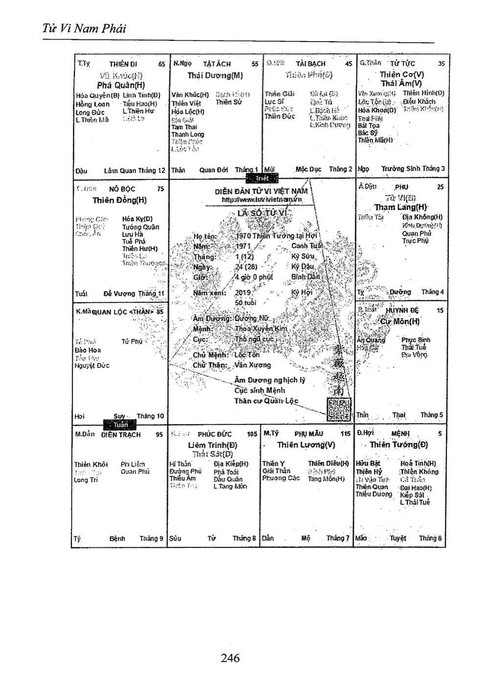

# Lá số mẫu 1

> Lá số mẫu  
> Trang sách 246–248 · *Tử Vi Nam Phái – Phần 1* (bản scan, chữ được nhận dạng OCR)

Người Thiên Tướng sống ôn hòa, ôn lương, Thiên Tướng làm nghề giáo nhưng bỏ nghề đi buôn  

Thiên Tướng tại Hợi quân tử, sống biết trước biết sau, chơi khẳng khái, nói đi đôi với làm,cung kính người ở trên khiêm cùng người ở dưới, người sống tình cảm, người có trí tuệ, đam mê kiến thức.  

Đàn bà Thiên Tướng thay chồng gánh vác đại gia đình  

Đàn bà Thiên Tướng tham mưu sách lược cực kỳ tốt, ra ngoài kinh doanh không thua kém ai cả  

Đàn bà Thiên Tướng Linh Hỏa có lúc bị căn đồng số lính, trời hành  

Thiên Tướng cai quản tuổi thọ nên tuổi thọ sẽ cao. Lá số này 97t gặp Không Kiếp Kinh Đà Linh Hỏa có Phá Toái chết vì bệnh lao phổi  

Thiên Tướng Tả Hữu đồng lai, người theo đường quan lộ thì phát triển rực rỡ, làm doanh thương thì phú thương có tai  

Thiên Tướng Đào Hồng Thiên Không Kiếp Sát đàn bà vất vả đường  

duyên Mệnh cư ở đất Thủy, mạng Kim là hợp cách Kim đặt trong bế thì thêm sáng  

Đàn bà Tả Hữu nhập mệnh một cầu chồng khó thành gia thất, ly tông tổ nghiệp  

Đàn bà hơi tiếc gặp Thiên Không vì tam hợp Đào Hồng Kiếp Sát vất vả đường lương duyên. Thiên Không là giác ngộ, là hư ảo của trời đất, hư không  

của vạn vật, có rồi lại mất mất rồi lại có đội lúc phải trắng tay rồi mới giác ngộ  

Thiên Không cư mệnh là người biết cho đi không cần nhận lại  

Đào Hồng chiếu mệnh là người đẹp, trẻ lâu  

Mệnh Thiên Quan người Phật tính rất lớn, mở lòng từ bi sẵn sàng giúp  

đỡ người khác. Trước khi mình sinh ông bà hay đến chùa chiền lễ bái, cầu tự  

mới sinh ra mình  

Song Hao người gây đích tóp, hay bệnh tiêu chảy, đường ruột, dạ dày  

Mệnh Tuyệt là người kín đáo, kín tiếng, nghĩ gì làm gì không ai biết.  

Tuyệt xứ phùng sinh càng trong gian nan, vất vả càng thể hiện khả năng bản lĩnh lèo lái của mình Mệnh phi Hóa Lộc nhập Tử rất quan tâm đến con cái Mệnh phi Hóa Kỵ nhập Huynh đệ anh em có gần thì cũng chẳng nhờ vả nhau,  

cho đi chứ không được nhận lại  

Phu Thê Địa Không Địa Kiếp Kình Dương Linh Hỏa vợ chồng duyên khó bền Địa Không Địa Kiếp cưới nhau hay bị cấm cản, càng cản thì càng lấy, lúc bỏ thì không ai cản được Tử có Mã ngộ Tràng sinh đắc lộ thanh vân, con cái xuất thế phương xa. Mã ngộ Âm Dương, Tử Âm Dường con cái dễ đi nước ngoai  

Tử có Khoa Quyền Xương Khúc con cái học giỏi  

Thiên Phủ cư Tài là người khá giả, giỏi quản lý kinh tế, có kho có xưởng, buôn bán xuất nhập khẩu  

Thiên Phủ gặp Triệt tiền bần hậu phú  

Tang Hổ nhập Phụ mẫu cả đời lo lắng cho cha mẹ  

Phụ mẫu tam hợp Ấn Cáo người cũng có bằng cấp, văn phong  

Điền có Long Trì nhà có mái nhà to, có giếng bỏ hoang không dùng sau lấp đi  

Điền và Quan gặp Tuần bị bó lại có thể buôn bất động sản trong khi Âm Dương chiếu Điền  

Khôi Việt cư Điền gần nơi dân trí cao  

Điền có Hóa Lộc Hoa Cái nhà cửa vững bền  

Nguyệt Đức cư Quan làm gì cũng không hại người khác  

Quan có Đào Hoa Nguyệt Đức làm lĩnh vực liên quan thiết bị công trình, điện dân dụng, hệ thống trong nhà  

Nô Thiên Đồng bạn bè lắm kẻ ăn chơi, phong lưu. Tràng sinh động bạn lắm bè, giàu vì bạn. Thiên Đồng chủ lạc thú, chủ đào hoa ngầm, ra ngoài nhiều người thích  

Nô có Đồng Hóa Kỵ Đế Vương cẩn thận đàn bà ra ngoài nhiều người muốn chiếm đoạt thân xác của mình  

Nô Phong Cáo bạn bè thành danh thành đạt, bằng cấp văn chương  

Thiên Quý cư Nộ ốm đau, tai nạn vận hạn sẽ có bạn bè đến giúp. Thiên Quý thì bạn bè hiển đạt Tật có Thái Dương mắc về bệnh về mắt, bệnh mạch máu não  

Hóa Lộc cư Tất của đi thay người  

Lưu Thiên Mã ở Thiên di phải đi nhiều  

Lưu Tang Môn nhập Phúc có tang xa  

Lưu Khốc Lưu Đà Lưu Hổ xuất số tiền khá lớn để đầu tư, làm việc  
