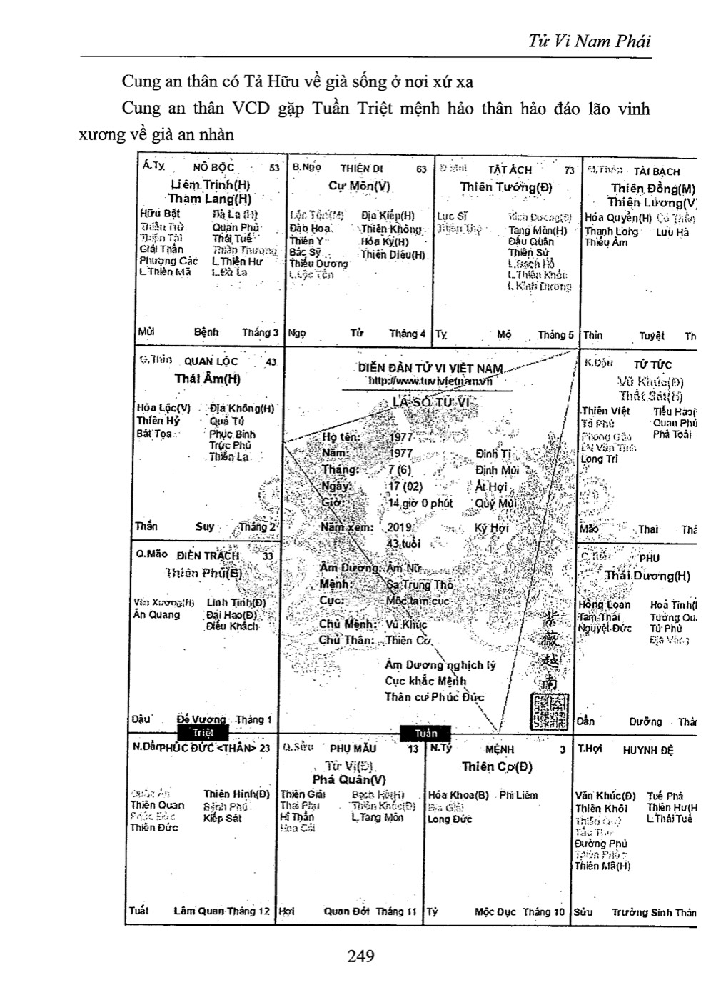

# Lá số mẫu 2

> Lá số mẫu  
> Trang sách 249–252 · *Tử Vi Nam Phái – Phần 1* (bản scan, chữ được nhận dạng OCR)

Thân cư Phúc năng chuyện gia đình, quan tâm chuyện thờ cúng, tâm linh, đến hậu thế về sau. Đàn bà thân cư Phúc đưa chồng về ở rễ được, lấy chồng phương xa được. Thân cư Phúc sướng khổ là do âm phước  

Cung an Thân có Thiên Hình về già càng khắc khe, khó tính, khó gần gũi ai  

Thân có Thiên Quan thích tụng kinh niệm Phật có sự giác ngộ  

Thân có Thiên Lương Nguyệt Đức chiết kế không là đạo sỹ cũng là tăng nhân, người tu tại gia  

Thân VCD có Triệt dễ đi xứ người, theo chân con đi xa, trông cháu chán rồi lại quay về vì Phu ở đất Hồng Loan vợ chồng không nhường nhịn dễ bỏ nhau vì Phu ở nơi đất Dưỡng, chủ về ốm đau chưa kể Hồng Loan gặp Mộ. Trong khi Thiên Di Đào Hoa Không Kiếp, vợ chồng sống sẽ rất khó bền  

Phu Thê Hồng Loan hành Thủy cư Tuất Thổ, Thổ Thủy tương phá. Hồng Loan là duyên và cũng là nghiệp  

Phu Thái Dương Đào Hồng, chồng da trắng  

Phu Thái Dương vừa gầy vừa cao  

Phu Tướng Quân chồng cũng cao lớn, Tướng Ân cũng có đường công danh  

Mệnh Thiên Cơ đắc địa người thông minh, trán dựng. Thiên Cơ điềm đạm, nhẹ nhàng, sâu sắc, người nhạy cảm trong đời sống bình thường dễ bị tác động đến suy nghĩ của mình, người nặng nợ về sự suy nghĩ. Thiên Cơ người nặng xương nặng cốt không nặng thịt  

Thiên Cơ là điều cơ mật trời đất do đó họ là người kín đáo, khả năng về ăn nói, tầm nhìn  

Thiên Cơ Tuần Triệt thạch trung ẩn ngọc, mệnh gặp Tuần tuổi ấu thơ có phần vất vả  

Mệnh Thiên Cơ mà năm Thìn Tuất dễ té ngã  

Thiên Cơ Mộc Dục Hóa Khoa theo ngành y dược, sư phạm. Thiên Cơ Hóa Khoa học ít biết nhiều, làm về giảng dạy, đào tạo, hướng dẫn cho người khác  

Thiên Cơ Hóa Khoa học ít biết nhiều  

Long Đức cư mệnh là người biết nhẫn nhịn, biết chiều lòng người khác  

Mệnh Mộc Dục con người khá gọn gàng, sạch sẽ  

Phi Liêm tóc tại dày, người hay đi  

Mệnh này đẹp được tam hóa liên châu, Hóa Khoa ở mệnh khả năng học  

hành học vấn, dễ xin đi học, thi cử dễ đậu, may mắn thuận lợi trên đường khoa  

bảng văn chương, khả năng về ứng biến xoay sở rất tốt, tư duy hoạt bát, người  

thích sách vở, trân trọng kiến thức, người sẽ ít gặp nạn lớn, nạn lớn thành nạn  

nhỏ, nạn nhỏ thành không có  

Huynh đệ Thiên Mã anh em có người đi xa. Thiên Mã Tràng sinh anh  

em thành danh thành đạt  

Phụ mẫu Bạch Hổ làm giảm thị trường của cha mẹ, hay ốm đau người  

khó tính, duyên nợ cha mẹ cũng khác ngược, ông yêu người khác nhưng quay  

lại lấy bà và ngược lại  

Phụ mẫu Tang Hổ bệnh di truyền từ cha mẹ  

Âm Dương lạc hãm, sinh vào ban ngày mẹ thọ hơn cha  

Hoa Cái Phụ mẫu dạy con, chăm con rất tốt, vô cùng nghiêm khắc, vô  

cùng mẫu mực, dạy con từng li từng tí. Hoa Cái là sự nóng nảy nên dạy con  

hay đánh nên sẽ không cưng chiều  

Phúc có Đồng Lương là nơi phát phước. Lâm Quan phước dày  

Phúc Thiên Hình lấy chồng gia đình chồng không giàu có, anh em gia  

đình chồng có phần ghê ghớm  

Phúc Thiên Quan Tứ Đức các cụ ngày xưa tạo nhiều phước báu  

Điền Thiên Phủ nhà cao cửa rộng, nhà ở nơi hè thông đất thoáng Điền  

Án Quang, Thân có Thiên Quan Tứ Đức càng sớm giác ngộ, càng thờ Phật Ân  

Quang cư Điền ngay trong gia đình biết giữ đạo kính trên nhường dưới, mình  

với ông bà, cha mẹ, cha chú  

Điền Đế vượng đất đai dư thừa có thể cho thuê cho mướn  

Quan Hóa Lộc, Hóa Lộc không chỉ mang ý nghĩa của tiền, giá trị của  

công việc, giá trị của sự đam mê, là lượng là thưởng, là tích lũy vốn liếng  

Quan Âm Dương lạc hãm công danh không còn lớn  

Nô Liêm Tham là sao đào hoa ra ngoài cũng có nhiều người thích mình  

Cung Nô Thái Tuế là nghị lực, càng bị bạn bè phản thì càng cố gắng, càng kiên trì  

Long Phượng cư Nô có bạn chí tình chí nghĩa  

Thiên di Cự Môn Diệu Đà Kỵ hay mắc nạn thị phi, người ta hay đơm đặt  

chuyện cho mình  

Thiên di Không Kiếp Thiên Không nạn xe cộ  

Tật có Thiên Tướng đau bao tử, đau dây thần kinh tọa  

Đẩu Quân cư Tật họa từ lời ăn tiếng nói không được cẩn trọng  

Tài có Cô Quả tay trắng dựng nghiệp, khéo giữ tiền  

Tài Thiên Đồng là phúc tinh, chủ tạo duyên tạo phước, hay bon chen bên ngoài, biết bỏ tiên tạo ra phước thiện về sau  

Tài Đồng Lương Miếu là của tiền dư thừa  

Tử Văn tinh con cái học trường chuyền lớp chọn, thông minh  

Tử Phong Các con cái nhiều bằng cấp  

Tử Phá Toán con cái bị hen suyễn, ho lao, bệnh về cuống họng  

Tử lục hại Phu con cái kỵ tuổi cha mẹ, khắc khẩu với con  

Tử song Hao đắc địa con cái có đứa xuất ngoại, phương xa, đi xa lập nghiệp  

Đang ở vận Thái Âm Hóa Lộc Địa Không, tĩnh thì sống mà động thì chết, duy trì công việc ở mức độ bình thường trung bình, không đầu tư của tiền ra bên ngoài kinh doanh, đổ ra bao nhiêu là mất đi bấy nhiêu đó là vận Không Kiếp, vận Không Kiếp kinh doanh là trắng tay, duy trì kinh doanh đều đặn thì được không đầu tư lớn  

Thái Âm Thủy, tam hợp vận Thủy, mệnh Thổ, Thổ Thủy tương khắc, Địa Không Tướng Quân chiếu phải lo về sức khỏe  

49t có sao Bạch Hổ cần thận sức khỏe, đi đứng liệu chừng  

Qua 54 chính thức mới thọ  

Lưu Tang Môn cư Phụ mẫu cấn thận bố mẹ ốm đau  

Tiểu vận Quan có Lưu Thiên Mã nằm ở cung Nô bộc, trong công việc có sự thay đổi  

Thiên di có Đào Hoa Không Kiếp, Đào Hoa là duyên con người đến với nhau, Đào Hoa Không Kiếp tình sớm nở cũng sớm tàn  
