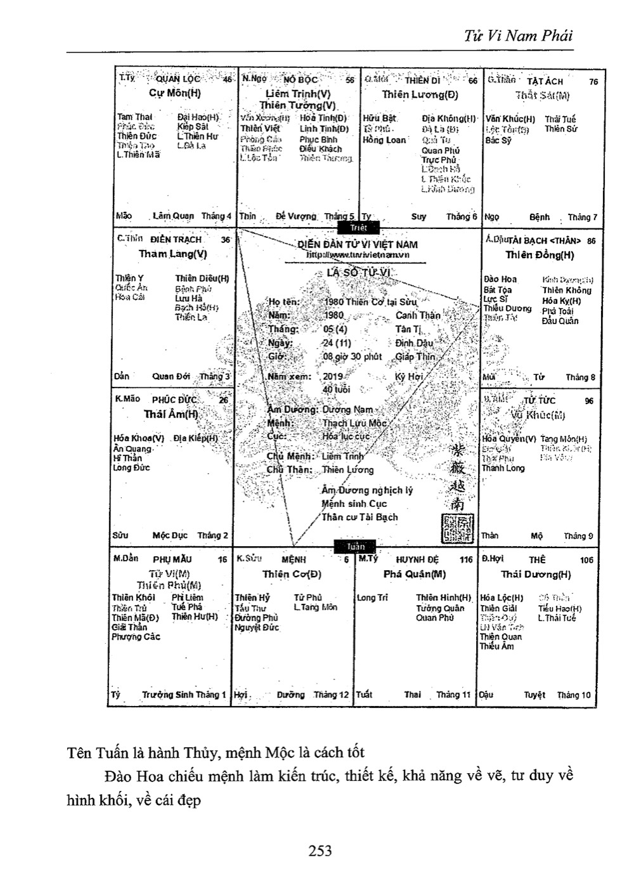

# Lá số mẫu 3

> Lá số mẫu  
> Trang sách 253–255 · *Tử Vi Nam Phái – Phần 1* (bản scan, chữ được nhận dạng OCR)

Tên Tuấn là hành Thủy, mệnh Mộc là cách tốt  

Mệnh Thiên Cơ là kỹ thuật, máy móc, điềm đạm, người giỏi lập kế hoạch, giỏi tham mưu, ứng biên  

Tài Thiên Đồng là cách hưởng thụ, vừa làm vừa chơi, làm chơi mà ăn thật, vì kế sinh nhai chạy ngoài đường suốt ngày  

Thế có Hóa Lộc cả 1 quá trình yêu thương, chăm bằm, được vợ quan tâm chăm sóc, đến bây giờ vợ chồng vẫn quan tâm đến nhau. Vợ là người khéo, đảm, nấu ăn ngon, vợ ưa nói ngọt (trong khi mệnh Thiên Cơ không giỏi nịnh nọt)  

Thiên Quan vợ chồng biết nhường nhịn nhau  

Song hao hãm địa vợ người hơi thấp  

Thế Thái Dương đi đúng nhanh nhẹn, tính khí y như đàn ông. Lấy vợ về là kinh tế tài chính ổn định  

Thê Cô Thần Thái Dương bản thân sẽ thọ hơn vợ  

Thê Thái Dương Hóa Lộc dân tài chính  

Thái Tuế cư Tật 3 năm hợp tuổi Thân Tý Thìn  

Vũ Khúc cư Tử tối thiểu 3 đứa, có con trai  

Tử có Tang Môn rất quan tâm đến con cái  

Cự Môn cư Quan là dân tư vấn, đi đàm phán  

Thiên di có Hồng Loan lấy vợ xa quê, xa quê lập nghiệp  

Không Kiếp cư Phúc bản thân người vợ không được giàu, bản thân mình không nhờ vả được anh ein dòng họ nhiều tự thân phải vận động. Nặng gánh hai bên gia đình  

Nô Thai Phục Vượng Tướng cần thận chuyện bạn bè, chuyện tình cảm  

Đang ở đại vận Điều Sản: Tích tụ tài sản, mua xe, mua nhà  

- Vận có Hoa Cái Long Trì; sinh đẻ được
- Vận Tham Lang là cầu đạo, tìm hiểu tâm linh, đạo giáo, tử vi, tướng số
- Vận Tham Lang là đào hoa, Tham Đào Riêu hay phải tiếp khách, rượu chè, bàn tiệc, bàn nhậu

Đại vận ở Điền thì vận mệnh sẽ rơi vào Điền, cung Phụ Mẫu sẽ rơi vào cung Quan, cung Quan rơi vào Tật ách có Thất Sát triều đầu miếu vượng là tốt (chỉ cần đại vận tốt, tiểu hạn tốt, lưu hạn tốt các sao Lưu xấu cũng sẽ không ảnh hưởng nhiều)  

Phi Hóa Kỵ nhập Tật áp lực về tâm lý, 1o nghĩ nhiều Song Kỵ nhập Tài cố gắng cực lực kiếm tiền, áp lực kiếm tiền  

Vận có Linh Hỏa trong khi mệnh Thiên Cơ là xấu vì Thiên Cơ rất sợ gặp Linh Hỏa, sức khỏe sẽ kém di  

Vận Thất Sát là vận sinh tử nếu qua được gặp Thiên Không thì cũng không qua được  

Đại vận từ 36-46 ôm vòng Thái Tuế là một đại vận thịnh vượng  

Đại vận Thân Tý Thìn thuộc Thủy, Tham Lang Thủy trong khi mệnh Mộc một đại vận tốt trong khi mệnh không có Không Kiếp là một đại vận thành công  

Đại vận Bạch Hổ ở đây là đề phòng tai nạn  

1. Tiếu hạn 40t ngay tại Mệnh Thiên Cơ  

2. Lưu hạn 40t về cung Thế Thái Dương. Lưu Thái Tuế kích phát cung Thê tại Hợi  

Tiểu hạn là nguyên nhân, Lưu hạn là Kết quả cuối cùng của một năm. Kết quả mỗi năm mỗi khác Lưu Thiên Mã nhập Quan công việc phải đi nhiều, Lưu Tang Môn nhập mệnh là mối lo, nhiều việc dự tính sẽ khó thành  

Lưu Hạn có Thái Dương Hóa Lộc gặp Lưu Thái Tuế làm ăn tốt. Hóa Lộc đi đến đâu được mời ăn mời uống  

Lưu Đà Lưu Hư Lưu Thiên Mã nhập Quan chạy như điên như dại công việc cũng gặp nhiều vất vả mới có thể thành công, tạo áp lực, việc chống việc  

Lưu hạn có Thiên Quan Thiên Phúc sinh con được  

Sang năm Lưu hạn gặp Phá Quân là kém, sợ đầu tư sai cách. Thiên Hình sợ té ngã  

Tướng Quân sợ gặp Triệt, gặp Tuần sẽ đỡ đi  

Hạn 44t gặp Không Kiếp là xấu may có Hóa Khoa sẽ qua được  
