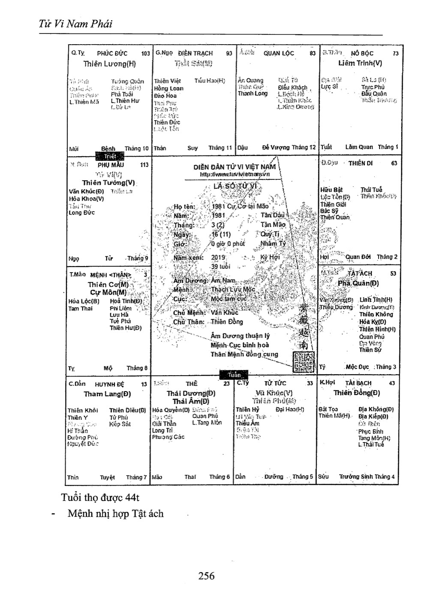

# Lá số mẫu 4

> Lá số mẫu  
> Trang sách 256–257 · *Tử Vi Nam Phái – Phần 1* (bản scan, chữ được nhận dạng OCR)

- Tật ách có Xương Khúc, Kình Dương, Thiên Không, Thiên Hình, Hóa Ky, Quan Phủ. Toàn những sao xấu nhập về Tật sẽ làm giảm thị trường. Tật có Văn Xương nặng hơn Văn Khúc

Thiên Hình nhập Tật là tù tội, pháp luật, lằn tên mũi đạn. Đi ra ngoài dễ bị ăn đòn, là cái chết đau đớn  

Tật là tổng hòa tất cả hành động, tạo duyên thì hưởng phước, tạo nghiệp thì hưởng nghiệp  

Tật có Mộc Dục sinh lý tốt dù đàn ông hay đàn bà  

Tật có Kình Dương là quái dị trong chuyện chăn gối, là bộ phận sinh dục, và cũng chính là còng số 8  

Thiên Không cư Tật đánh tan bệnh tật nhưng họa không thể đánh được  

39t Hợi năm nay tiểu hạn nằm Thiên di  

39t lưu vận nhập vào cung mệnh  

44t lưu vận nhập vào đúng cung Tật  

Tiểu hạn 44t gặp Tham Lang tam vận trúc la  

Mệnh Mộc gặp vận Vũ Khúc là Kim, Phủ là Thổ là xấu  

Mệnh Hóa Lộc là người cực kỳ khéo, mồm mép, khôn ngoan, lanh lợi, tinh tế, dịu dàng, lấy lòng người khác, là sự hưởng thụ  

Thiên Cơ là sao thiện tinh ngày bé nặng xương nhưng không nặng thịt. Do ảnh hưởng Cự Môn lớn lên người sẽ thân phì người dày  

Mệnh Cụ Môn Hóa Lộc mở miệng ra tiền. Cự Môn người khéo nhưng chết cũng do cái miệng. Cự Môn là sao đào hoa  

Quan có Quang Quý đồng cung làm ăn tốt  

Càng giàu có thì thú vui càng lớn mệnh có sao Hóa Lộc tính chất là thụ hưởng  

Thiên Cơ là cái đầu, âm mộc gặp Linh Hỏa là Hỏa; Cơ Linh Hỏa làm cho con người ta rồ dại, ngụ muội, điên rồ, thần kinh. Cơ Hỏa khi bị trêu ghẹo họ sẽ rất giận dữ như Chí Phèo (lá số này làm lò mổ, giết 3 mạng người). Cơ Linh Hòa ngày nào cũng bốc hỏa, giận dữ lên không nên kìm nén quá lâu sẽ dễ mất kiểm soát hành động làm những điều tai họa  

Mệnh Tuế Hư răng xấu, tóc tai phải dày, Tuế Hư là bộ sao của sự chống đối, đa đoan, đa tình, là sự gian dối  
