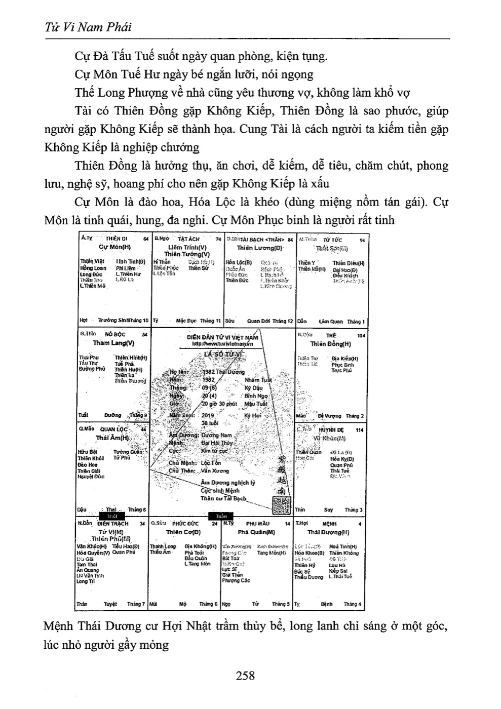

# Lá số mẫu 5

> Lá số mẫu  
> Trang sách 258–259 · *Tử Vi Nam Phái – Phần 1* (bản scan, chữ được nhận dạng OCR)

người gặp Không Kiếp sẽ thành họa. Cung Tài là cách người ta kiếm tiền gặp Không Kiếp là nghiệp chướng  

lưu, nghệ sỹ, hoang phí cho nên gặp Không Kiếp là xấu  

Môn là tinh quái, hung, đa nghi. Cự Môn Phục binh là người rất tinh  

Mệnh Thái Dương cư Hợi Nhật trầm thủy bể, long lanh chỉ sáng ở một góc, lúc nhỏ người gầy mỏng  

Mệnh Thiên Không người nghệ sỹ, tính hơi dị, người mộ đạo, thích cuộc sống tĩnh lặng  

Mệnh được Đào Hồng chiếu, đàn bà thì đẹp, đàn ông thì phong lưu, đẹp trai  

Đào Hồng làm dân kiến trúc, kỹ thuật, công trình, máy móc cơ khí  

Âm Dương hãm địa không gặp thời gặp vận  

Thiên Hỷ cư mệnh người vui vẻ, vui tính, người dễ gần, dễ sống  

Quan gặp Triệt quan quyền quan chức là không  

Quan Thái Âm gặp Triệt làm cho Âm Dương sáng lên có thể làm chủ, kho xưởng  

Sao văn tinh như Khôi Việt Xương Khúc không ưa Triệt lộ, Hóa Ky. nhưng trí tuệ vẫn năm trong đầu  

Không Kiếp cư Phu Thê nhanh quen nhanh cưới hay cãi nhau, giận nhau rồi quay sang cưới. Vợ chồng là người nóng tính  

Thai Phục Vượng Tướng ăn ngủ với nhau rồi mới cưới  

Thê Thiên Đồng vợ béo tốt, vợ đảm, chịu khó, hay lấy vợ phương xa. Vợ tính lành nhưng do gặp Không Kiếp vợ chồng vẫn hay cãi nhau  

Liêm Trinh cư Tật có khối u trên người  

Tiểu hạn Hồng Loan là tốt  

Đại vận Tử Phủ là đẹp không sợ Lưu tiểu vận 38t có Không Kiếp  

Đại vận 34-44 ở cung Điền phát động cung Tử sẽ lấy vợ, sinh con  

  - -
