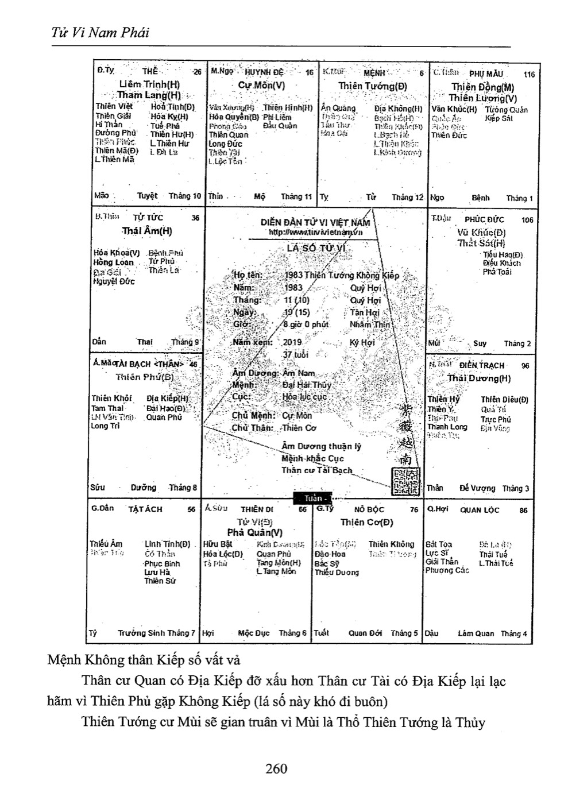

# Lá số mẫu 6

> Lá số mẫu  
> Trang sách 260–264 · *Tử Vi Nam Phái – Phần 1* (bản scan, chữ được nhận dạng OCR)

hãm vì Thiên Phủ gặp Không Kiếp (lá số này khó đi buôn)  

Người Thiên Tướng là hiêu học, hiếu nghĩa, chơi biết nhường nhịn người khác, hay chịu thiệt thòi về mình, giữ khiêm cung khiêm nhường, không bon chen với đời.  

Mệnh Thiên Tuóng tuổi thọ tốt khi Thiên Tướng giàu thì Thiên Phủ ở Tài sinh lòng tham, tài mà tham thì sẽ hao đi phúc nên sẽ khó thọ cho nên người giàu có vô cùng nhưng lại không có tuổi thọ  

Mệnh Thiên Tướng Quang Quý tuổi thọ tốt nhưng gặp Không Kiếp Tang Hổ tuổi thọ sẽ giảm bớt lại "Kiếp Không dù đắc địa chết vòng trung niên" trong khi Kiếp Không lạc hãm ở đây  

1. Xét Tuần Triệt  

Nếu Tuần Triệt nằm ở Phúc có Thất Sát lạc hãm thì làm sáng cung Phúc vì lạc hãm cần Tuần Triệt. Tuần Triệt ở Tài và Tật để hãm Địa Kiếp lại  

2. Ngũ đại chính tinh  

Tử Vi gặp Tuần Triệt: đái ấn triệu hồi mất đường công danh,  

Thiên Phủ gặp Không Kiếp (Phủ Tướng sợ Không Kiếp, nó chỉ hãm lại  

Không Kiếp) Thiên Tướng gặp Không Kiếp (Phủ Tướng sợ Không Kiếp, nó  

chỉ hãm lại Không Kiếp)  

Âm Dương lạc hãm  

Tướng Ấn  

Mệnh có Bạch Hồ Tang Môn  

  - Sinh ra gia đình sẽ không được giàu
  - Sống thiên về nội tâm
  - Ngày nhỏ thì khó nuôi
  - Việc chưa đến đã lo, việc chưa về đã nghĩ
  - Làm cái gì cũng bất mãn với đời (gặp chuyện không thuận chẳng hạn đi thi tắc đường đành phải về khỏi thi..)
  - Cái gì trong nhà đều đè lên đầu gánh vác
  - Tang Hổ đắc địa người ăn nói khéo

Mệnh Thiên Khốc người sống nội tâm  

Không Kiếp ở mệnh da không trắng, tính nóng, trán đen. Không Kiếp gặp Thiên Tướng Quang Quý sẽ giảm được tính hung, tính nóng lại tạo thành cách vất vả, vì Không Kiếp là thiệt thòi (người ta làm 1 hưởng 2, 3 con Không Kiếp làm chỉ hưởng 1).  

Không Kiếp thích làm cái khó không thích làm cái dễ (cái khó khăn người ta mình lại thích chui vào làm) nên người Không Kiếp lọ mọ làm một mình, hay thức đêm, cày đêm, đam mê tìm hiểu vận số là Không Kiếp  

Thiên Tướng Không Kiếp học sư phạm thì tốt, làm nghề sẽ vất vả tay chân. Thiên Tướng là truyền thụ, truyền thừa, là hướng nghiệp hướng nghề  

Thiên Tướng Quang Quý là cách tu hành nhưng đế tu hành được thì cung Thế Thiếp và Tử phải xấu  

Văn Xương khởi từ Thìn, Văn Xương đi thuận  

Văn Khúc tính từ Tuất, Văn Khúc đi nghịch  

Khúc Xương hãm địa gặp Hình Kỵ, đường học hành không đến nơi đến chốn, học lên cao cũng khó, chỉ có cách cần cù bù thông minh (mệnh giáp Xương Khúc có tài nhung Xương Khúc hãn)  

Mệnh Quang Quý Sửu Mùi là học cao hiểu nhiều, học ít biết nhiều nhưng Xương Khúc lạc hãm  

Thiên Tướng Quang Quý nên học ngành dược, Đông y  

Thiên Tướng Tả Hữu học về Tử Vi được  

Mệnh Tấu Thư là khéo  

Mệnh Hoa Cái chỉ ưa đàn bà, vừa đẹp vừa điệu. Đàn ông chỉ là sự giản  

Mệnh tam hợp Thái Tuế là người có chí, người nghị lực, kiên trì Phụ mẫu Đồng Lương cha mẹ sống thọ. Thiên Lương cai quản tuổi thọ. Thiên Đồng cai quản phúc báu  

Khúc Xương lạc hãm cư Phụ mẫu cha mẹ đi theo đường học hành nhưng đang học bỏ dở  

Cha mẹ không giàu vì tam hợp Thiên Không, Phúc song Hao Phúc Tài Vũ Khúc Thất Sát lạc hãm đồng tiền tán tụ mấy ai có giàu  

Thiên di gặp Tuần Triệt đi không được mà ở không xong, đi lại phải về  

Thiên di có Tả Hữu đi ra ngoài có rất nhiều quý mến mình, đi đâu cũng có người đưa đón, Quân Thân tá xứ đi đêm ma tà không trêu Dưỡng cư Tài không cờ bạc, không ăn chơi, biết tích cóp, tiết kiệm và Dưỡng là chăm sóc, dụng dưỡng  

Dưỡng cư Mệnh là người keo kiệt  

Tài nhiều sao học LN Văn Tinh, Thai Tọa, Khôi Việt nên tập trung việc học  

Phi Hóa Kỵ, Phu Thê vợ chồng khắc nhau mệnh số, mệnh duyên, thiên can địa chi là rất lớn (ví dụ anh này mệnh Thủy dễ lấy vợ mệnh Hỏa)  

Hóa Kỵ Phu Thê vợ chồng khó nói chuyện hài hòa với nhau  

Liêm Tham Hóa Kỵ vợ đảm, vợ khỏe, béo tốt  

Tuế Phá Thiên Hư vợ răng xấu, giọng to, tóc hơi thô. Tuế Phá Thiên Hư xung với Thái Tuế là hai mặt đối lập, bù trừ Thể Tham Linh Hỏa vợ kiếm tiền tốt thì bản thân lại kém đi bấy nhiêu  

Hi Thần dài lưng tốn vải, tay chân dài lông  

Thiên Mã vợ đảm, vợ biết quan tâm. Cung Nô có Đào Hoa kích phát vợ sẽ bế con bỏ đi đó chính là Thiên Mã  

Thiên Mã Vợ chồng có quãng thời gian xa cách, vợ chồng gặp nhau ở xa, người xa quê, cách sông, cách núi, cách đò  

Thê có Tham Lang Hỏa vợ kiếm tiền giỏi, ra ngoài không ai bắt nạt được  

Thê Khôi Việt bản thân lá số không làm trưởng thì chồng là con trưởng trong nhà. Thiên Việt người rất đảm việc  

Tuyệt cư Phu Thê vợ là người kín đáo, khôn ngoan. Tuyệt là giấu đồ  

giấu kín tiền của không khoe, thích tiết kiệm, thích tích lũy (làm 10đ giấu 54, 5đ còn lại chi tiêu trong nhà  

Âm Dương cư Tử trai gái đầy đủ Tử Âm Dương Đào Hồng con cái tốt Thai cư Tử là bầu bí, vợ chồng sinh hoạt không giữ hết con. Vợ mắn đẻ  

Lưu Hà cư Tật tránh vùng sông nước Điện tốt có Thái Dương Đế vượng kinh doanh về nhà được, chăn nuôi ở nhà cũng được Cô Quả cư Điền giữ được nghiệp sản cha ông, không bán điền sản tổ tiên Điền không có Tuần Triệt gặp Thanh Long sau có nhà ngã ba ngã tư đường  

Nô Thiên Không bạn bè không nhiều  

Huynh đệ Văn Xương là 2, Văn Khúc là 4, Vũ Khúc là 3, tổ hợp Sinh  

Vượng Mộ có thể đạt đến 4 gặp Thai Tọa có thể 6  

Huynh đệ Phong Cáo gặp Thiên Hình bằng cấp cũng không sử dụng được Huynh đệ Cự Môn Thiên Hình chị em tính cách cũng khá ghê ghớm  

Huynh đệ Hóa Quyền bản thân phải chịu thiệt thời  

Lưu Tang Môn nhập Thiên di đi xa học hành thì được (đi để hấp thụ kiến thức thì được) nhưng đi công đi việc sẽ không được việc  

Lưu Thái Tuế kích quan là sẽ học một nghề mới, chuyển nghề, chuyển việc, tiếp cận một ngành nghề mói  

Mệnh có Lưu Hổ sức khỏe kém ốm đau. Lưu Tang Luu Hổ nhập mệnh đề phòng chó mèo cắn  

Tháng 6 có Luu Tang Môn cân thận ngã xe, mất xe  

Tháng 7 có Phục binh cẩn thận bị lừa  

Tháng 8 gặp Địa Kiếp là ốm, Thiên Phủ là hao tiền rút ví  

Tháng 10 Hóa Ky, là hạn cãi nhau, Lưu Thiên Mã là đi xa, Hỉ Thần trong nhà có người cưới vợ cưới chồng theo đoàn đi xa  

Tháng 12 ốm  

Tiểu hạn có Tử Vi Hóa Lộc của sẽ đi thay người  

Lưu đại vận có Thiên Hỳ Thanh Long nhà có việc vui  

Mệnh Thủy vận 66 có Tử Vi hành Thổ sẽ khắc Thủy  

Đại vận 66 có Kình Dương Linh Hỏa, tổ hợp Sát Phá Liêm Tham, mệnh trong tam hợp Lâm Dưỡng Tử. đi đến tam hợp Mộc Suy Tuyệt là kịch thọ 66- 75t.  

68t có Tướng Quân Kiếp Sát  

69t có Quang Quý thì ổn  

73t Không Kiếp qua tuổi này mới thọ  

Vận 46 Không Kiếp sức khỏe đi xuống  
