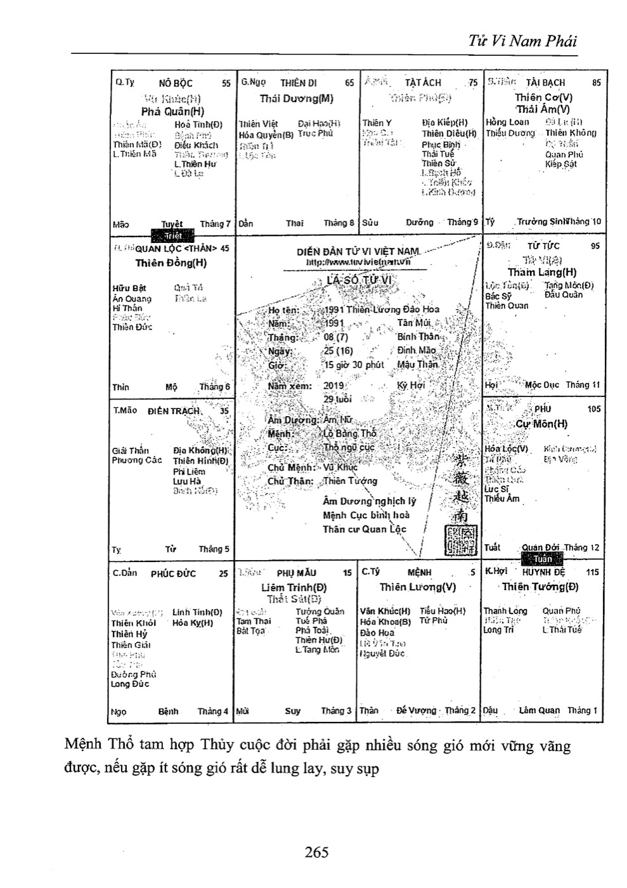

# Lá số mẫu 7

> Lá số mẫu  
> Trang sách 265–268 · *Tử Vi Nam Phái – Phần 1* (bản scan, chữ được nhận dạng OCR)

Mệnh Thổ tam hợp Thủy cuộc đời phải gặp nhiều sóng gió mới vững vãng được, nếu gặp ít sóng gió rất dễ lung lay, suy sụp  

Mệnh trong tam hợp Đào Hồng hợp chiếu đàn bà sắc nước hương trời, càng ngày càng trẻ, trẻ lâu, độ lão hóa không đến nhanh ( kể cả 40t nhìn vẫn trẻ)  

Mệnh Đào Hoa mặt mày thanh tú, da trắng, tóc dày, da xanh tóc tốt. Người Đào Hoa luôn thể hiện sự mềm mại ra bên ngoài bằng cái răng, cái tóc, cách ăn, cách mặc, cách đi đứng, cách nói. Cái gu thời trang rất đẹp, phối màu đẹp, phối quần áo tốt  

Người Đào Hoa có sức hút của người khác giới, người tinh tế, thích được yêu thích được cưng chiều  

Đàn bà Đào Hồng sau rất thích mặc váy, lả lướt, thướt tha  

Thiên Lương Đào Hồng hợp về nghệ thuật, như múa, đàn, hát, viết, vẽ, kiến trúc, có năng khiếu nghệ thuật; cũng có thể học y dược thể hiện sự yên bình là sao Thiên Lương  

Thiên Lương Đào Hồng Âm Dương Xương Khúc có tính nghệ sỹ Thiên Lương gặp Tràng Sinh Đế Vượng tuổi thọ tốt  

Thân cư Quan rất đam mê công việc, hy sinh mọi thứ cho công việc trong khi mệnh có Đào Hồng có thế làm người của công chúng, được nhiều người biết đến mình  

Thiên Lương hành Mộc, chủ thiện tinh, ôn hòa, không bao giờ thích tranh giành số cách làm thầy được như đào tạo, giảng dạy cho người khác  

Đế Vương cư mệnh thể hiện nội lực dồi dào, sức khỏe tốt, thị trường tốt  

Mệnh song Hao nên không thế to cao, người nho nhỏ, người gầy má hóp đích tóp  

Khúc Xương hãm địa cứ mệnh học hành khó lên cao, nhưng học chuyên sâu về nghề mang tính chất nghệ thuật, văn chương, báo chí, khả năng viết lách tốt  

Khúc Xương đều lạc hãm đừng mong học ngành nào làm ngành đó là hơi khó, phải đi trái ngành trái nghề  

Người có Xương Khúc ăn nói nhẹ nhàng, hành vi hành xử là người có học, người không hô vàng, luôn từ tôn  

Người Hóa Khoa thuận lợi con đường học hành, chỉ thuận lợi chưa hẳn là học cao vì Hóa Khoa chính là sự thông minh, khả năng ứng biến, ăn nói, khả năng nhận thức nhìn nhận về cuộc sống, tầm nhìn rộng. Người đam mê học hành, thích sách vở  

Mệnh Xương Khúc Hóa Khoa làm việc mang tính trí tuệ cao như IT, thiết kế phần mềm tư duy tốt của bộ Hóa Khoa, có sự mềm mại của Xương Khúc, chăm chỉ miệt mài của Thiên Lương  

Mệnh Văn Tinh học các khối trường chuyên lớp chọn Mệnh Nguyệt Đức thể hiện tính thiện của con người, Phật tâm, người sống từ tốn, ôn hòa, ôn lương, không tranh giành, tranh chấp, tranh đua với ai. Nguyệt Đức là mặt trăng thể hiện đức độ của người đàn bà  

Đàn bà có Nguyệt Đức dễ sinh dễ đẻ  

Mệnh Thiên Lương Nguyệt Đúc có chuyên tu, có cái duyên tu hành, có thiện căn đế tu, rất đam mê kinh Phật, tướng số, chuyện tu hành  

Mệnh giáp Long Phượng ra ngoài nồi danh, lá số phải xa quê lập nghiệp hay phát triên phương xa thì mới tốt  

Phúc có Hóa Kỵ trong khi mệnh Đào Hồng chuyện 1 vợ 1 chồng đi suốt cuộc đời là rất khó.  

Phúc là môi trường tổng hòa, trong đó có môi trường tiền kiếp, duyên nghiệp, thể hiện gia đình nhà chồng tương tác với mìn không được tốt là sao Hóa Ky, dễ bị gãy đố kỵ hiểu lầm, không thể nhờ gia đình nhà chồng. Hóa Ky là sự xung đột, là bon chen. Phúc có Hóa Ky cả đời vất vả lương duyên, yêu ai khổ đó, lấy ai không được bên, có con rồi vợ chồng ở vẫn lục đục với nhau  

Phúc VCD được Cơ Âm chiếu, hưởng theo phước cụ bà  

Phụ mẫu có Thất Sát là cách không hay vì Thất Sát nhập về đâu là phá cung đó, cư Phụ mẫu phá đường duyên của cha mẹ, tuổi thọ của cha mẹ đi khá nhiều cho nên tuổi thọ cha mẹ không được cao  

Phụ mẫu có Tướng Quân là người to béo, tròn trịa đầy đặn  

Tam hợp Phụ mẫu có Thiên Quan Thiên Phúc sau này sinh con đẻ cái cha mẹ giúp đỡ nhiều, trong khi mệnh Đào Hồng nhị hợp Phụ mẫu đường duyên lỡ dỡ sau về ở với cha mẹ. Đó là giai đoạn 35-45 Điền trạch vận có Không Kiếp Hình Diệu có Tang Hổ lúc này Phu Thê có Liêm Sát giai đoạn vợ chồng lục đục  

Huynh đệ có Lâm Quan anh em đồng nhất là 5 người  

Phu có Cự Môn Hóa Lộc công việc liên quan đến giảng dạy, văn chương, nghề mở miệng ra tiền, nghề ăn nói  

Hóa Lộc cư Phu Thê vợ chồng cũng khá chắn chút nhau  

Thiên Quý ở cũng vì tình vì nghĩa  

Kình Dương cư Phu chồng sẽ bị bệnh liên quan tới tuyến thận, suy gan  

Cự Môn vợ chồng hay cãi nhau  

Nhưng do Kình Dương Hóa Kỵ cư Phúc duyên vợ duyên chồng bị lục đục ảnh hưởng chi phối bởi gia đình nhà chồng  

Cung Tử có Tang Môn cả đời lo cho con  

Tử Thiên Quan Thiên Phúc sẽ có con cầu, con nuôi  

Tử Tham chiếu Điền VCD sau sẽ thờ Phật tại gia trong khi mệnh Thiên Lương  

Điền có Không Kiếp Thiên Hình nhà gần nơi doanh trại, công an  

Điên có Long Phượng nhà cửa gọn gàng sạch sẽ vì mệnh Nguyệt Đức bản thân là người gọn gàng sạch sẽ, lôi thối lượm thượm là không chịu được  

Quan Thiên Đồng, Đồng chủ dịch, hóa là động, con người có sự khéo léo trong công việc, ôn hòa, nhiều người giúp mình và mình hay giúp đỡ. Quan có Thiên Đồng có duyên buôn bán chẳng hạn nghề liên quan đến hưởng thụ như ăn uống, dịch vụ (service), du lịch  

Triệt cư Quan sẽ rơi vào thời điểm nào đó để mình thay đổi công việc theo hướng khác Ân Quang cư Quan làm việc gì cũng người hỗ trợ, cấp trên hay đặt niềm tin  

Vũ Phá cư Quan bạn bè không được đông nên thành danh cũng khó  

Quan Nô gặp Triệt làm môi trường tập thể được, hệ thống chuỗi  

Thiên di có Thái Dương đi nước ngoài liên tục được  

Thiện di Thái Dương cư Ngọ gặp Hóa Quyền đi ra ngoài sẽ được nhiều người biết đến  

Tài Thiên Không đôi lúc phải trắng tay nhưng có Đào Hồng có thể gây dựng lại được, Tài Đào Hồng rất dễ kiếm tiền  

Tài có trong tam hợp Cơ Nguyệt Đồng Lương có thể chuyển sang kinh doanh, có kho xưởng vì Tài Cơ Âm  
