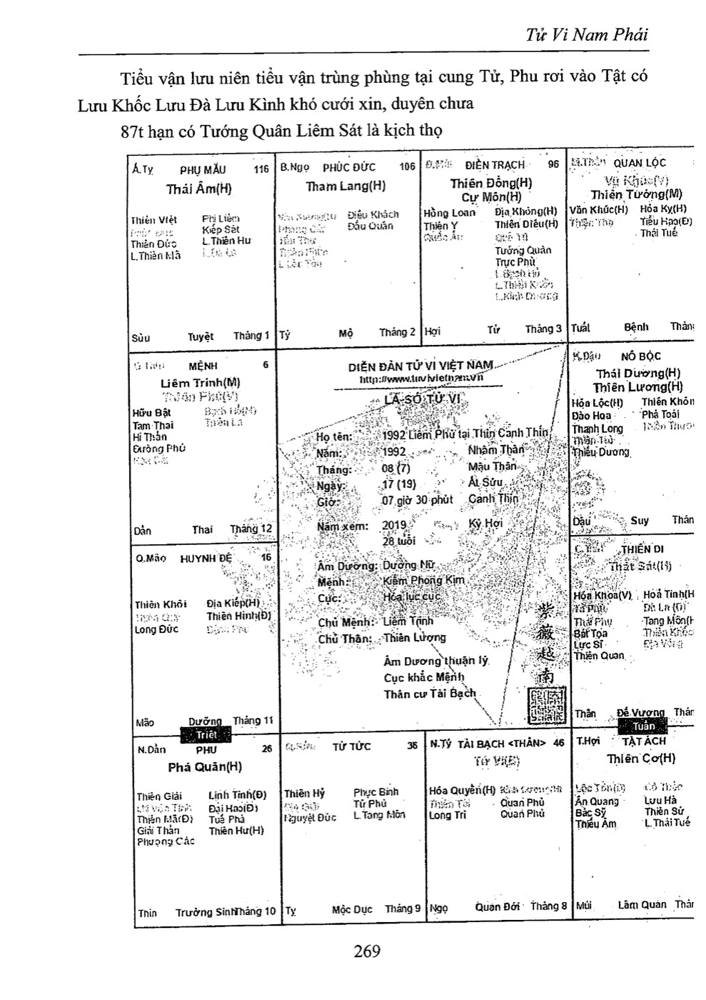

# Lá số mẫu 8

> Lá số mẫu  
> Trang sách 269–271 · *Tử Vi Nam Phái – Phần 1* (bản scan, chữ được nhận dạng OCR)

Lưu Khốc Lưu Đà Lưu Kình khó cưới xin, duyên chưa  

Mệnh Liêm Phủ 2 cung Thìn Tuất người giàu có, khá giả  

Mệnh Liêm Phủ kinh doanh, làm đẹp, kinh doanh nhà hàng, khách sạn Mệnh Thái Tuế học Luật nhưng Quan có Xương Khúc Hóa Ky.  

Mệnh Liêm Trinh đệ nhất hưởng thụ, ăn phải ngon mặc phải đẹp, người nóng tính, khí khái, phóng khoáng, lúc hiền thì rất hiền, lúc dữ thì dữ vô cùng  

Thiên Phủ da trắng  

Mệnh Tang Hổ Phu Triệt Tuần, Thiên Mã số dễ 2 lần đò  

Mệnh Hoa Cái Bạch Hổ đồng cung là cách không hay chưa kể Hóa Kỵ. cư Quan chiếu về  

Hoa Cái cưng ai cưng lắm nhưng độ lì cao, bước chân ra ngoài lắm anh theo vì Đào Hoa nhập Nô, yêu anh nào được anh đó cũng chiều vô cùng vì Nô có Hóa Lộc  

Mệnh Tang Hổ người hay lo nghĩ  

Mệnh Hoa Cái Thai tinh mạnh mẽ trong chuyện tình yêu tình trường, Hoa Cái là lì không thích là bỏ ngay, lúc nào cũng nghĩ mình phu nhân, công tử bắt người khác phải theo mình. Nhìn bên ngoài nhẹ nhàng nhưng bên trong thì rất rắn  

Mệnh Tả Hữu phải ly tông tổ nghiệp, đàn bà dễ làm vợ hai, chồng dễ có con riêng rồi mới đến với mình  

Quan có Xương Khúc Hóa Kỵ học hành bằng cấp bỏ xó, chuyển sang ngành khác để làm  

Phúc Điểu Khách môi trường ăn chơi hưởng thụ, ví dụ làm quán bar, thời trang, nghệ thuật  

Phu Thiên Mã Long Phượng chồng kiếm tiền tốt, nhà chồng rất giàu Phu Thiên Mã lấy chồng phương xa  

Phu xung Thái Tuế liệu chừng dính với Pháp luật là không hay  

Phu Tuế Phá Thiên Hư răng xấu, giọng to  

Cung an Thân có Kình Dương năm tháng về già vất vả, bị giảm thọ, khi về già bệnh tật sẽ hành hạ đau đớn  

Vũ Khúc cư Quan đam mê công việc, thích làm giàu, máu làm giàu  

Thái Tuế cư Quan làm đào tạo, giảng dạy, giáo dục. Nếu liên quan tới tài chính dễ bị ra tòa kiện tụng  

Quan Hóa Ky mang tính bon chen, áp lực cao, áp lực không gian, thời  

gian, tài chính, kinh tế, thậm chí là phải đánh đổi, mình không bon chen với  

người ta thì người ta cũng bon chen với mình  

Nô Đào Hoa đi đến đâu cũng có người thích mình, nhất là sau khi mình  

lập gia đình vẫn có người thích mình  

Nô Hóa Lộc, bản chất là sự chăm chút, thụ hưởng, người rất quan tâm  

đến các mối quan hệ, ở gần ai cũng thường cũng chiều Đào Hoa Hóa Lộc  

Tật Thiên Cơ đau đốt sống lưng, đau vai gáy  

Phụ mẫu Kiếp Sát dễ bị sức khỏe, liên quan pháp luật, nạn duyên Thái Âm lạc hãm  

Điền do Phu có Triệt nên vợ chồng chia đôi tài sản đó là Địa Không Địa  

Kiếp. Không Kiếp cung Điền nhanh mua nhanh bán  

Tiểu vận năm Hợi có Đào Hồng Thiên Hỷ vận cưới hỏi dù gặp Lưu Kình  

Lưu Hồ Lưu Khốc vẫn có thể cưới những khoản cuối năm  

Tiểu vận năm Tý có Tham Lang tan vận trúc la làm ăn không tốt  

Đại vận 26-36 Phá Quân đi lại nhiều, vất vả, hao tài, tổn sức  

Đại vận xấu có Kinh Dương cẩn thận trắng tay, phải làm lại  
