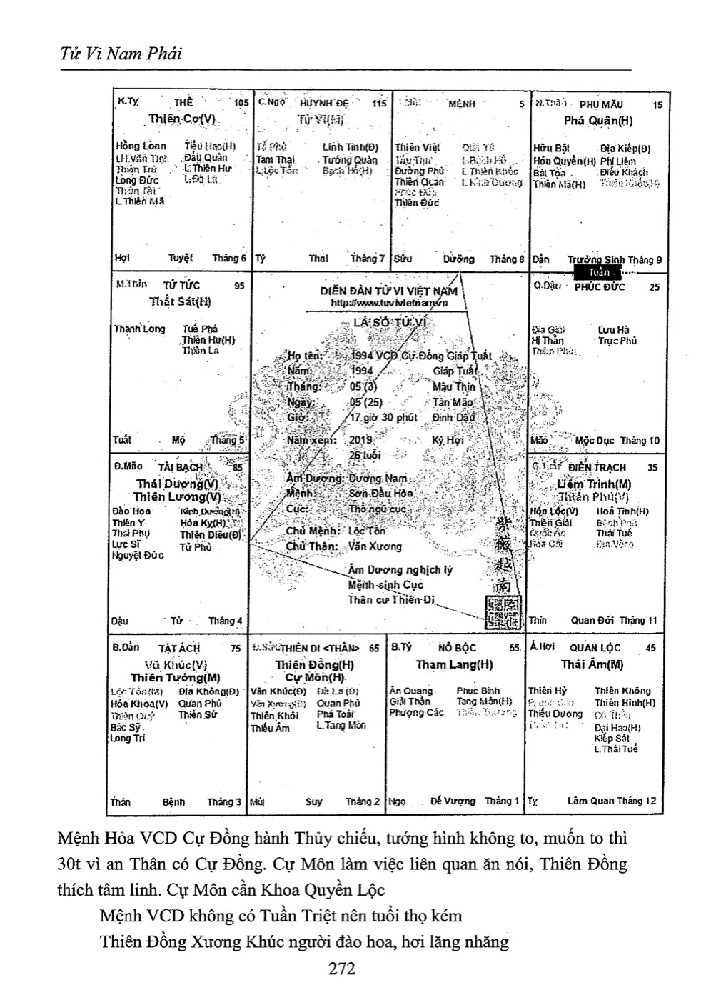

# Lá số mẫu 9

> Lá số mẫu  
> Trang sách 272–274 · *Tử Vi Nam Phái – Phần 1* (bản scan, chữ được nhận dạng OCR)

Mệnh Hỏa VCD Cự Đồng hành Thủy chiếu, tướng hình không to, muốn to thì 30t vì an Thân có Cự Đồng. Cự Môn làm việc liên quan ăn nói, Thiên Đồng thích tâm linh. Cự Môn cần Khoa Quyền Lộc  

Mệnh Thiên Việt da ngăm, làm trưởng trong nhà, học hành tốt  

Mệnh Tâu Thư ăn nói khéo  

Mệnh giáp Tam Thai Bát Tọa lá số học tốt nhưng chỉ trong thời gian ngắn học không đi đôi với thành công, lá số nên xuất ngoại vì thiên di có Thiên Đồng  

Mệnh này đẹp được Âm Dương Xương Khúc chiếu về, kinh doanh có tài  

Người muốn giàu có phải có Khúc Xương Khôi Việt  

Điền đẹp có Thiên Phủ Hoa Cái Thái Tuế Hóa Lộc làm kinh doanh bất động sản tốt  

Quan có Thiên Hình Thiên Không việc học sẽ bị hãm lại mặc dù Xương Khúc đắc địa, vì Thiên Hình (kiếm) sẽ hãm công danh lại nền công danh không có nhiều , học hành không có công danh nên Xương Khúc chẳng có ý nghĩa gì, chỉ còn độ khéo, tỉ mỉ, tinh tế  

Thiên Hình cư Quan làm chuyên môn giỏi, làm nhà nước rồi cũng xin ra ngoài  

Quan Thiên Hình Phong Cáo là không hay  

Quan có Âm Dương chịu học ngoại ngữ, kinh tế làm xuất nhập khẩu, cầu cảng  

Quan Thái Âm làm xuất nhập khẩu, liên quan yếu tố nước ngoài, bất động sản, chứng khoán vì Thái Âm miếu. Trong khi Thiên di Thiên Đồng Xương Khúc người khéo, đi ra ngoài học đời không học ở ghế nhà trường nhiều vì Quan Thiên Hình Phong Cáo  

Hóa Kỵ, cư Tài cẩn thận tranh chấp, thị phi, lừa đảo, của tiền dễ bị mất hết, mất cả danh lẫn tiếng Đào Hoa cư Tài học công trình, xây dựng trong khi Cự Đồng đi khắp nơi  

Diêu đắc địa cư Tài ăn có nơi và chơi có chốn, không phải quá ẩu quá bừa, có mục đích của sự ăn chơi (ví dụ đi với đối tác sẵn sàng bao ăn, uống, đi chơi để được việc)  

Thiên di có Thiên Khôi, chính là đất của quý nhân, đi ra ngoài luôn có người giúp đỡ  

Xương Khúc ở Thiên di ra ngoài dễ tiếp thu, học đời không học nhà trường vì Quan có Thiên Hình  

Nô có Tham Lang môi trường Đào Hoa, làm thầy trong khi mệnh VCD cung Nô ảnh hưởng rất lớn, cho nên số này đa đoan  

Nô Long Phượng bạn bè toàn người giàu có, vì Long Phượng ở đâu làm giàu ở đó  

Thế có Hồng Loan vợ ở xa (lấy vợ gần dễ bỏ nhau), vợ đẹp, lắm vợ (có thể vợ đã qua một đời chồng)  

Thế Thiên Cơ dáng hơi gầy  

Thân có Xương Khúc Thị Hồng Loan dễ lấy 2 đời vợ  

Huynh đệ có Tử Vi Tả Hữu dễ có anh em khác dòng  

Hạn 55-65 Tham Lang hạn Tam vận trúc la, tam hợp hạn hành Thủy mệnh Hỏa cẩn thận thì trường vì mệnh VCD không có Tuần Triệt ở Tật  
