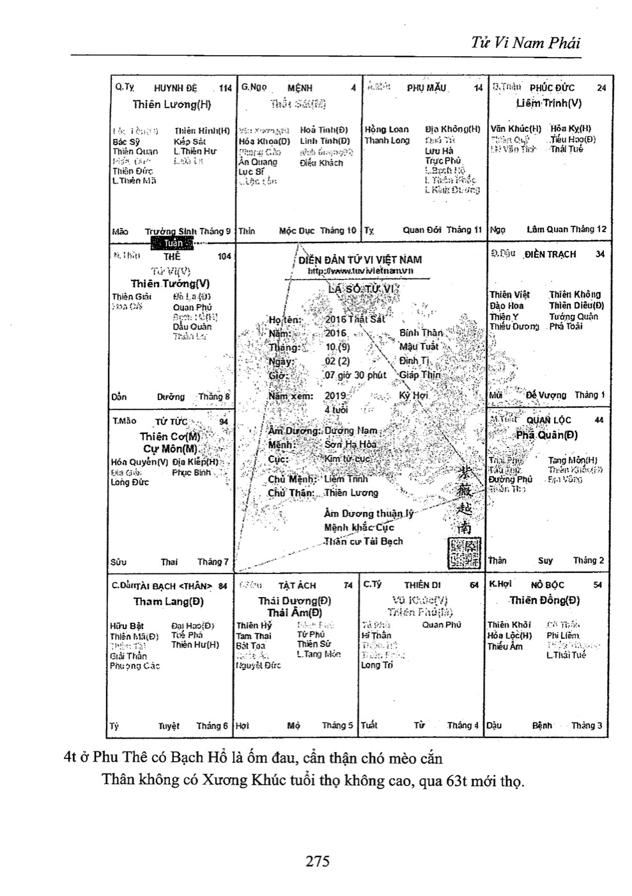

# Lá số mẫu 10

> Lá số mẫu  
> Trang sách 275–276 · *Tử Vi Nam Phái – Phần 1* (bản scan, chữ được nhận dạng OCR)

At ở Phu Thê có Bạch Hổ là ốm đau, cần thận chó mèo cắn  

Thất Sát miếu địa thân to người lớn, mặt lộ nhiều xuong, mắt to, tính nóng người hung, râu ria nhiều, Tigười hay glen, tính bộc trực ở cái mồn. Thất Sát Số cô đơn cô độc, không gần người khác được  

Mệnh này hợp theo ngành quân đội công an hoặc ngành liên quan yếu tố pháp lý, pháp chế, viện kiểm soát nhân dân, tòa án  

Mệnh Kinh Dương đi hơi gù, đầu cắm về phía trước  

Mệnh Điểu Khách người chỉ tiêu phóng khoáng, nếu dính vào nợ nần cờ bạc là phá gia chi tử, tuyệt đối không chơi cờ bạc đỏ đen, ăn thua  

Mệnh Linh Hỏa tuy rằng đắc địa nhưng thị trường giảm đi nhiều  

Mệnh Xương Khúc Hóa Khoa học hành giỏi giang, người thông minh  

Mệnh Phong Cáo là bằng sắc, có quyền uy Mệnh Ân Quang có thể phù trì cho người khác được, làm thư ký cho người lãnh đạo, người có nhiều phật tính  

Tài có Thiên Mã Long Phượng dễ kiếm tiền  

Tài Tham Lang Song Hạo dễ ăn chơi  

Huynh đệ Đào Hồng Thiên Không anh em mỗi người một xứ  

Lá số này có thể có con riêng vợ lẽ  

Thê có Thiên Tướng vợ là người ôn hòa điềm đạm, biết nhẫn nhịn  

Lâm Quan cư Phúc là nhà tốt phước  

Hóa Kỵ cư Phúc vẫn còn oán nghiệt để lại, Hóa Kỵ là cái lưỡi họ hàng chưa được đoàn kết  

Phúc Thái Tuế là người có trách nhiệm với họ hàng, với mọi người xung quanh  

Âm Dương chiếu Điền đất đai nhà cửa là có  

Nô có Khôi Việt đi đâu cũng có người giúp đỡ, trợ lực tương trợ nhưng do mệnh Thất Sát Điếu Khách nên tránh xa bạn bè ăn chơi  

Thiên di Vũ Khúc Thiên Phủ ra ngoài là người kín đáo, có tiền không ai biết, không có tiền chẳng ai hay  

Tật có Thiên Hình chiếu sẽ có lần gãy tay què cùng  

Thân có Thiên Mã về già chung thân bôn tẩu  

Kinh Dương Lưu Kình nhập mệnh tai họa họa tại  

19t Không Kiếp Phục binh cẩn thận đánh đấm ở bên ngoài Vận 14 Không Kiếp Đào Hồng vận có tình yêu tình cảm  
