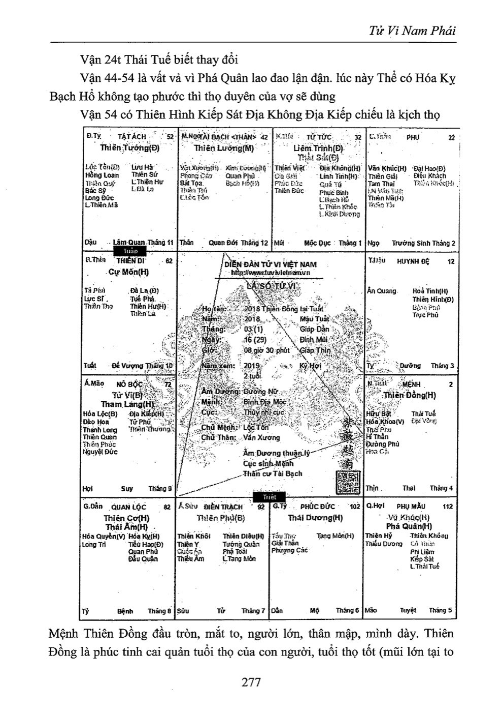

# Lá số mẫu 11

> Lá số mẫu  
> Trang sách 277–280 · *Tử Vi Nam Phái – Phần 1* (bản scan, chữ được nhận dạng OCR)

Bạch Hổ không tạo phước thì thọ duyên của vợ sẽ dùng  

Mệnh Thiên Đồng đầu tròn, mắt to, người lớn, thân mập, mình dày. Thiên Đồng là phúc tinh cai quản tuổi thọ của con người, tuổi thọ tốt (mũi lớn tại to mới thọ). Thiên Đồng nghĩa động nên con người phải đi xa, đặc biệt Phu Thiên Mã Tràng Sinh theo chồng đi xa  

Thiên Đồng da trắng người đẫy đà, trẻ con dễ ăn dễ nuôi dễ lớn, trẻ con thích cái gì là đòi cho bằng được, tay chân mát mẻ tính tình ôn hòa, nhẹ nhàng, mềm mại, không hại ai,. Tính như trẻ con, cả thèm chóng chán  

Thiên Đồng là sao hưởng thụ nên đàn ông dễ cờ bạc, ăn chơi, hưởng lạc thú. Đàn bà thích làm đẹp, lả lướt, thướt tha, mềm mại, ăn nói dịu dàng, rất khéo  

Mệnh Thiên Đồng lạc hãm hay ham chơi, quá đà, có tính nghệ sỹ trong người.  

Mệnh Thái Tuế chủ khả năng lý luận, khả năng ăn nói, tư duy, đặc biệt là tính độc lập, tự chủ vô cùng lớn , có nghị lực lớn, làm gì cũng muốn mình là người đi trước, người đứng đầu, tố chất là người có ý chí phân đấu rất cao, nghị lực lớn, tính xấu là ăn thua hơi nhiều, ăn thua từ lời ăn tiếng nói đến thứ khác. Con đường học hành thích tự lập, tự giác, không thích ỷ lại vào ai. Thái Tuế đa ngành giáo dục, đào tạo, làm các đơn vị liên quan yếu tố về luật, văn bản hành chính, ngoại giao  

Mệnh Hoa Cái Thái Tuế đời không nể phục ai, khi ăn nói là không nể nang người khác nhất là trong công việc, làm bác sỹ giỏi Hoa Cái Thái Tuế. Hoa Cái lì lợm, điệu đà, thích màu sắc rực rõ, nhẹ nhàng ra vẻ bên ngoài nhưng bên trong Thái Tuế là sự chống đối. Hoa Cái là cát tinh, nhưng Thái Tuê là hung tinh  

Hoa Cái là lọng che sỹ tử đi thi, mệnh Hỏa Khoa Xương Khúc học hành giỏi đạt nhiều giải  

Hoa Cải Thai đàn bà rất điệu đà, diễm lệ điểm trang  

Mệnh Tả Hữu Số phải ly tông cửa nhà  

Mệnh Hóa Khoa học ít biết nhiều, tư duy thông tuệ, khả năng tư duy linh hoạt không bị gò ép, học sâu hiểu rộng, ham mê đọc sách, thích ngồi vẽ viết, thích ngồi nghiên cứu tỉ mỉ  

Mệnh Thai Phụ người không thù oán ai lâu, khoan dung, khoan hòa. Thai Phụ luôn trong tam hợp Phong Cáo vì Phong Cáo chủ học hành, học vấn, tiếp thu, việc học hành quyết định lên một con người, ai được học hành trí tuệ thì biết hành vi ứng xử  

Mệnh Đường Phủ là hiền lành, Đường Phù là huy hiệu, huy chương, nếu đi thi, thi đấu rất nhiều giải  

Phong Cáo nhập Tài bạch ứng dụng được bằng cấp, lại có Khúc Xương Phong Cáo công danh tốt  

Huynh đệ ở nơi đất Dưỡng bản thân phải lo cho anh em  

Huynh đệ có Quang Quý anh chị em biết yêu thương, quan tâm nhau  

Phụ mẫu Vũ Khúc cha mẹ khá kinh tế, doanh thương buôn bán  

Phụ mẫu Thiên Không Thiên Không là sự giác ngộ của con người cha mẹ người điểm đạm, biết giác ngộ  

Phúc Thái Dương các cụ hay đi theo phù trì  

Phúc Mộ nhà phát phước, mà phát phù cho con cháu khá giả  

Phúc Long Phượng gia đình ngày càng tấn tới, anh em con cháu ngày càng khá giả đặc biệt ở đất Âm Dương thành danh ở nơi xứ người  

Phúc Thái Dương Triệt lộ mất mà người đàn ông  

Phúc Tang Hồ cuộc đời lo cho mọi người xung quanh  

Điền Thiên Phủ thể hiện lớn mạnh về tài chính, giàu có  

Quan Hóa Kỵ song Hao sau này ổn định thời gian sẽ bung ra ngoài làm tự do. Hóa Ky là sự chèn ép  

Quan song Hao trúng thủy triều đông buôn ra bán vào, làm xuất nhập khẩu, làm hàng không đẩy hàng đi các nước  

Mệnh ôm vòng Thái Tuế, Quan song Hao đắc địa Quan Phù là người nắm luật, nên sẽ là người đứng đầu  

Đào Hoa cư Nô ra ngoài được nhiều người yêu thích, nhiều người dành tình cảm cho mình  

Nô có Hóa Lộc chơi với bạn biết cách dùng người, biết quan tâm đến người xung quanh, tạo dựng các mối quan hệ, thanh lọc các mối quan hệ. Hóa Lộc cư Nô thích nấu ăn ở nhà gọi bạn bè đến ăn, tụ tập người thân người quen  

Nô Thiên Quan Thiên Phúc bạn bè hỗ trợ rất tốt  

Mã chiếu Thiên di khả năng đi nước ngoài, có thể đi học, đi định cư, lấy chồng nước ngoài, xây dựng sự nghiệp ở nước ngoài được  

Thiên di Cự Môn Tuần ra ngoài ít nói, kín tiếng, cẩn trọng, không nói năng hàm hồ, nói bừa  

Thiên di có Tuần giảm nhiều tai họa khi đi ra ngoài như bệnh tật, ốm đau, tai nạn bởi tính chất của Tuần là sự ngăn chặn  

Tật gặp Tuân là ngăn bệnh Tật lại, ít ốm đau  

Tật Lưu Hà sinh con phải mổ, băng huyết, để phòng sông nước  

Thiên Tướng cư Tật ngày chết có sự sải đứng bên cạnh, bệnh ngoài da, bệnh đường ruột  

Hồng Loan cư Tật nhanh ốm nhanh khỏi, khá tốn tiền cho nhân tình, yêu chiều chồng (dại trai), bệnh tim mạch  

Tật có Quang Quý họa đến là sẽ có người giúp, bản chất Quang Quý đóng đầu là hóa giải những hung họa ở đó, ngày chết có đám ma rình rang trang trọng  

Thiên di Cự Đà Tấu Tuế mỏi mòn, tháng ngày chầu chực công môn mỏi mòn nên theo ngành luật pháp  

Cung an Thân Thiện Lương Xương Khúc tuổi thọ tốt  

Phu Cơ Âm chồng hiền lành, nhẹ nhàng  

Thiên Ma cư Phu vợ chồng quen nhau xứ xa, đưa nhau đi nước ngoài định cư.  

Phu Mã Khốc Khách chồng kinh doanh giỏi.  

Phu Văn Tinh chồng học giỏi  

Mệnh nhị hợp Đào Hồng, Tử Không Kiếp Linh Hỏa dễ có tình yêu bên ngoài rồi sau quay về vợ chồng cơm lành canh ngọt  

Vận Liêm Sát giai đoạn hơi vất vả  
