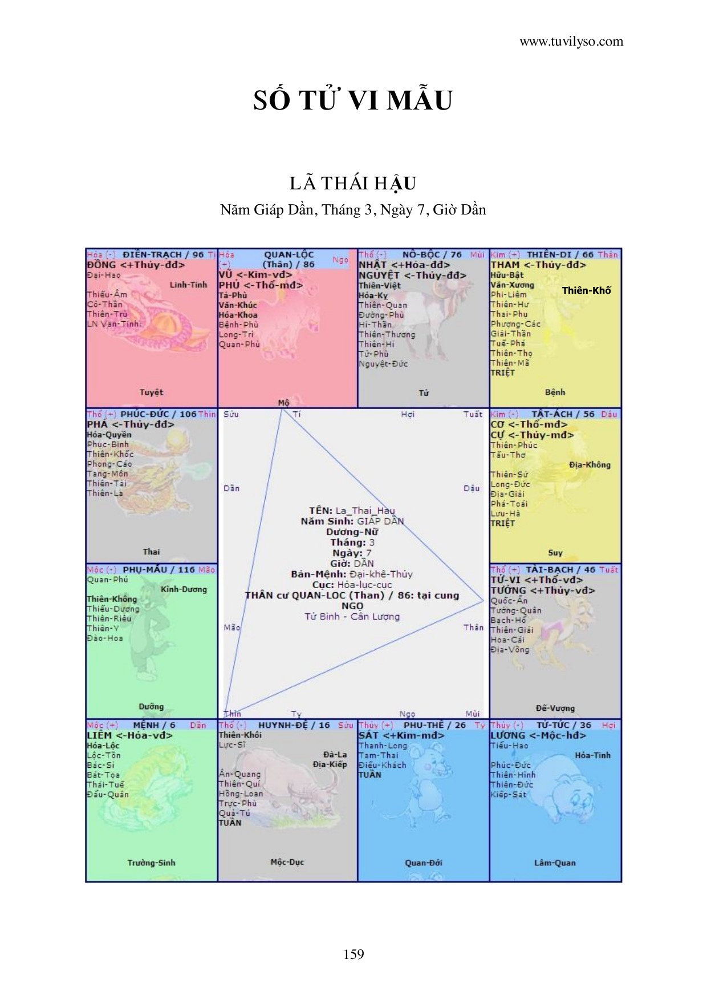

# Lã Thái Hậu

> Số Tử Vi mẫu  
> Trang sách 159–160 · *Tử Vi Thực Hành* (Dịch Lý Huyền Cơ)

Năm Giáp Dần, Tháng 3, Ngày 7, Giờ Dần

### Nhận Xét Lá Số Thái Hậu

Mệnh: Liêm Tham đồng độ, Tử phủ vũ tướng chiếu. Hội Song Lộc Mã, Xương Khúc. Thân: Tả Hữu, Hóa Khoa, Tướng Ấn. Long Phượng Cái Hổ (Tứ Linh).

1. Liêm Tham đồng độ nam đa lãng đãng, nữ đa dâm;  
2. Liêm đắc địa có Tử Vi chiếu hội Xương Khúc, trong phú có câu:

Liêm mà gặp được Tử Vi  
Ở cung miếu vượng quyền uy đó mà...  
Liêm đắc địa Khúc Xương cùng  
Là người văn võ anh hùng lược thao.  
3. Song Lộc ngộ Mã:  
Mệnh bà Lã Hậu chuyên quyền:  
Song lộc ngộ Mã chiếu miền chính cung.  
4. Tứ Linh triều Thân Mệnh, có Tả Hữu:  
Tứ linh: Cái Hổ Phượng Long  
Công danh quyền thế vẫy vùng một khi  
5. Sinh năm Giáp gặp Thiên Khố (ở cung Thân) phú có câu:  
Hỏi ai Giáp Kỷ mấy người  
Gặp sao Thiên Khố tiền rời bạc muôn  
6. Xét về ngũ hành thì cung, sao và mệnh cục rất tương ứng  
7. Cung mệnh Liêm Tham đồng độ nam đa lãng đãng, nữ đa dâm chưa kể cung Nô của đàn bà mà có Đào Hồng ngộ Mộc Dục, Diêu Hỉ – cung Phu lại gặp:

Thất Sát Vũ Khúc đồng danh  
Bao lần hôn phối mới thành được chăng
