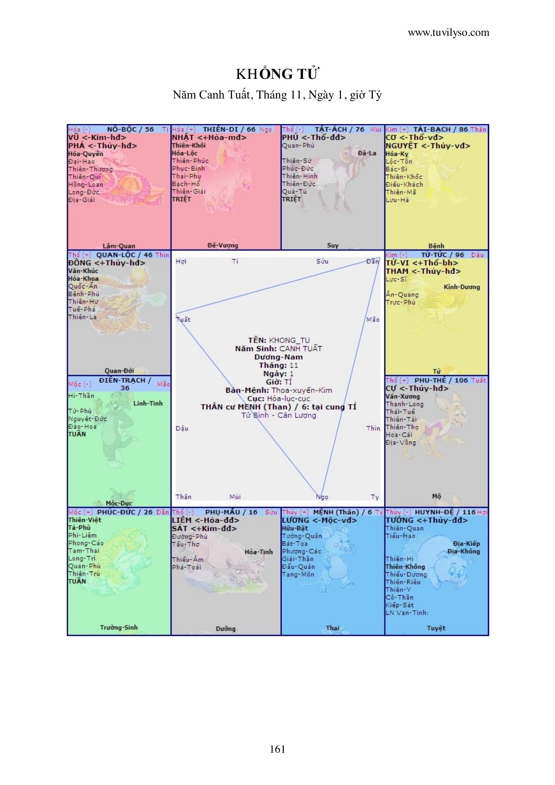

# Khổng Tử

> Số Tử Vi mẫu  
> Trang sách 161–162 · *Tử Vi Thực Hành* (Dịch Lý Huyền Cơ)

Năm Canh Tuất, Tháng 11, Ngày 1, giờ Tý

### Phân Tách Số Khổng Tử

Cách: Cơ Nguyệt Lương Đồng, Hội Song Lộc, Mã Khốc Khách, Tướng Ấn. Cách uy quyền. Lương vượng ở Tí gặp Thái Dương, Lưỡng Lộc, vinh hiển tột bực, tính chất thanh cao đạo hạnh, trung nghĩa cương cường:

**Phú:**

Lương đắc địa đồng vì Xương Khúc  
Hoặc Thái Dương, Hóa Lộc hiển vinh  
Từ cung Tí tiếp liền đến Ngọ  
Có Thiên Lương hội chiếu Nguyệt tinh  
Ấy người tài cán tinh anh…  
Bởi đó sự thông minh hơn người là nhờ ở Nhật Nguyệt, mặc dầu Nhật có Triệt, nhưng Triệt ở Ngọ là nơi âm dương giao thoa tạo thành sự phóng khoáng, khoan hoà, nhân hậu, và chính tinh dù tốt hay xấu cũng không chịu ảnh hưởng nhiều. Hơn nữa Thái Dương ở đây lại gặp Thái Âm hội Bát Tọa tất là bậc quí nhân. Mà Nguyệt lại gặp Cơ (Cơ Nguyệt ở Thân đắc địa nên văn chương quán thế).

Xét thấy cung Thiên di có Tam Hoá liên châu. Thái Dương gặp Lộc (Lộc Tí, Ngọ) tất văn chương lỗi lạc mà ra ngoài được người người kính trọng.

Đến cung Quan lộc có Xương Khúc, Tướng Ấn, Lộc Mã chỉ làm về nghề văn hóa, không đắc hoạn lộ được, nhất là Cự Đồng ở đó, nên Khổng Tử không thể chọn con đường làm quan bền bỉ.

Vận hạn: Khổng Tử sinh năm Tuất mà tiểu hạn đến cung Thìn tối kỵ, đại hạn đến cung Nô năm 61 tuổi Canh Tuất gặp Thiên Lương Song Hao, Liêm trinh Hỏa Tinh, Thiên Không Kiếp Sát, Kình Dương, Phá Toái. Mà tiểu hạn lại gặp lưỡng Tuế, Kỵ, Tang Hư Khốc Điếu; không nguy đến tính mạng là vì đại hạn có Tử Vi, Hóa Quyền, vì vậy mới bị tuyệt lương ở nước Trần.

Đến năm 73 tuổi Nhâm Tuất, tiểu hạn cũng về cung Thìn với các hung tinh ám hại đó đóng ở La Võng mà Thái Tuế ở đó rất độc, đại hạn lại bị gặp phải Lưỡng Tang Môn Bạch Hổ ngộ Thiên Trù, Hư Khốc lưu niên, mà về già lại gặp cả Tả Hữu đi với hung tinh, đúng là hai kẻ âm công đưa đi về cõi chết.
