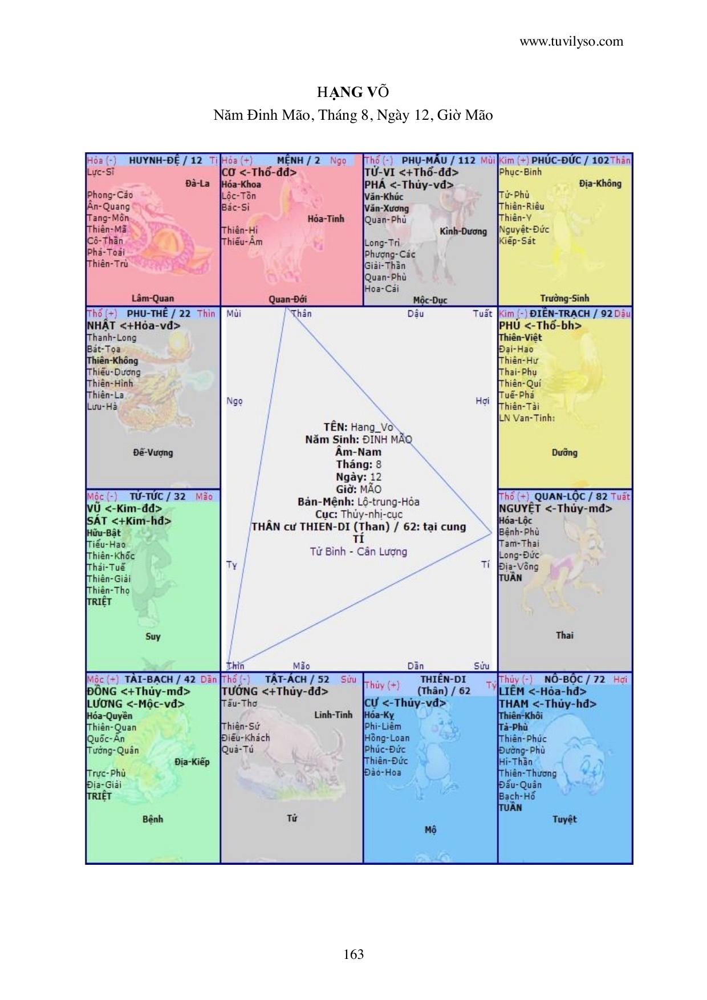

# Hạng Võ

> Số Tử Vi mẫu  
> Trang sách 163–164 · *Tử Vi Thực Hành* (Dịch Lý Huyền Cơ)

Năm Đinh Mão, Tháng 8, Ngày 12, Giờ Mão

### Nhân Xét Số Hạng Võ

Cách: Cơ Nguyệt Đồng Lương – Tam Hóa triều, Lưỡng hợp có Xương Khúc – Tứ Linh.

Mệnh Hỏa đóng cung Hỏa, Thiên Cơ miếu địa đa tài, hội Thiên Lương giỏi về vũ lược. Ở đó Hỏa Tinh miếu địa lại gặp Khoa Quyền võ nghệ tinh thông. Đáng tiếc là Lộc Tồn thủ mệnh không bền, lại gặp cả Không Kiếp nên hãm hại công danh.

Đại hạn 32 đến cung Mão gặp hạn Trúc La gia Liêm Vũ, Thái Tuế, Kình, Hổ, Song Hao, là cách sấm sét. Đến tiểu hạn đến cung Thân gặp Cự Kỵ, Kiếp Không, Phục Binh Thiên Hình. Đại Tiểu hạn như thế nên bức tử ở Ô giang.

Hạn hành Cự Kỵ hung thần  
Phải phòng những chốn giang tân mới lành  
Phú nói về Hạng Võ:  
Ai đương Hạng Võ anh hùng  
Vì sao Cơ Cự Lương Đồng hợp xung  
Cơ miếu địa ở Ngọ cung  
Lương Đồng Cự Nguyệt hợp trong một miền  
Lại thêm Khoa Lộc, Hóa Quyền  
Ba cung xung chiếu triều viên một bề.
