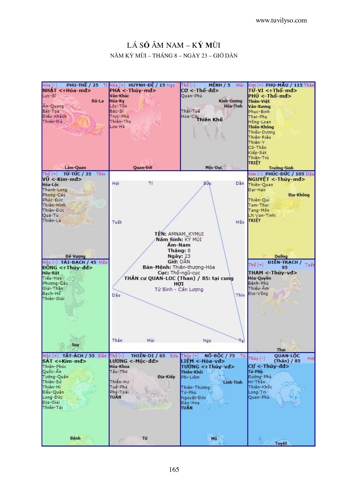

# Âm Nam – Kỷ Mùi

> Số Tử Vi mẫu  
> Trang sách 165–166 · *Tử Vi Thực Hành* (Dịch Lý Huyền Cơ)

### Năm Kỷ Mùi – Tháng 8 – Ngày 23 – Giờ Dần

### Nhận Xét Lá Số Kỷ Mùi

Cách: Cơ Cự Đồng Lương hội Tả Hữu Long Phượng. Lương chính chiếu. Hợp giáp Xương Khúc. Tứ Linh triều thân mệnh. Bạch Hổ kỳ cách thủ Tài. thủ mệnh (người sinh năm Kỷ).

Cuộc đời: Sinh trưởng phú quí. Vì có Tả Hữu Long Phượng Đại hạn đến 21 tuổi, ở Tiểu hạn gặp cung La Võng có Hình, Kỵ, Sát Phá Tham ở cung Tuất ngộ Thái Tuế lưu niên bì tù đày những có nhiều Cát tinh giải nên tai ương chóng qua.

Thích biện luận, hoạt động vì Tuế Kình hội. Trung hậu vì Cơ Lương có Hóa Khoa.

Đại hạn 15-25 mất cơ nghiệp vì Lộc Tồn bị Hóa Kỵ chiếu, "Cát xứ phùng hung".

Đại hạn 45-55 mới chịu ngồi yên. Thích làm văn chương vì giáp Khúc Xương, tuy công danh lận đận vì Kình đắc cách mà ngộ Cơ hãm địa. Tài có mà thời vận không gặp được.

Đại hạn 55 trở ra vinh hiển an nhàn.
