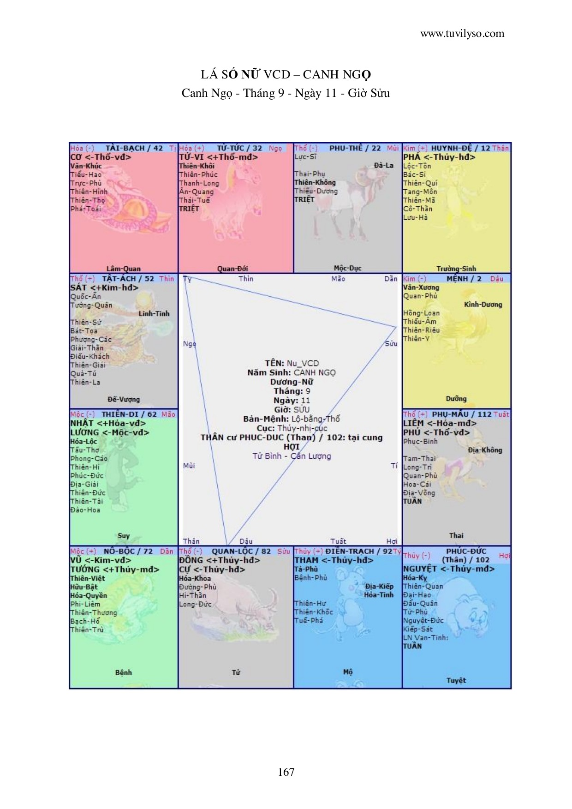

# Nữ mệnh vô chính diệu – Canh Ngọ

> Số Tử Vi mẫu  
> Trang sách 167–168 · *Tử Vi Thực Hành* (Dịch Lý Huyền Cơ)

Canh Ngọ - Tháng 9 - Ngày 11 - Giờ Sửu

### Nhận Xét Số Canh Ngọ

“Mệnh vô chính diệu”, giao hội Xương Khúc, Quang Quí, Thai Tọa, Hồng Đào Hỷ, Tấu Thơ. Giáp Lộc củng Lộc. Tiền Cái hậu Mã cách.

Cuộc đời: Lúc ấu nhi sung sướng vì có Thai Tọa. Nhưng sang đại hạn 12 –32 phải có đại tang, đến đại hạn 32 – 42 cũng thế.

Nữ mệnh mà có Xương Khúc gặp Đào Diêu tất thích văn thi ca hát lãng mạn, đa tình, nhưng may gặp được Thiên Hình, Thiên Quí nên trở thành đứng đắn.

**Phú:**

Thói dâm dật xướng hòa kém phúc  
Ấy Văn Xương Văn Khúc ai khen…  
Kìa người phượng chạ loan chung  
Đào Diêu số ấy trong lòng chẳng trinh  
Nhưng gặp được Quí, Hình, Tử Phủ  
Dạ sắt vàng nào sợ lung lay

Ở đây lại có cả Hồng Đào Hỉ gọi là Tam Minh nên giữ được đoan chính tuy phải làm kế thất. Nhưng cung “Phối thì Nguyệt Đức Đào tinh. Trai lấy vợ đẹp gái lành chồng sang". Số ung dung về sau vì tiền Mã hậu Cái (đi ngựa có lọng che) nhưng đáng tiếc vì sinh phùng bại địa phát không bền. Mong ở cung Phối hơn.
