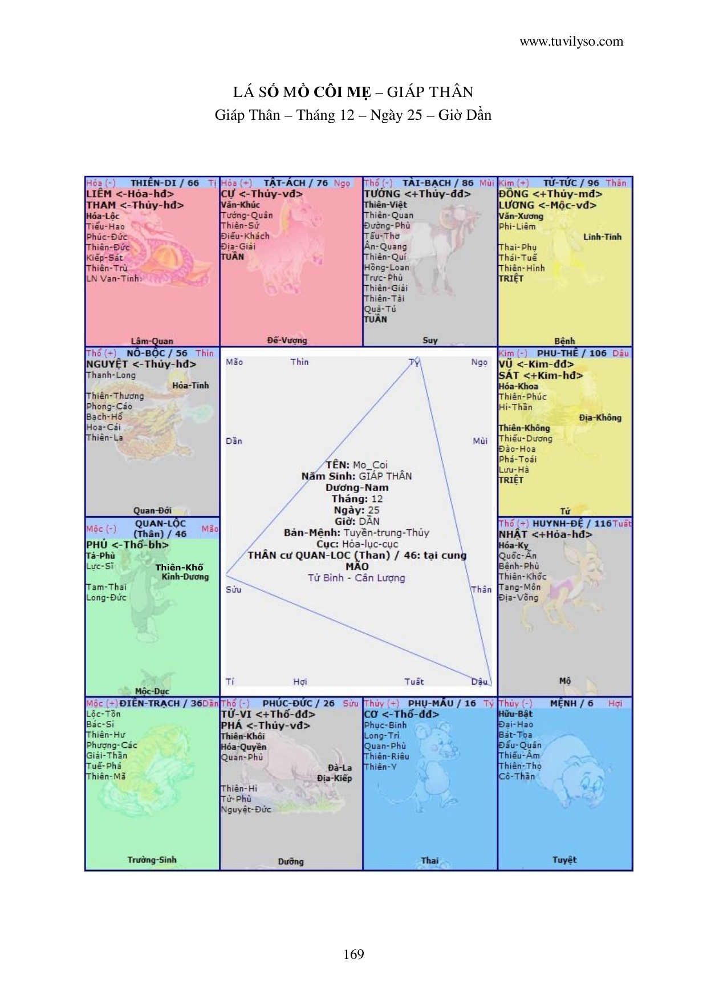

# Mồ côi mẹ – Giáp Thân

> Số Tử Vi mẫu  
> Trang sách 169–170 · *Tử Vi Thực Hành* (Dịch Lý Huyền Cơ)

Giáp Thân – Tháng 12 – Ngày 25 – Giờ Dần

### Nhận Xét Số Giáp Thân

Mệnh vô chính diệu hội Tả Hữu, Quang Quí, Thai Tọa, "hợp Lộc củng Lộc cách".

Nhận xét thấy cuộc đời mồ côi mẹ từ bé, xem cung Phụ mẫu thấy Âm Dương phản bối ngộ Linh Hỏa, Hình Phục Hổ, nhưng Thái Dương hãm gặp được Hóa Kỵ.

Mệnh có Song Hao mà gặp tuổi Dần, Thân rất hợp nên thông minh. Thiếu thời thích ngao du 4 bể tìm học hỏi, muốn tìm hiểu sâu rộng. Tuy ham chơi song lúc học thì say mê không kém. Ở đây Hao lại gặp được Tuyệt là hạng khôn ngoan nhưng hơi tính suy lợi hại không thật lòng. Có nhiều tham vọng nhưng khó toại nguyện. Có Ân Quí đóng Mùi đắc cách:

Quí, Ân Mùi Sửu hạn cầu  
Đường mây gặp bước cao sâu cửu trùng

Năm 20 tuổi đã đỗ toàn cử nhân Luật. Bởi Mệnh vô chính diệu nên lúc nhỏ lao đao, không sống cuộc đời bình lặng được, song về sau sẽ hưởng được quí hiển, nhất là sinh năm Giáp mà gặp được.

Hỏi ai Giáp, Kỷ mấy người  
Gặp sao Thiên Khố tiền rời bạc muôn

Nhưng cung Phối xấu vì Vũ Sát khó mong mãn ý toại lòng.
