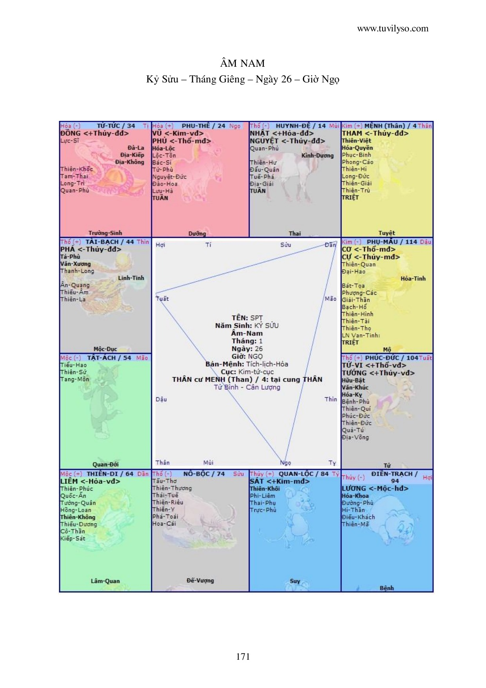

# Âm Nam – Kỷ Sửu

> Số Tử Vi mẫu  
> Trang sách 171–172 · *Tử Vi Thực Hành* (Dịch Lý Huyền Cơ)

Kỷ Sửu – Tháng Giêng – Ngày 26 – Giờ Ngọ

### Nhận Xét Số Kỷ Sửu

Cách: Sát Phá Liêm Tham cách Khôi Việt Tướng Ấn Thai Cáo. Quyền tinh nhập miếu cách Thất Sát cư Quan Lộc.

**Phú:**

Hồng Xương Liêm Khôi phù trì  
Sân rồng dấn bước tên ghi Cửu trùng

Chú ý: Người sinh năm Giáp, Kỷ mà gặp Tham đóng Mệnh ở cung miếu vượng đắc địa thì rất thích hợp, sẽ được hưởng phú quí, nhưng phải ngoài 30 tuổi.

Tính chất ít thích ngồi yên, lúc nào cũng thích hoạt động nơi đông người. Số này hợp với kinh doanh kỹ nghệ hoặc quân binh hơn là văn học.

Cung Bào có Nhật Nguyệt gặp Hỉ Thần có anh em dị bào (nhất là có cả Thai Vượng).

**Phú:**

Âm Dương chiếu với Hỉ tinh  
Âm cùng Thiên Phúc cũng sinh dị bào
