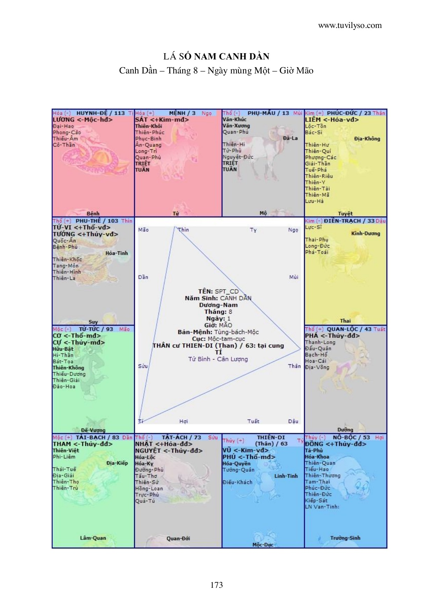

# Nam – Canh Dần

> Số Tử Vi mẫu  
> Trang sách 173–174 · *Tử Vi Thực Hành* (Dịch Lý Huyền Cơ)

Canh Dần – Tháng 8 – Ngày mùng Một – Giờ Mão

### Nhận Xét Số Canh Dần

Mệnh: Sát Phá Tham hội Khôi Việt. Thân: Tử Phủ Vũ Tướng hội Quyền Lộc, Quang Quí, Tướng Ấn, Long Phượng.

Mệnh dương đóng cung Dương. Thất Sát miếu địa ở Ngọ tất có tài cán. Gặp Thiên Phủ chính chiếu, theo phú ta thấy:

Phủ phùng Thất sát chí khôn  
Việc làm mạnh bạo những toan hơn người

Tuy nhiên ở đây Sát gặp Quyền nên hay liều lĩnh dễ thất bại trong đời, mà lại bị Tuần Triệt đương đầu tất trắc trở sự nghiệp công danh. Phải ngoài 33 tuổi mới thấy hanh thông vì Thân cư Thiên di được đắc cách. Tất có công danh và hiển đạt.
