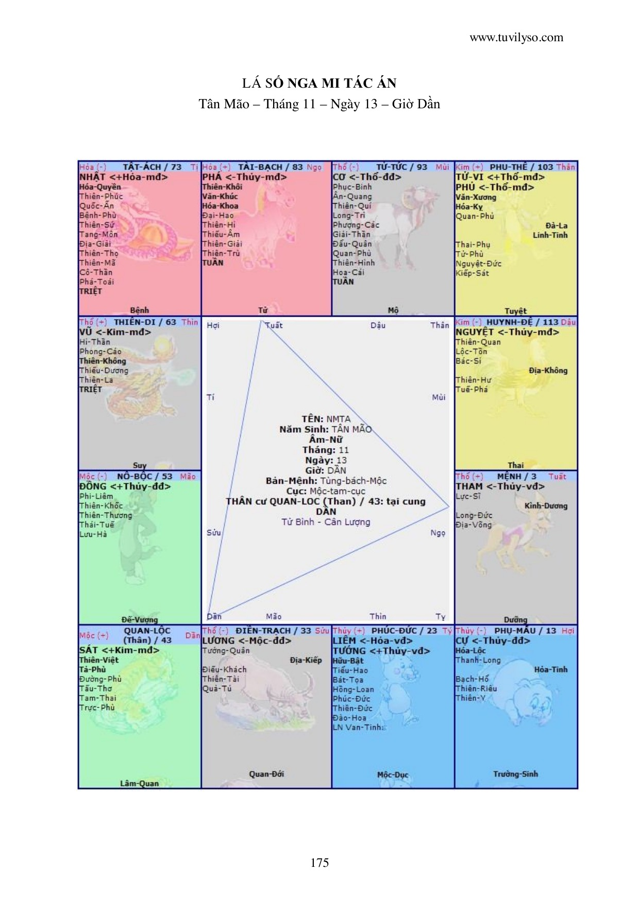

# Nga mi tác án – Tân Mão

> Số Tử Vi mẫu  
> Trang sách 175–176 · *Tử Vi Thực Hành* (Dịch Lý Huyền Cơ)

Tân Mão – Tháng 11 – Ngày 13 – Giờ Dần

### Nhận Xét Số Tân Mão

Tham Vũ đồng hành hội Khôi Việt giáp song Lộc  
Phúc cung: có Hồng Đào Là cách Nga mi tác áng

**Chú ý:**

Âm Dương ở cung Mệnh và Cục đều hợp. Tham miếu địa, đặc biệt nhất hung tinh đắc cách là Kình Dương đóng tứ mộ là hạng vượng phu ích tử, đoan trang thẳng thắn trong mọi việc, đắc cách nhất là Mệnh giáp song Lộc. Thân cư Quan Lộc có Xương Khúc, Khôi Việt về sau thích văn chương và có đại khoa.

Nhưng cần xem cung Phu tuy có Tử Phủ, Đào, Nguyệt Đức xong gặp Hóa Kỵ, Đà, Kiếp Sát ắt có lúc buồn đau, phiền toái.
