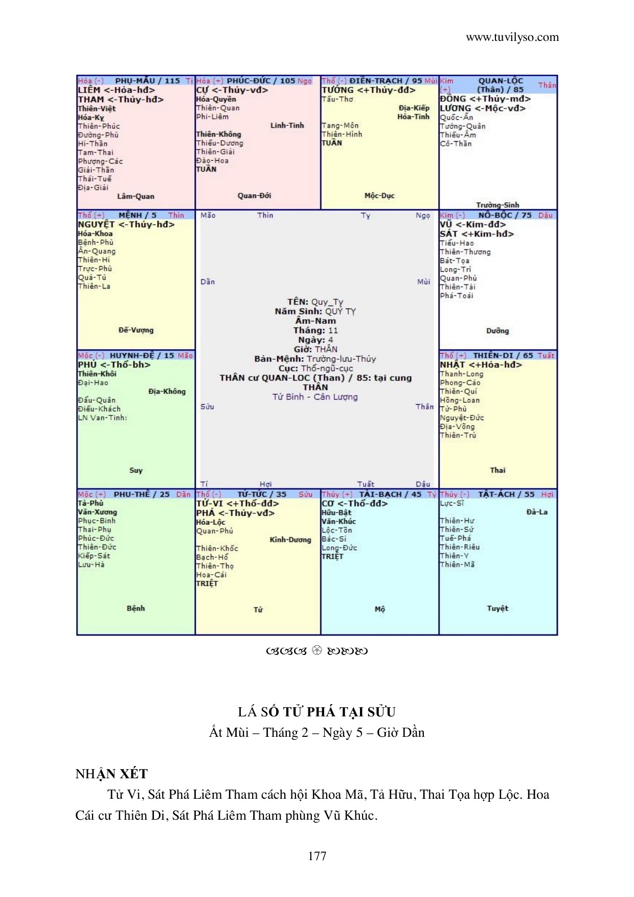

# Âm Nam – Quí Tỵ

> Số Tử Vi mẫu  
> Trang sách 176–177 · *Tử Vi Thực Hành* (Dịch Lý Huyền Cơ)

Quí Tỵ – Tháng 11 – Ngày 4 – Giờ Thân

### Nhận Xét Số Âm Nam Quí Tỵ

Cơ Nguyệt Đồng Lương thủ mệnh Tồn Khoa Tướng Ấn Quang Quí, giáp Khôi Việt.

**Chú ý:**

Mệnh có Nguyệt hãm địa, nhưng được lợi là Âm Nam mà lại hội được Khoa Lộc, Xương Khúc, Hồng Hỉ, Sinh Vượng, giáp Khôi Việt nên sẽ thành đạt khoa danh. Tuy tánh ưa nhàn tản và thích ngao du.

Về sau có công danh vì Thân cư Quan có Tả Hữu An Tướng Xương Khúc Khoa Tồn đắc cách. đại hạn 35 tuổi hoạnh phát.

