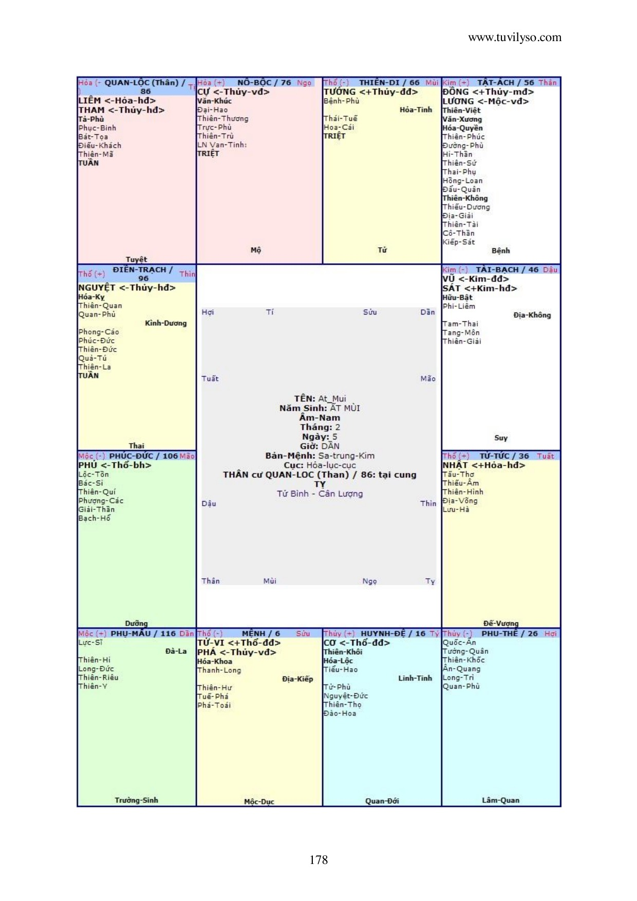

# Tử Phá tại Sửu – Ất Mùi

> Số Tử Vi mẫu  
> Trang sách 177–179 · *Tử Vi Thực Hành* (Dịch Lý Huyền Cơ)

Ất Mùi – Tháng 2 – Ngày 5 – Giờ Dần

**NHẬN XÉT:**

Tử Vi, Sát Phá Liêm Tham cách hội Khoa Mã, Tả Hữu, Thai Tọa hợp Lộc. Hoa Cái cư Thiên Di, Sát Phá Liêm Tham phùng Vũ Khúc.

**Cước chú:**

Tử Vi của tuổi Ất Mùi, trong phú có câu:

Mệnh thân: Tử Phá ở cùng  
Sửu, Mùi, Thìn, Tuất bất trung bất nghì.

Nhưng nếu là tuổi Sửu, Mùi, Thìn, Tuất thì phản cách vi giai, là người chí hiếu, Nhưng Tử Vi đây mất lực vì Kiếp Không nên không tăng cho cách cuộc Thân Mệnh đẹp hơn được.

Tương lai là kẻ cơ chỉ, giỏi về kỹ nghệ kinh thương, khí cụ, và có địa vị khá giả. Đại hạn 26 tuổi có Tứ Linh ngộ Lộc, bắt đầu hưng vượng về công danh, tài lộc.
